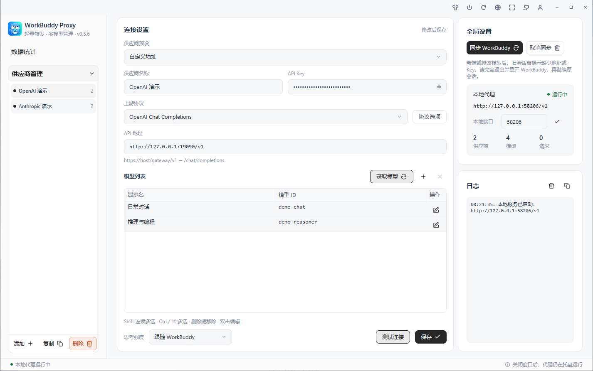
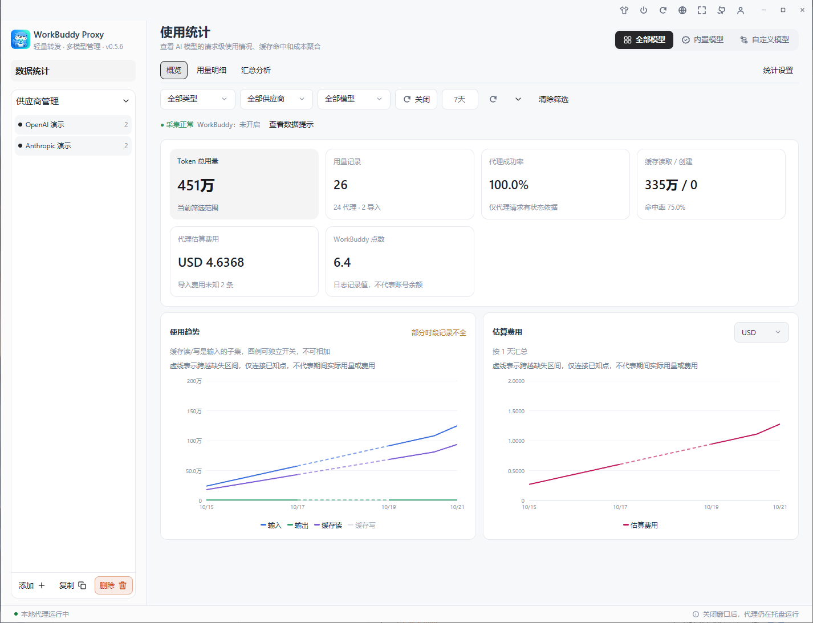
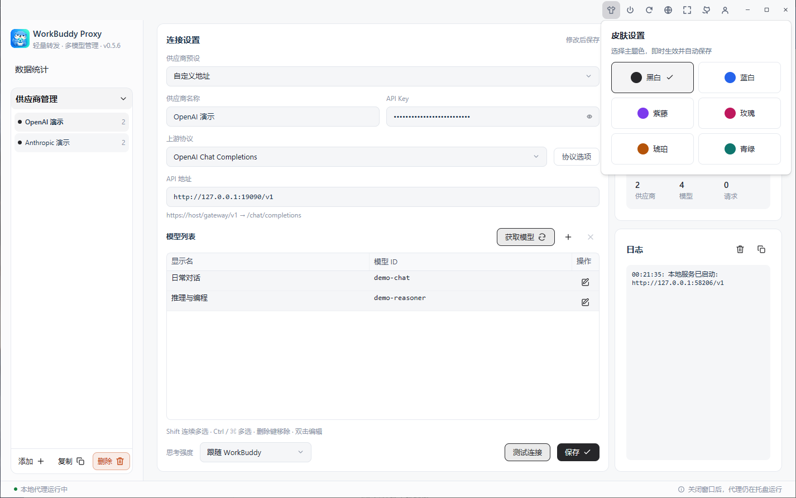
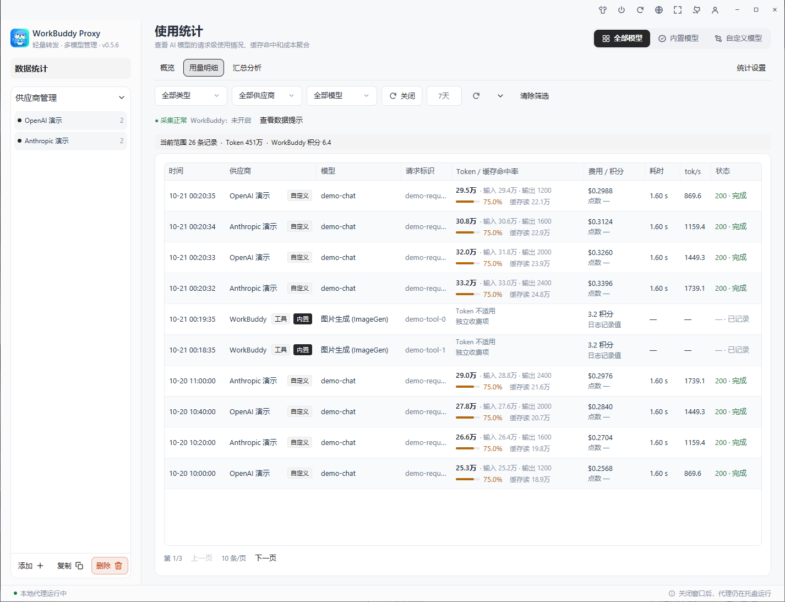
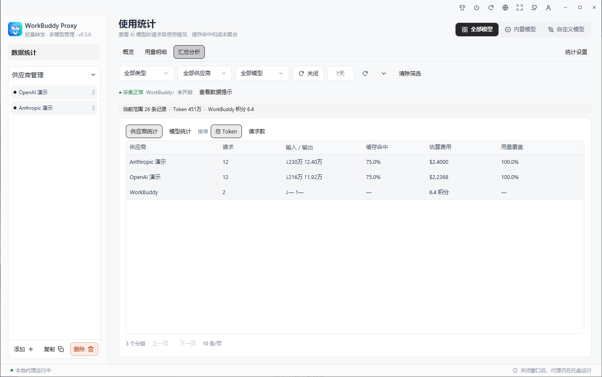
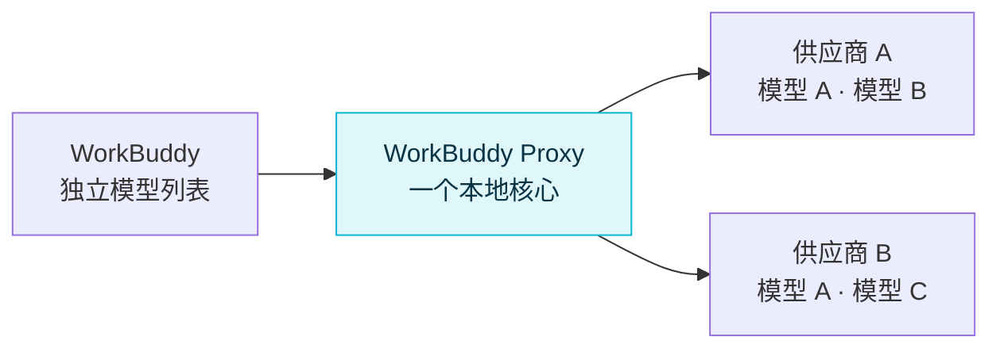

<p align="center">
  
</p>

<h1 align="center">WorkBuddy Proxy</h1>

<p align="center">
  <strong>四协议接入 · 多模型管理 · 用量与积分统计 · 六套主题皮肤</strong><br>
  为 WorkBuddy 打造的跨平台本地模型代理，一份配置管理多个服务与模型。
</p>

<p align="center">
  <a href="https://github.com/gloryhui/workbuddy-proxy/releases"></a>
  <a href="https://github.com/gloryhui/workbuddy-proxy/actions/workflows/desktop.yml"></a>
  <a href="https://github.com/gloryhui/workbuddy-proxy/actions/workflows/ci.yml"></a>
  
  
  <a href="LICENSE"></a>
</p>

<p align="center">
  <a href="#下载与安装">下载与安装</a> ·
  <a href="#三步接入-workbuddy">快速上手</a> ·
  <a href="#使用统计">使用统计</a> ·
  <a href="#上游协议">上游协议</a> ·
  <a href="#界面预览">界面预览</a> ·
  <a href="#性能实测">性能实测</a> ·
  <a href="#常见问题">常见问题</a>
</p>

<p align="center">
  <a href="https://github.com/gloryhui/workbuddy-proxy/releases/latest"><strong>下载正式版</strong></a> ·
  <a href="docs/ARCHITECTURE.md">设计与性能边界</a>
</p>

<p align="center">
  
</p>

<p align="center">
  
</p>
<p align="center"><sub>2026-10-21 · Windows 10 当前 main 实拍 · 默认黑白皮肤 · 隔离演示配置，用量、费用与积分均为合成示例</sub></p>

---

## 用它做什么

把 **OpenAI Chat Completions、OpenAI Responses、Anthropic Messages 和 Gemini GenerateContent** 服务接入 WorkBuddy，用同一套桌面界面管理供应商、模型、用量与费用。WorkBuddy 统一调用本地 Chat Completions 接口，由代理按供应商的显式协议配置转发或转换。

| 能力 | 使用体验 |
| --- | --- |
| 🪶 轻量界面 | Rust 转发核心，GPUI Kit 统一界面；关闭设置释放界面进程 |
| 🧩 一份配置，多个模型 | 同一个供应商只填一次 URL 和 Key，模型列表每行添加一个 ID |
| 🗂️ 供应商预设 | 内置 78 个供应商／地区／套餐预设，支持 Anthropic 官方与 Azure API Key，地址仍可自定义 |
| 🧠 自动识别模型能力 | 结合供应商信息与 models.dev 自动补齐图片、工具、思考档位及 Token 上限，支持离线缓存与手动覆盖 |
| 🔀 同名模型独立选路 | 多个账号、多个供应商使用相同模型 ID，也能在 WorkBuddy 中分别选择 |
| 🌊 四协议流式接入 | Chat 保留上游流；Responses / Anthropic / Gemini 转为标准 Chat JSON / SSE，支持多轮与工具结果 |
| 📊 本地统计 | 概览 / 用量明细 / 汇总分析分开查看，筛选、表头与分页固定；默认过去 7 天，记住上次视图和筛选 |
| 🧾 WorkBuddy 积分 | 导入内置 / 自定义模型与独立工具收费，显示工具名称和标签，积分单独汇总并去重 |
| 🎨 六套皮肤 | 默认黑白，另有蓝白、紫藤、玫瑰、琥珀、青绿；即时切换，重启后保留 |
| 💰 历史费用快照 | 每次调用冻结单价、币种及费用，当前价格可修改或删除，缺价默认零价，不回写历史 |
| 🦦 统一图标 | 主图标覆盖应用、窗口、Windows 任务栏 / 托盘、Mac 菜单栏和启动提示 |
| 🔄 同步与重启确认 | 同步 / 取消同步先确认；macOS 可同步后正常重启 WorkBuddy，启动时检查已同步地址是否一致 |
| 📋 获取模型 | 按当前地址和 Key 拉取可用模型，弹窗勾选后添加，支持搜索、全选、反选和清空 |
| 🌐 单语言界面 | 简体中文 / English 切换，按钮和提示使用同一种语言 |
| 🪟 单例启动 | 重复打开唤回原窗口，保留未保存的输入，复用后台核心 |
| 🚀 开机启动 | 默认关闭；开启后登录系统只启动托盘与代理服务 |
| 📜 运行日志 | 新日志自动滚动到底部，支持清空与复制，不记录 Key 或对话内容 |
| 🔔 更新检测 | 自动检测 GitHub 正式 Release，也可手动检查 |

最多 **64 个供应商、合计 256 个模型**，共用一个转发核心和一个本地端口。

## 下载与安装

### v0.5.6 正式版

GitHub 当前正式版为 **v0.5.6（2026-10-16）**，提供四协议接入、本地统计与价格快照，以及 Anthropic / Azure 预设。[查看正式版更新记录](CHANGELOG.md#v056--2026-10-16)。

本文功能说明对应当前 **main 分支**，包含后续的界面调整、皮肤设置、工具积分修复和趋势图改进；正式下载附件的功能以对应 Release 更新记录为准。

| 系统 | 下载 | 体积 | 安装方式 |
| --- | --- | ---: | --- |
| Windows 10 / 11，x64 | [Windows 安装包](https://github.com/gloryhui/workbuddy-proxy/releases/download/v0.5.6/workbuddy-proxy-0.5.6-windows-x64-setup.exe) | 见 Release 附件 | 中文向导，自选目录，默认创建桌面图标 |
| Mac，Apple Silicon | [M 系列芯片 DMG](https://github.com/gloryhui/workbuddy-proxy/releases/download/v0.5.6/workbuddy-proxy-0.5.6-macos-arm64.dmg) | 见 Release 附件 | 打开 DMG，将 WorkBuddy Proxy.app 拖入“应用程序” |
| Mac，Intel | [Intel 芯片 DMG](https://github.com/gloryhui/workbuddy-proxy/releases/download/v0.5.6/workbuddy-proxy-0.5.6-macos-x64.dmg) | 见 Release 附件 | 打开 DMG，将 WorkBuddy Proxy.app 拖入“应用程序” |

Windows 正式分发只提供安装 EXE，Mac 只提供 DMG。程序名称统一为 **WorkBuddy Proxy**。无需 Rust、Python、Node 或 WebView 运行时。分享时直接发送安装包，每个人填写自己的 Key。

Windows 与 Mac 使用同一套设置界面。关闭设置窗口后，托盘 / 菜单栏和转发核心继续运行；需要设置时再打开。

[全部版本](https://github.com/gloryhui/workbuddy-proxy/releases) · [SHA256 校验值](https://github.com/gloryhui/workbuddy-proxy/releases/download/v0.5.6/SHA256SUMS.txt)

> 升级前先从托盘或菜单栏退出旧版。当前 Mac 包为 ad-hoc 签名，未做 Developer ID 公证；Windows 未做 Authenticode 签名，系统可能提示未知开发者。

## 三步接入 WorkBuddy

### 1. 添加供应商

打开程序，在左侧选择或新增供应商。可先用连接设置顶部的**供应商预设**下拉框，搜索供应商名称、地区、套餐或地址，选择后填入供应商名称、上游协议和 API 地址；Azure 预设需要填写自己的资源地址。也可直接填写自定义地址。

预设不会自动保存或发起上游请求，也不会修改已有 Key、模型和路由；选择预设会设置对应协议、认证方式并恢复协议选项默认值。确认地址对应自己的套餐与地区，再填写 Key 和模型：

| 字段 | 填什么 |
| --- | --- |
| 供应商预设 | 可搜索的地址快捷选项；自有服务或未收录地址使用“自定义地址” |
| 供应商名称 | 方便自己区分的名称，例如“日常账号”“备用账号” |
| 上游协议 | 按供应商文档选择 Chat Completions、Responses、Anthropic Messages 或 Gemini GenerateContent；不按模型名称猜测 |
| 上游地址 | 填写所选协议的 API 基础地址并保留网关前缀，详见[上游协议](#上游协议) |
| API Key | 自己在该供应商获得的 Key；保存后保留显示，默认为星号，可切换显示 / 隐藏 |
| 模型列表 | 显示名、模型 ID 和编辑操作；显示名默认使用 ID |

使用 OpenCode Go 时，可选择对应预设，或填写 `https://opencode.ai/zen/go/v1`。上游地址使用 HTTPS，本机 loopback 地址也允许 HTTP。预设中的完整路径应保留，不要统一替换为 `/v1`。

预设目录参考 [yetone/magpie](https://github.com/yetone/magpie)，共收录 78 个预设：原有 76 个 OpenAI Chat 地址、Anthropic 官方 Messages 地址及需填写资源地址的 Azure OpenAI（地区和套餐分别列出）；收录范围和来源见[供应商预设说明](docs/PROVIDER-PRESETS.md)。预设提供连接参数，不提供 Key 或模型权限；部分套餐没有 `/models` 接口，可手动填写模型 ID。

### 2. 配置模型，保存并测试

点击**获取模型**，程序会按当前协议、API 地址和 Key 请求对应的模型目录，然后打开模型选择窗口。新模型默认不勾选，可逐行勾选、搜索模型 ID、仅看已勾选，并使用**全选当前筛选**、**反选当前筛选**或**清空选择**（清空所有待添加项）。点击**确认添加**后，仅将勾选的新模型加入编辑表格；取消或关闭窗口不会改动表格。已有模型标记为“已添加”并保留原显示名，手动添加且未出现在获取结果中的模型也会保留；新增项默认使用模型 ID。Key 留空时使用该供应商已保存的 Key。确认后还需要点击**保存**才会写入配置。

获取列表最多展示 4096 个模型；确认添加时检查所有供应商合计最多 256 个模型。超限会提示并保留选择，可取消部分勾选后重试。

也可以点击模型表格旁的 **＋** 手动添加，通过“操作”列的编辑图标或双击模型行，在弹窗中编辑显示名、模型 ID 与能力配置，再用 **−** 移除选中项。例如：

| 显示名 | 模型 ID |
| --- | --- |
| 日常任务 | model-a |
| 编程任务 | model-b |
| 同模型的另一项 | model-a |

模型表格支持 Shift + 点击连续选择，以及 Windows Ctrl / Mac Command + 点击逐项多选。表格获得焦点后，Delete / Backspace 移除所选模型，Ctrl / Command + A 全选，Enter / F2 打开模型编辑弹窗。Ctrl / Command + S 保存当前供应商；编辑弹窗内回车确认，Esc 取消，Delete / Backspace 只删除输入框中的文字。

这些 ID 仅用于演示，请替换成上游实际支持的模型。相同模型 ID 可以添加多项，填写不同显示名即可。修改供应商地址或 Key 会对该供应商下的全部模型生效。

点击**测试连接**会先保存当前修改：选中模型时测试该项；多选时按列表顺序测试第一个选中项；未选中时测试列表第一项。测试使用该模型的思考设置，发送一个简短流式请求。保存失败时保留草稿，不发起测试。也可以随时点击**保存**单独保存。

模型默认自动识别图片、工具、思考档位和 Token 上限，结合供应商返回信息与 models.dev 自动补齐，并支持离线缓存及手动覆盖。“操作”列可直接打开编辑窗口。[查看自动识别规则与多模态边界](docs/MODEL-CAPABILITIES.md)。

### 3. 同步到 WorkBuddy

在右侧全局设置区点击**同步 WorkBuddy**，弹窗提供**同步并重启 / 仅同步 / 取消**。确认同步后，先自动保存当前供应商的修改，再一次写入所有已保存 Key 的供应商下的模型，无需先单独点击保存。模型编辑弹窗内的修改请先确认；校验或保存失败时保留草稿并停止同步，也不会重启。

**同步并重启**目前支持 macOS：同步成功后请求 WorkBuddy 正常退出，确认退出后重新打开原应用。重启会中断正在执行的任务，请先保存工作；20 秒未退出就停止并提示，不强制结束进程。WorkBuddy 未运行时会尝试打开；未安装、多实例、退出或启动失败会明确提示。选择**仅同步**不会操作 WorkBuddy 进程；取消、关闭弹窗或按 Esc 不保存、不同步。其他平台请在仅同步后手动重开 WorkBuddy。

WorkBuddy 的旧会话可能保留旧模型配置；新增或修改模型后若提示“未配置接口地址或 API key”，请完全退出并重开 WorkBuddy，再继续原会话。同步内容没有变化时保留模型配置文件的原始字节、修改时间及文件标识；有变化时仍备份并原子替换文件。

删除模型行或供应商后，再同步一次即可清理对应的 WorkBuddy 项。供应商侧栏的“复制”用于复制供应商配置。

**取消同步**同样先弹窗选择**移除并重启 / 仅移除 / 取消**。确认后移除受管理模型，恢复已备份的原有条目并保留其他模型；不保存供应商草稿。只有移除成功才会执行所选重启；若重启失败，会明确提示配置已经修改，需要手动重开。

> **两种 Key 各有用途：** 供应商 Key 填在代理里；WorkBuddy 使用代理生成的本地连接码。“同步 WorkBuddy”会自动完成填写。

## 界面预览

每次打开设置默认进入**数据统计**。左侧的**数据统计 / 供应商管理**为可折叠一级目录，供应商为二级列表；新增、复制、删除固定在列表底部，滚动时仍可访问。进入供应商后采用三栏布局：供应商侧栏、模型设置、全局设置与滚动日志。右侧“同步 WorkBuddy”作用于所有已保存供应商；“取消同步”先提示“移除并重启 / 仅移除 / 取消”；移除代理添加的条目，如曾覆盖已有条目则恢复原条目。只有成功移除后才执行用户选择的重启；取消不会改动配置。简体中文 / English 默认跟随系统，点击右上角地球图标选择语言，菜单标记当前选项，界面每次只显示一种语言。旁边的四角图标将窗口恢复为默认 **1440 × 900** 逻辑像素，最小尺寸仍为 **1100 × 700**；全屏或最大化时先退出该状态再恢复尺寸。主图标与系统托盘 / 菜单栏保持一致。

右上角开机启动使用电源图标，开启时高亮，悬停显示当前状态，点击切换；“检查更新”仅显示刷新图标，悬停可查看说明。GitHub 图标打开项目主页，反馈图标打开项目的新建 Issue 页面，由用户填写并提交。

顶部图标依次为皮肤设置（衣服）、开机启动、检查更新、语言、恢复默认窗口尺寸、GitHub 和反馈，版本号显示在副标题末尾。**开机启动默认关闭**，旧配置未设置此项时也保持关闭。开启后，Windows / macOS 在当前用户登录系统时启动托盘与代理服务，不自动弹出设置；关闭会移除本软件的登录启动项，选择立即保存。设置失败会回滚选择并显示错误。手动打开应用仍会显示设置窗口；Windows 卸载时清理本软件的启动项并保留配置。

可用按钮显示清晰描边和深色文字，悬停 / 按下有反馈，灰色表示当前不可用。日志统一按“本地时间：操作内容”从旧到新显示，每次操作只记录一次；**新日志出现时自动滚动到底部，没有新内容时保留当前阅读位置**。日志区域提供“清空日志”和“复制日志”，前者同步清空核心记录，后者复制服务摘要及全部当前日志，便于反馈问题；关闭并重开设置窗口仍可查看当前核心进程的日志。连接测试详情包含供应商、模型、请求目标、HTTP 状态、响应头耗时、首个有效 SSE 事件耗时、总耗时及失败提示，收到首个有效事件即结束测试，不等待完整生成。

WorkBuddy 的列表名称为 **显示名 · 供应商**，模型 ID 使用 **供应商名称/上游模型 ID**，例如 `opencode/deepseek-v4.1-flash`。重复条目会加固定的 8 位短后缀，例如 `opencode/deepseek-v4.1-flash-a1b2c3d4`；后缀由内部路由标识生成，调整列表顺序不会改变，删除其他重复条目也会保留已同步的后缀。遇到标识碰撞时自动延长后缀。

升级后再次同步，会按内部路由关联并原位更新已安装条目，保留恢复记录和其他已有模型。修改供应商名称或上游模型 ID 后，再次同步会更新对应的可读 ID。旧的 `wbp-<路由标识>` 及更早版本的别名仍可调用；保存更名后、尚未同步时，当前已安装的 ID 也保持可用。本地 `/models` 列表返回相同的可读 ID。

本地代理状态卡集中显示地址、端口、供应商数、模型数和请求数。日志保留最近 100 条事件，不记录 API Key 或对话内容；关闭设置后，日志仍保留在核心内存中。

### 皮肤设置

点击标题栏里位于“开机启动”前的**衣服图标**，选择黑白、蓝白、紫藤、玫瑰、琥珀或青绿。默认采用**黑白浅色主题**，切换后即时生效并自动保存，重启后恢复上次选择。成功、警告、错误状态和图表系列保留各自的语义颜色。

<details>
<summary><strong>查看皮肤设置实拍</strong></summary>



</details>

### 统计请求明细

用量明细的筛选区、表头和底部分页固定，列表内容单独滚动。供应商与模型分列，展示输入 / 输出 / 缓存读 / 总 Token / 命中率、费用或积分、耗时和 tok/s；支持分页与拖动列宽。独立工具收费显示可读工具名称，并在“内置 / 自定义”前加“工具”标签。

<details>
<summary><strong>查看明细与独立工具收费实拍</strong></summary>



</details>

### 汇总分析

按供应商或模型分组查看请求数、Token、缓存命中率、费用与积分，支持按总 Token 或请求数排序。独立工具收费保留积分，Token 和用量覆盖显示为不适用的“—”。

<details>
<summary><strong>查看供应商汇总实拍</strong></summary>



</details>

### 模型发现与选择

按当前 API 地址和 Key 获取模型，搜索后批量勾选。已有模型单独标记，确认添加前不会修改配置。

<details>
<summary><strong>切换界面语言</strong></summary>

点击顶部地球图标选择界面语言。供应商名称、显示名等用户输入不会被自动翻译。

</details>

以上截图拍摄于 2026-10-21，来自当前 main 的 Windows 10 原生 GPUI 界面，使用隔离配置、演示 Key 和合成统计记录；未使用真实 WorkBuddy 配置或调用历史。截图展示 main 分支功能，正式下载附件以 Release 更新记录为准。拍摄信息与旧版 macOS 截图见[截图说明](docs/screenshots/README.md)。

### Release 更新检测

打开设置窗口时自动检查本仓库的最新正式 Release，成功结果缓存 24 小时。右上角可手动立即检查；发现更高版本后按钮显示下载入口，点击打开对应 Release 页面。按数字比较主 / 次 / 修订版本，不会把预发布版当作正式更新。

检测不需要 GitHub 登录，不发送供应商 Key；网络超时为 8 秒。失败只显示状态 / 日志，保留当前程序继续使用。下载并替换程序前，先从托盘 / 菜单栏退出旧版。

### 上游没有模型列表接口？

部分供应商不支持 `GET /models`，或返回的列表与账号实际权限不同。获取失败时仍可在表格手动填写 ID；模型能否调用，以实际请求 / 测试结果为准。上游列表最多 1 MiB，所有供应商合计最多 256 个已配置模型。

### 关闭窗口以后

| 操作 | Windows | Mac |
| --- | --- | --- |
| 关闭设置窗口 | 释放设置进程，托盘和转发继续 | 释放设置进程，菜单栏和转发继续 |
| 最小化设置窗口 | 按系统方式最小化 | 按系统方式最小化 |
| 重新打开设置 | 单击托盘，或再次启动程序 | 菜单栏 → 设置，或再次打开 `.app` |
| 完全退出 | 右键托盘 → 退出 | 菜单栏 → 退出，或设置窗口中按 Command + Q |

两个平台都采用**转发核心 + 轻量托盘 + 按需设置界面**。设置打开时有 3 个进程；关闭设置后保留核心与托盘 2 个进程。未保存的草稿保存在私有目录，重新打开可继续编辑。

普通启动使用单例模式，同一配置目录复用原有应用；显式使用不同 `--config-dir` 时可运行隔离实例。仅需转发时，可以使用 `--headless` 运行单个核心进程。

## 多供应商与同名模型



| 配置场景 | 配置方式 |
| --- | --- |
| 同一个账号使用多个模型 | 一个供应商，添加多行模型 |
| 同一个账号、同模型 ID，展示为多项 | 一个供应商，同模型 ID 配不同显示名称 |
| 同一家服务的多个账号 | 复制供应商，为各账号填写各自的 Key |
| 不同供应商提供相同模型 ID | 分别添加供应商，独立同步到 WorkBuddy |

每个模型具有独立内部路由 ID、可读别名和本地 URL。例如 `opencode/deepseek-v4.1-flash` 会在转发时还原为真实上游 ID `deepseek-v4.1-flash`，使用所选供应商的 Key。旧的 `wbp-abc123` 仍支持相同选路；上游响应中的模型字段保持原样。

裸模型 ID 对应多项配置时，代理会拒绝模糊选路。WorkBuddy 自动同步使用每个模型的独立 URL，选中的列表项与上游凭据保持对应。

Anthropic 官方预设使用 `https://api.anthropic.com/v1` 和 Messages 协议，填写 API Key 后可获取模型、测试并保存。Azure OpenAI 预设默认使用 Chat 协议和 `api-key` 认证：填写 `https://你的资源.openai.azure.com` 或完整的 `/openai/v1` 基地址；也可切换 Responses，认证方式会保留。模型 ID 必须填写 Azure **部署名称**，不一定等于模型品牌名称；获取模型只查询部署列表，列表不可用或为空时请手动填写部署名称，不使用 `/models` 中的基础模型 ID 代替部署名称。两者均只支持 API Key 接入，不需要 OAuth 登录。

## 上游协议

在供应商的“上游协议”中明确选择，已有配置默认使用 Chat Completions。同一模型名称可能提供不同接口，请以供应商实际地址和协议为准。

| 上游协议 | API 地址示例 | 代理处理 |
| --- | --- | --- |
| OpenAI Chat Completions | `https://host/gateway/v1` | 默认保留请求和响应字节，处理选路、认证、模型别名及显式配置 |
| OpenAI Responses | `https://host/gateway/v1` | 将本地 Chat 请求转换为 `/responses`，返回标准 Chat JSON / SSE |
| Anthropic Messages | `https://api.anthropic.com/v1` | 使用原生鉴权调用 `/messages`，支持模型目录分页与工具结果回放 |
| Gemini GenerateContent | `https://generativelanguage.googleapis.com/v1beta` | 调用 generateContent / streamGenerateContent，使用原生 Key 头 |

保留供应商给出的网关前缀与 API 版本。前三种协议也接受匹配的完整推理端点；Gemini 填基础地址，模型填 `gemini-…` 或 `models/gemini-…`。模型发现、连接测试和统计跟随所选协议。

原生适配器支持普通多轮、图片、函数工具及多轮并行结果；思考预算或档位在“协议选项”中显式配置。Gemini 当前仅接受内联图片；不可等价转换的参数会明确拒绝。原生工具历史依赖有界进程内回放缓存，重启、超时或路由有效配置变更后可能需要新建对话。详细的参数、思考映射和资源边界见[协议使用说明](docs/protocol-compat/USAGE.md)。

## 透明转发与思考设置

对于 **Chat Completions**，默认选择**跟随 WorkBuddy**：思考参数、输出上限、消息、工具历史和额外字段由客户端决定，代理只处理选路、认证和模型别名还原。

- 其余请求字节保留原样，包括字段顺序、空白和未知字段；真实模型 ID 已匹配时复用原始请求 Bytes。
- 响应按流返回，保留原始 SSE 字节、HTTP 状态、端到端头与错误内容，支持背压和取消。
- 开启使用统计后，每个转发块先被**有界旁路**观察再原样交给客户端：不缓存整段响应、不改写内容、不延迟首字节，取消与 4 并发许可的释放行为不变。
- 本地 Authorization 替换为供应商 Key，Host 按上游生成；移除 hop-by-hop 及 Connection 指定的头。
- 上游 401 / 403 / 429 原样返回，不自动换 Key、换模型或重试这些错误。

### 需要固定思考档位时

代理提供“关闭 / 低 / 高 / 最高”覆盖，保存后应用到当前供应商的各模型，优先级高于 WorkBuddy 的选择。“保留各模型设置”用于保留迁移来的不同档位；默认透传可保留客户端发送的其他档位。

对 DeepSeek，显式开启会写入 `thinking.type=enabled` 和 `reasoning_effort`；关闭会写入 `thinking.type=disabled` 并删除冲突的 `reasoning_effort`。其他模型只覆盖 `reasoning_effort`。可用档位由上游决定，不支持的参数会收到其原始错误。

<details>
<summary><strong>WorkBuddy 的思考强度、上下文窗口如何显示？</strong></summary>

默认开启“自动识别模型能力”：读取供应商模型列表的明确声明，再用 models.dev 的供应商／原厂记录补齐图片、工具、思考档位、输入／输出上限与上下文长度。后台定期更新，离线使用缓存；用户手动设置始终优先。点击模型列表“操作”列的编辑按钮，可查看识别结果和主要来源，也可以取消自动识别后单独调整。

能力未知时会明确提示，不将缺少信息解释为模型一定不支持。没有已知思考档位时不虚构选择项。Chat 默认转发不主动增加输出上限或上下文参数；Anthropic 请求缺少输出上限时使用协议配置中的默认值，实际限制以上游服务为准。

同步后重新打开 WorkBuddy 模型列表，必要时重启 WorkBuddy。[自动识别规则、缓存及多模态边界](docs/MODEL-CAPABILITIES.md)。

</details>


## 使用统计

设置窗口默认打开**数据统计**，统一查看本地代理请求、WorkBuddy 日志导入记录和独立收费项；模型 Token、货币估算费用和 WorkBuddy 积分分别汇总。

- 记录内容：开始时间、供应商与路由（当时的名称快照）、请求/上游/响应模型、状态与错误类别、耗时、首内容时间、TTFB、Token 用量与用途完整性。
- **不保存**聊天正文、messages、tools、图片、API Key、Authorization 或上游原始错误正文；详情只展示摘要字段。
- 用量异步写入配置目录下的 `usage.sqlite3`（WAL 模式，Unix 权限 0600），写入有界，数据库故障不会影响转发。
- 首次打开默认统计**过去 7 天（含今天）**，从 6 天前本地零点到当前时刻；支持快捷范围及自定义日期。“清除筛选”也回到 7 天，已保存的个人筛选优先恢复。
- **概览**展示 Token、缓存、费用、积分和趋势；**用量明细**查看逐条记录；**汇总分析**按供应商或模型分组。筛选区固定在内容上方，明细和汇总的表头、分页固定，表格内容单独滚动。
- 时间范围、当前视图、来源、供应商 / 模型、记录类型、状态、刷新间隔等保存到本地，下次打开恢复。价格、采集与存储管理集中在右上角的**统计设置**。
- 趋势图展示输入、输出、缓存读 / 写及当前币种的估算费用：相邻有效点用实线连接，跨越缺失时段用**虚线**作为连接指引，悬浮可查看缺失区间。虚线不代表期间实际用量或费用，未知值不补零、不外推；只有一个点时保留圆点并明确提示。
- 请求明细中供应商与模型分列，保存当时的名称，之后重命名或删除供应商不影响历史；Token 单元格展示**输入 / 输出 / 缓存读 / 总Token / 命中率**。流式 tok/s 按输出量除以首内容之后的耗时计算；非流式按总耗时计算，缺数据时显示“—”。
- 明细支持拖动列宽，时间列固定，其他列按可用空间调整；明细与分组统计默认 **10 条 / 页**，定价和采集供应商列表默认 **20 条 / 页**，支持切换每页条数，避免一次加载全部记录。
- 未知用量保持 `null`，显示为“—”，永远不会被当成 0；缓存读/写是输入的子集，图例注明不可相加。
- 供应商默认开启**请求上游返回用量**（request）：流式 Chat 请求合并 `stream_options.include_usage=true`，并保留其余 `stream_options` 字段。可按供应商关闭，改为只读取上游已有用量的被动采集（observe）；已保存的选择在升级后保留。实际用量仍取决于上游是否返回。
- 连接测试走同一个记录器，来源标记为“测试连接”，默认不出现在统计页，可勾选“包含测试连接”查看。
- 费用来自本地当前价格（供应商 + 上游模型，USD/CNY 分开），按整数纳单位计算，**是估算值，不是实际账单**；每次请求冻结单价、币种及最终分项/总价，当前价格可随时编辑或删除；缺少价格时按默认币种记录 0 元，改价不回写历史。
- 启动时检查本机当天是否成功更新过 models.dev 价格；未更新则自动拉取，持续运行期间每分钟检查日期。完整目录保存在本地，为配置模型匹配输入、输出及缓存基础价，单位为 USD/百万 Token；优先匹配供应商端点，其次原厂 canonical 模型，同 ID 多个价格无法确定时保留原价。
- “数据统计 → 统计设置 → 成本定价 → 手动更新价格”随时重新拉取。同供应商与模型 ID 的价格直接覆盖，包括用户手动调整过的价格，不弹确认；只影响之后的新调用。下载或写入失败保留原价及上次成功日期，自动失败后间隔至少 15 分钟重试。当天新增的模型优先使用已保存目录补齐缺价。
- 统计页显示固定的“更新于: HH:MM”，精确到分钟；成功读取统计后更新，不显示逐秒变化的计时器。
- 默认保留 180 天，可选 30/90/180/365 天或永久。自动清理只删除早于截止日的已结束请求；“清除历史统计”需要先在页面预览再确认，且只删除确认时刻以前的行。

“缓存计费数据不足”表示冻结价格需要按普通输入与缓存分别计费，但该次调用缺少可用拆分或缓存单价，费用无法可靠估算；它不表示请求失败，也不表示免费。修改当前价格不会重算这条历史。

数据边界：只统计**本代理接受并路由成功之后**的请求。鉴权失败、Host/Origin 拒绝、并发许可不足、请求体超限或无法解析模型等发生在接纳点之前，不写逐请求记录，因此页面“请求数”不等于全部 HTTP 流量。升级前缺失的原始代理网络字段无法从日志恢复。

## 用量导入（WorkBuddy 日志）

除了本代理自己转发的调用，WorkBuddy 桌面端还会在本地写 JSONL 日志，记录**内置模型**和**自定义模型**的用量。开启导入后，这些记录会与本代理的记录汇总在同一套统计里。

**后台同步是固定 5 秒一次，与页面刷新无关。** 这不是一个设置项，也没有"实时"模式：导入由核心的后台任务按自己的节奏推进，页面上的刷新选项（关闭 / 5 / 10 / 30 / 60 秒）只决定**页面多久重新读一次已经存下来的数据**，不会加快也不会减慢导入。把页面刷新设为"关闭"时，后台仍按周期推进，只是页面不会自动显示，需要手动刷新。

历史记录较多时会在后台逐步导入，启动和代理照常运行，统计先展示已经入库的部分。导入设置会显示进度条、剩余文件数、剩余数据量和已入库条数；发现总量尚未确定时显示扫描状态。进度只针对已发现的数据，源文件继续增长或被替换时可能变化；模型归类无需确认创建来源；缺少模型字段、内容冲突等异常单独显示。

已追平文件与新项目小文件继续按5秒周期增量同步；仍有积压的巨型文件需要先处理到相应位置，其尾部新增会随回填进度入库。历史回填的完成时间取决于数据量和磁盘速度。

开启方式：统计页 → 统计设置 → 采集与存储 → WorkBuddy 导入开关。开关默认关闭。开启时会为本机生成一个命名空间标识，它是每条导入记录身份的一部分，此后不再改变。

**三类来源在明细里是可区分的**：

| 来源 | 含义 |
|---|---|
| 代理 | 经过本代理转发的调用 |
| 内置 | 从日志导入的 WorkBuddy 内置模型用量 |
| 自定义 | 从日志导入的自定义模型用量，无论模型由用户或 Proxy 添加 |

**不会重复计数**：如果一次调用既经过本代理、又出现在日志里，日志那条会被识别并排除，总量只算一次。判定依据是消息标识而不是时间或模型名。

**自动分类与去重**：模型只分内置／自定义，不再按创建者或代理／直连规则决定是否导入。同一次调用在本机代理和日志两边都有记录时，优先本机代理明细；使用请求头 `X-Conversation-ID`／`X-Conversation-Message-ID` 与日志会话／消息标识的哈希精确关联，不按模型名、相近时间或相同 Token 猜测。日志先到时可先入库，原始代理记录到达后原子撤下日志副本。没有对应本机代理明细的日志正常导入，旧版误排除的历史会后台重读恢复。旧版代理行若未保存关联标识，不能凭空恢复精确关联。清除墓碑和保留期限仍有效。

**独立收费单列，积分仍计入总计**：生成工具及团队子代理等独立收费项与模型用量分开统计，可按“模型用量 / 工具收费 / 其他收费”筛选。能识别时显示具体工具名称，例如“图片生成 (ImageGen)”，并添加“工具”标签，不直接展示内部收费标识。

独立收费没有对应的 Token 用量，明细标记为 **Token 不适用**，不计入缺失用量告警和用量完整率分母；真正缺少 Token 的模型记录仍会提示。独立收费回执与工具结果中的同笔费用只计一次。升级时会自动修正既有收费记录，积分不丢失、不重计，无需手动重新导入。

**已知限制**：

- 只读取 `<用户目录>/.workbuddy/projects/<项目>/<会话>.jsonl` 这一种位置，不读其他目录。
- 单个文件里的超长行（超过 4 MiB）会被跳过，不影响同一文件的其他记录。
- 文件名必须与会话标识一致，改名后的文件不会被当作新会话导入。
- 未定价的导入记录会让费用显示为"—"，**不会**画一条零费用线（那会暗示这些调用免费）。
- 导入记录没有 HTTP 状态，明细里显示"已记录"而不是任何 HTTP 结果。
- 日志里的点数（credit）是独立指标，**不代表账号余额**，也不会混进费用。

导入功能的设计与验收材料在 [`docs/workbuddy-import/`](docs/workbuddy-import/)，逐项证据在 [`evidence/`](evidence/)。

## 性能实测

本版将转发核心、托盘和设置界面分为独立进程。关闭设置窗口会释放 GPUI 设置进程，核心继续转发；托盘重新打开会恢复私有草稿。

以下为历史 **v0.5.2 同一提交的 CI 发行包测试**，配置为 1 个供应商、64 个模型，数值为进程 RSS 合计：

| CI 环境 | 设置打开：核心 + 托盘 + 界面 | 关闭设置：核心 + 托盘 |
| --- | ---: | ---: |
| Windows x64 | 75.53 MiB | 22.73 MiB |
| Mac Apple Silicon | 148.77 MiB | 52.80 MiB |
| Mac Intel | 72.46 MiB | 21.76 MiB |

这些数值包含界面开销；关闭设置会释放设置进程。不同机器和 GPU 环境会影响占用，不能据此比较平台优劣。RSS 合计可能重复计算共享页，GPU 内存未独立测量。核心延迟测试使用本机模拟 HTTP 上游，不代表真实模型推理速度。

[查看 v0.5.2 原始数据](docs/benchmarks/v0.5.2) · [三平台构建与测试](https://github.com/gloryhui/workbuddy-proxy/actions/runs/38675797234) · [测量方法与历史记录](docs/PERFORMANCE.md)

### 轻量实现

| 部分 | 选择与边界 |
| --- | --- |
| 核心 | Rust，单线程 Tokio I/O 调度器，Axum / Hyper / Reqwest |
| 界面 | GPUI Kit 共享组件，虚拟化模型列表 |
| TLS | 系统原生 TLS，保留证书验证 |
| 选路 | 内存哈希索引，模型共享供应商 URL / 凭据 |
| 连接 | 上游池化复用，每个主机最多 2 个空闲连接，60 秒后清理 |
| 并发 | 全局 4 个在途请求；忙时本地返回 429，不堆积等待队列 |
| 请求体 | 每个最多 8 MiB，输入读取最多 30 秒 |
| 上游读取 | 单次读取的空闲超时 180 秒 |
| Go 会话缓存 | 最多 64 个会话，每个最多 128 个消息哈希，按需清理 |

界面按需运行。模型目录由用户配置；用量摘要保存在本地 SQLite；程序没有后台余额轮询、自动下载安装更新、遥测或聊天正文日志。更完整的取舍见 [设计与性能边界](docs/ARCHITECTURE.md)，历史测量见 [首版记录](docs/PERFORMANCE.md)。

## 常见问题

<details>
<summary><strong>同步成功了，WorkBuddy 里还是看不到模型？</strong></summary>

重新打开模型列表，必要时重启 WorkBuddy。确认已保存供应商 Key 和至少一个模型；没有 Key 的草稿供应商不会同步。配置文件位置为当前用户的 `~/.workbuddy/models.json`。

</details>

<details>
<summary><strong>模型列表要手动填写吗？可以自动发现吗？</strong></summary>

点击“获取模型”，按当前供应商地址和 Key 拉取上游 `/models`，在弹窗中勾选并确认添加后保存，也可以手动添加真实模型 ID。“测试连接”先保存修改，再测试所选模型；多选时测试列表顺序的第一项，未选中时测试首项。

代理的 `/v1/models` 可向兼容客户端提供已配置模型列表，供应商 URL 下的 `/models` 只返回该供应商的模型。WorkBuddy 使用“一键同步”即可批量添加。

</details>

<details>
<summary><strong>可以连接本机兼容模型服务吗？</strong></summary>

可以使用 `http://127.0.0.1:端口/v1` 这类 loopback 地址。上游需实现所选的四种协议之一；本工具的供应商 Key 字段需要保存非空值，不校验 Key 的上游可填写自用占位值，例如 `local`。

远程上游要求 HTTPS，地址不能包含用户名、密码、查询参数或 fragment。

</details>

<details>
<summary><strong>改完 Key、增加或删除模型，还要做什么？</strong></summary>

先保存，再同步 WorkBuddy 列表；macOS 可选择“同步并重启”，让旧会话读取新配置。Key 留空会保留当前供应商已保存的值；URL / Key 的修改作用于该供应商全部模型。已开始的请求沿用原来的选路，新请求使用新配置。

</details>

<details>
<summary><strong>测试报 401 / 403 / 429，怎么排查？</strong></summary>

若“测试连接”提示上游 HTTP 401 / 403，检查供应商 Key、地址、账号权限及模型可用性。若 WorkBuddy 提示本地 Key 错误，重新同步 WorkBuddy。

上游 429 通常需要检查服务额度或限流；代理自己也会在 4 个请求同时在途时返回 429，错误信息会说明请求槽已满。HTTP 400 可检查模型 ID 和参数；不确定思考档位时先选择“跟随 WorkBuddy”。

</details>

<details>
<summary><strong>同步 / 取消同步提示列表项已被修改？</strong></summary>

同步会强制覆盖本工具管理的条目，手动修改、重复条目或重装后遗留的代理条目也会被更新；缺失条目会重新添加。取消同步会移除这些条目，条目已删除或重复取消也会成功，重装后无需先同步即可取消。已保存的历史原条目仍会恢复，其他手动添加的模型会保留。同标识但无法识别为本工具管理的条目仍会提示冲突，避免覆盖其他模型。

新同步的条目带有管理标记；旧版遗留条目通过本地代理地址和代理 Key 特征识别。写入前仍会生成 `models.json.workbuddy-proxy-时间戳.bak` 备份。

</details>

<details>
<summary><strong>端口被占用，或者 Windows 启动失败？</strong></summary>

默认监听 `127.0.0.1:18080`，启动后沿用保存的端口。打开设置窗口时，后台只读检查 WorkBuddy 中由代理管理的模型地址，按实际监听 IP/端口核对（包括命令行覆盖的端口）；不检查或改动用户自行配置的其他供应商。发现不一致时显示地址与模型数量，提供“同步并重启 WorkBuddy”和“取消”。取消不修改 WorkBuddy；确认后只同步已保存的供应商配置，不保存未提交的草稿，再正常重启 WorkBuddy。

运行时可在右侧“本地端口”输入 1–65535 并点击“应用”：先弹窗，只有“同意并重启”或“取消”。取消（包括关闭确认框）不保存、不切换端口，也不更改 WorkBuddy 地址，并恢复输入框原端口。确认后程序先检查新端口，再切换监听、保存并更新现有 WorkBuddy 代理模型地址，最后重启 WorkBuddy。端口占用或保存失败会保留原设置且不会重启；若端口已经更新但 WorkBuddy 无法退出/重新打开，会明确提示已更新端口和需要手动重开，不能声称已恢复原端口。重启会中断 WorkBuddy 正在执行的任务，请先保存工作。当前自动重启仅支持 macOS，其他平台不会执行这个需要自动重启的端口变更。启动时若端口已被占用，退出占用程序或使用命令行指定其他端口。

Windows 包内有 `Diagnose.cmd`，可查看无界面启动诊断。启动日志在代理配置目录的 `startup.log`，只记录启动元数据，不记录聊天内容或 Key。

</details>

<details>
<summary><strong>OpenCode Go 会话是怎样处理的？</strong></summary>

使用 Go 地址时，程序发送自己的 User-Agent，并补齐 `x-opencode-session`。优先采用客户端会话头，缺少时依据消息历史前缀推断，且使用独立模型 ID 区分连接。

相同开场历史可能归为同一会话；历史压缩、超出缓存窗口或服务重启可能产生新会话标识。请求和响应内容仍来自原对话，不会交换聊天内容。通用上游不进行这项 Go 会话处理。

</details>

## 升级、备份与配置位置

从 v0.1 / v0.2 升级时，旧配置先备份为 `config.pre-v0.3-*.bak` 再自动迁移。同供应商标签、同 URL、同 Key 的 v0.2 连接会合并为一个供应商，其模型别名、思考设置、本地连接码和恢复记录保留；不同 Key 分别保留。

| 文件 / 目录 | 位置与用途 |
| --- | --- |
| Windows 代理配置 | `%APPDATA%\WorkBuddyProxy` |
| Mac 代理配置 | `~/Library/Application Support/WorkBuddyProxy` |
| Linux 代理配置 | `~/.config/workbuddy-proxy`，用于无界面开发 / 测试 |
| 已保存设置与 Key | 代理配置目录中的 `config.json` |
| 未保存的设置草稿 | 同目录的 `gpui-drafts.json`，可能包含 Key |
| 用量与费用数据库 | 同目录的 `usage.sqlite3` 及 WAL / SHM 文件；保存摘要、价格与逐请求快照 |
| 启动诊断 | 同目录的 `startup.log`、`gpui-startup.log`；界面事件日志保留在核心内存中 |
| WorkBuddy 模型配置 | `~/.workbuddy/models.json`，Windows 的 `~` 为当前用户目录 |
| WorkBuddy 备份 | 与 `models.json` 相邻，名称为 `models.json.workbuddy-proxy-时间戳.bak` |

上游 Key 和本地连接码以明文保存在本机配置中。Unix 目录 / 文件权限为 0700 / 0600；Windows 使用当前用户配置目录的默认权限。**配置目录及备份不要打包分享。** 安装 EXE / DMG 不包含这些文件。

服务只监听 loopback，校验 Host、Origin 和本地 Key；管理接口使用独立令牌。控制连接禁用系统代理，上游转发可使用系统代理，且关闭重定向。上游 Key 只发往配置的供应商。

## 开发与协议范围

面向客户端的本地接口保持 Chat Completions 与已配置模型目录；供应商侧支持上述四种协议：

| 端点 | 用途 |
| --- | --- |
| `POST /v1/chat/completions` | 按模型别名选路；裸 ID 唯一时也可使用 |
| `GET /v1/models` | 所有已保存供应商的模型列表 |
| `/r/供应商ID/v1` | 限定一个供应商的聊天与模型目录 |
| `/r/模型ID/v1` | 限定一个模型，供 WorkBuddy 自动同步使用 |

本地不对外暴露原生 Responses、Anthropic 或 Gemini 服务端点，也不提供 MCP 服务；这些协议用于供应商侧转换。构建需要 Rust 1.88+ 和平台 C 编译器：Mac 使用 Xcode 命令行工具，Windows 使用 MSVC Build Tools / Windows SDK。Windows 发布构建静态链接 CRT。

主分支只维护 GPUI Kit 统一设置界面；旧 Win32 / AppKit 设置页归档在 [backup 分支](https://github.com/gloryhui/workbuddy-proxy/tree/backup)，不再维护。平台适配层仅负责托盘、单例唤醒和错误提示。

<details>
<summary><strong>构建、验证、无界面运行与打包命令</strong></summary>

以下命令从仓库根目录执行，路径均相对于当前检出目录。Windows 使用 `python`（或 `py -3`）替代 `python3`，可执行文件名加 `.exe`。Linux 可构建和验证无界面核心；桌面适配与安装包目前面向 Windows 和 macOS。

Cargo 默认复用当前仓库的 `target/`、`gpui/target/`；如需共享 worktree 缓存，可在本机配置 `CARGO_TARGET_DIR`。临时文件默认使用系统临时目录；需要其他磁盘时，在启动构建或 Python 进程前设置 `TMPDIR`、`TMP`、`TEMP` 为本机存在且可写的目录。项目不要求特定外置盘、盘符或用户目录；平台专用的签名、沙箱和打包脚本仍需在对应平台运行。

`docs/` 和 `evidence/` 中带日期的日志、报告及 GUI 自动化脚本是历史快照，其中的旧机器路径只用于追溯，不是当前配置或执行要求。复跑时以当前 `AGENTS.md`、本节和脚本参数为准；归档的原生 GUI 脚本需先按目标平台迁移，不能直接作为跨平台测试入口，也不能用旧结果代替新验收。

```sh
python3 scripts/path_portability_test.py
cargo test --locked
cargo clippy --locked --all-targets -- -D warnings
cargo build --release --locked
cargo test --manifest-path gpui/Cargo.toml --locked
cargo build --manifest-path gpui/Cargo.toml --release --locked

python3 scripts/smoke.py --exe target/release/workbuddy-proxy
python3 scripts/multi_routing.py --exe target/release/workbuddy-proxy
python3 scripts/benchmark.py --exe target/release/workbuddy-proxy --output bench-results/local.json
```

Windows 把可执行文件路径改为 `target/release/workbuddy-proxy.exe`。基准默认配置 64 个模型，可用 `--models` 改变数量；设置进程测量使用 `scripts/gpui_package_test.py`。测试只用假 Key 和临时目录，Python 是开发工具，发布程序运行不依赖它。

```sh
# 从源码构建后，以默认配置目录无界面启动
./target/release/workbuddy-proxy --headless --port 18080

# Mac 打包前安装仅构建时使用的 DMG 工具
python3 -m pip install -r scripts/dmg-requirements.txt

# 构建设置程序
cargo build --manifest-path gpui/Cargo.toml --release --locked

# Mac 打包 DMG；Windows 暂存 ZIP 仅供安装包构建
python3 scripts/package.py --exe target/release/workbuddy-proxy --gpui gpui/target/release/workbuddy-proxy-gpui --platform macos-arm64
```

需要独立配置目录时，可附加 `--config-dir "私有目录路径"`。

在 Mac 上修改图标原稿后，可运行 `python3 scripts/generate_icons.py` 生成 ICO、ICNS 和 PNG。资源随构建 / 打包嵌入程序。

CI 在 Windows、Apple Silicon Mac、Intel Mac、Linux 上验证实际程序，包含流式直通、取消释放槽位、同名选路、凭据隔离、WorkBuddy 同步 / 恢复、旧后台升级兼容、登录启动项注册与静默启动，以及设置窗口与核心的进程隔离。Windows 另验证自选目录、快捷方式、重复安装、卸载清理启动项并保留配置。自动检查不替代目标机的人工作业和真实上游账号验证。

</details>

统计功能的实现、价格快照口径和验收边界见[统计文档](docs/statistics/README.md)。

## 致谢

感谢 [yetone/magpie](https://github.com/yetone/magpie) 提供的思路和方案。本项目在供应商预设、模型能力自动识别与 WorkBuddy 配置同步等方面参考了 Magpie 的设计，帮助减少用户手动配置的工作。

供应商预设的来源与许可见[供应商预设说明](docs/PROVIDER-PRESETS.md)及[Magpie 上游许可](docs/third-party/magpie-LICENSE.txt)。

## 许可

[MIT License](LICENSE)。第三方开源项目，与 WorkBuddy、腾讯、OpenCode 无隶属关系。
