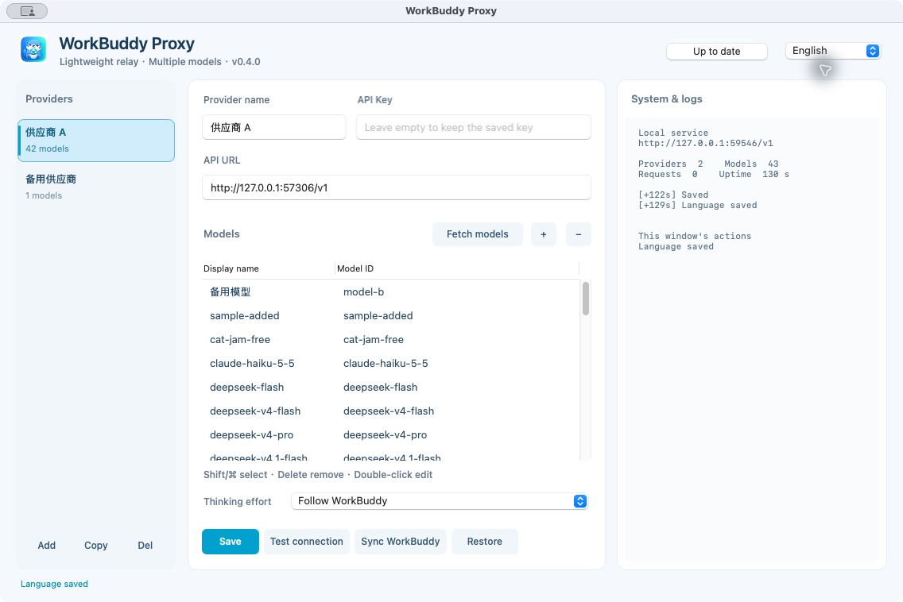
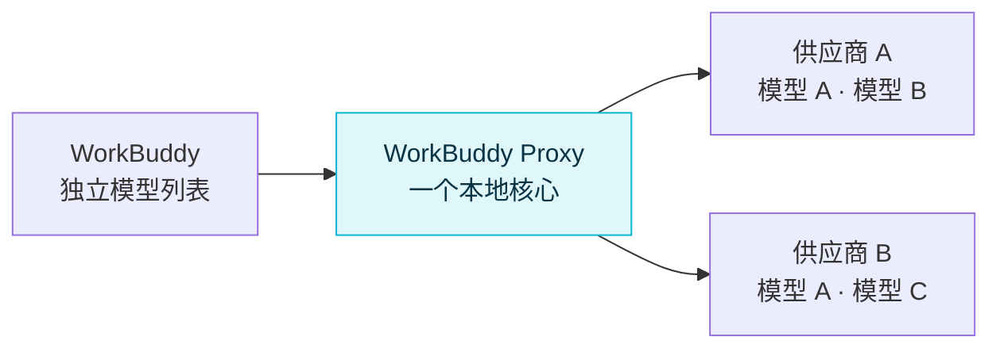

<p align="center">
  
</p>

<h1 align="center">WorkBuddy Proxy</h1>

<p align="center">
  <strong>轻量运行 · 快速转发 · 参数透传</strong><br>
  为 WorkBuddy 打造的原生本地模型代理，一份供应商配置连接多个模型。
</p>

<p align="center">
  <a href="https://github.com/gloryhui/workbuddy-proxy/releases"></a>
  <a href="https://github.com/gloryhui/workbuddy-proxy/actions/workflows/ci.yml"></a>
  
  
  <a href="LICENSE"></a>
</p>

<p align="center">
  <a href="#下载与安装">下载与安装</a> ·
  <a href="#三步接入-workbuddy">快速上手</a> ·
  <a href="#界面预览">界面预览</a> ·
  <a href="#性能实测">性能实测</a> ·
  <a href="#常见问题">常见问题</a>
</p>

---

## 用它做什么

把兼容 **OpenAI Chat Completions** 的服务接入 WorkBuddy，用一个小型原生程序管理地址、Key 和模型列表。OpenCode Go、其他兼容供应商，以及本机兼容服务，都可以按同一套方式配置。

| 能力 | 使用体验 |
| --- | --- |
| 🪶 轻量原生 | Rust 转发核心，Windows Win32 / Mac AppKit 界面；解压即可运行 |
| 🧩 一份配置，多个模型 | 同一个供应商只填一次 URL 和 Key，模型列表每行添加一个 ID |
| 🔀 同名模型独立选路 | 多个账号、多个供应商使用相同模型 ID，也能在 WorkBuddy 中分别选择 |
| 🌊 流式透传 | 默认只还原模型别名，保留其余请求字节、流式响应与上游错误 |
| 🦦 统一图标 | 主图标覆盖应用、窗口、Windows 任务栏 / 托盘、Mac 菜单栏和启动提示 |
| 🔄 一键同步 | 批量写入 WorkBuddy 模型列表，自动备份并保留其他已有模型 |
| 📋 获取模型 | 按当前地址和 Key 拉取可用模型，支持多选、批量删除和双击编辑 |
| 🌐 单语言界面 | 简体中文 / English 切换，按钮和提示使用同一种语言 |
| 🪟 单例启动 | 重复打开唤回原窗口，保留未保存的输入，复用后台核心 |
| 🔔 更新检测 | 自动检测 GitHub 正式 Release，也可手动检查 |

最多 **64 个供应商、合计 256 个模型**，共用一个转发核心和一个本地端口。

## 下载与安装

### 当前开发版（尚未正式发布）

当前代码已增加无供应商时的添加引导、Mac DMG 拖入安装、标准应用 / Dock 模式、输入框复制粘贴与双击全选，以及 API Key 小眼睛开关和保存后回显。这些变更目前用于本地检查，尚未覆盖 GitHub Release。下方下载链接仍指向已发布的 v0.4.0，后续功能说明以当前开发代码为准。

### v0.4.0 正式版

| 系统 | 下载 | 安装包大小 | 启动方式 |
| --- | --- | ---: | --- |
| Windows 10 / 11，x64 | [Windows 版](https://github.com/gloryhui/workbuddy-proxy/releases/download/v0.4.0/workbuddy-proxy-0.4.0-windows-x64.zip) | 约 2 MB | 解压，双击 `workbuddy-proxy.exe` |
| Mac，Apple Silicon | [M 系列芯片版](https://github.com/gloryhui/workbuddy-proxy/releases/download/v0.4.0/workbuddy-proxy-0.4.0-macos-arm64.zip) | 约 4.1 MB | 解压，把 `.app` 拖到“应用程序”后打开 |
| Mac，Intel | [Intel 芯片版](https://github.com/gloryhui/workbuddy-proxy/releases/download/v0.4.0/workbuddy-proxy-0.4.0-macos-x64.zip) | 约 4.2 MB | 解压，把 `.app` 拖到“应用程序”后打开 |

Mac 要求 macOS 12 或更高版本。运行程序无需安装 Rust、Python、Node 或额外 WebView 运行时。分享给朋友时，直接发送对应系统的 ZIP / DMG，每个人填写自己的 Key 即可。

[全部版本](https://github.com/gloryhui/workbuddy-proxy/releases) · [源代码 ZIP](https://github.com/gloryhui/workbuddy-proxy/releases/download/v0.4.0/workbuddy-proxy-0.4.0-source.zip) · [SHA256 校验值](https://github.com/gloryhui/workbuddy-proxy/releases/download/v0.4.0/SHA256SUMS) · [性能原始数据](https://github.com/gloryhui/workbuddy-proxy/releases/download/v0.4.0/performance.json)

> 升级前先从托盘或菜单栏退出旧版。当前 Mac 包为 ad-hoc 签名，未做 Developer ID 公证；Windows 未做 Authenticode 签名，系统可能提示未知开发者。

## 三步接入 WorkBuddy

### 1. 添加供应商

打开程序，在左侧选择或新增供应商，填写：

| 字段 | 填什么 |
| --- | --- |
| 供应商名称 | 方便自己区分的名称，例如“日常账号”“备用账号” |
| 上游地址 | 填写供应商提供的 OpenAI 兼容 Base URL；新增时只显示提示文字，不预填任何厂商地址 |
| API Key | 自己在该供应商获得的 Key；保存后保留显示，默认为星号，可切换显示 / 隐藏 |
| 模型列表 | 两列表格：显示名在前、模型 ID 在后；显示名默认使用 ID |

使用 OpenCode Go 时，地址填写 `https://opencode.ai/zen/go/v1`。上游地址使用 HTTPS，本机 loopback 地址也允许 HTTP。

### 2. 配置模型，保存并测试

点击**获取模型**，程序会按当前 API 地址和 Key 请求上游 `/models`，把可用模型补进表格。已有显示名保留，新增项默认使用模型 ID；Key 留空时使用该供应商已保存的 Key。获取结果需要点击**保存**才会写入配置。

也可以点击模型表格旁的 **＋** 手动添加，双击单元格编辑，再用 **−** 移除选中项。例如：

| 显示名 | 模型 ID |
| --- | --- |
| 日常任务 | model-a |
| 编程任务 | model-b |
| 同模型的另一项 | model-a |

模型表格支持 Shift + 点击连续选择，以及 Windows Ctrl / Mac Command + 点击逐项多选。表格获得焦点后，Delete / Backspace 移除所选模型，Ctrl / Command + A 全选，Ctrl / Command + C 复制所选模型 ID，Enter / F2 编辑显示名，Ctrl / Command + N 添加模型，Ctrl / Command + S 保存。编辑单元格时 Delete / Backspace 只删除文字，Esc 取消此次编辑。

这些 ID 仅用于演示，请替换成上游实际支持的模型。相同模型 ID 可以添加多项，填写不同显示名即可。修改供应商地址或 Key 会对该供应商下的全部模型生效。

点击**保存**，再点击**测试连接**。测试只检查已保存的首个模型，使用其思考设置，发送一个简短流式请求。

### 3. 同步到 WorkBuddy

在右侧全局设置区点击**同步 WorkBuddy**，一次写入所有已保存 Key 的供应商下的模型。重新打开 WorkBuddy 的模型列表，分别选择对应项；必要时重启 WorkBuddy。

删除模型行或供应商后，再同步一次即可清理对应的 WorkBuddy 项。供应商侧栏的“复制”用于复制供应商配置。

> **两种 Key 各有用途：** 供应商 Key 填在代理里；WorkBuddy 使用代理生成的本地连接码。“同步 WorkBuddy”会自动完成填写。

## 界面预览

两端采用同一套三栏布局：供应商侧栏、模型设置、全局设置与滚动日志。右侧“同步 WorkBuddy”作用于所有已保存供应商；“移除已同步模型”移除代理添加的条目，如曾覆盖已有条目则恢复原条目。简体中文 / English 默认跟随系统，右上角可切换，界面每次只显示一种语言。主图标与系统托盘 / 菜单栏保持一致。

<p align="center">
  
</p>

WorkBuddy 的列表名称为 **显示名 · 供应商**；内部标识使用短格式 `wbp-<路由标识>`，不再拼接完整模型 ID。升级后再次同步，可更新已安装的列表项。

“运行信息与日志”显示本地地址、供应商与模型数、请求数、运行时长和最近 100 条核心事件。日志不会记录 API Key 或对话内容。窗口最小化 / 隐藏后停止轮询。

<details>
<summary>查看英文界面</summary>



</details>

### Release 更新检测

打开设置窗口时自动检查本仓库的最新正式 Release，成功结果缓存 24 小时。右上角可手动立即检查；发现更高版本后按钮显示下载入口，点击打开对应 Release 页面。按数字比较主 / 次 / 修订版本，不会把预发布版当作正式更新。

检测不需要 GitHub 登录，不发送供应商 Key；网络超时为 8 秒。失败只显示状态 / 日志，保留当前程序继续使用。下载并替换程序前，先从托盘 / 菜单栏退出旧版。

### 上游没有模型列表接口？

部分供应商不支持 `GET /models`，或返回的列表与账号实际权限不同。获取失败时仍可在表格手动填写 ID；模型能否调用，以实际请求 / 测试结果为准。上游列表最多 1 MiB，所有供应商合计最多 256 个已配置模型。

### 关闭窗口以后

| 操作 | Windows | Mac |
| --- | --- | --- |
| 关闭设置窗口 | 隐藏到任务栏托盘，转发继续 | 界面进程退出，转发核心继续 |
| 最小化设置窗口 | 隐藏到任务栏托盘 | 按系统方式最小化窗口 |
| 重新打开设置 | 单击托盘，或再次双击程序 | 再次打开 `.app`；窗口运行时也可从菜单栏打开设置 |
| 完全退出 | 右键托盘 → 退出 | 菜单栏 → 退出；设置窗口已关闭时先重新打开程序 |

普通启动使用单例模式：同一配置目录只运行一个设置窗口和一个转发核心。连续打开、从另一份程序文件打开，都唤回原窗口；最小化时恢复窗口，未保存的输入保留。显式使用不同 `--config-dir` 时，可运行独立的隔离实例。

Windows 的托盘模式保留核心和界面两个进程；Mac 关闭设置窗口后只保留核心。需要无界面运行时，两端都可使用 `--headless`。

## 多供应商与同名模型



| 配置场景 | 配置方式 |
| --- | --- |
| 同一个账号使用多个模型 | 一个供应商，添加多行模型 |
| 同一个账号、同模型 ID，展示为多项 | 一个供应商，同模型 ID 配不同显示名称 |
| 同一家服务的多个账号 | 复制供应商，为各账号填写各自的 Key |
| 不同供应商提供相同模型 ID | 分别添加供应商，独立同步到 WorkBuddy |

每个模型具有独立内部 ID、别名和本地 URL。例如 `wbp-abc123` 会在转发时还原为真实上游 ID `deepseek-v4.1-flash`，使用所选供应商的 Key。上游响应中的模型字段保持原样。

裸模型 ID 对应多项配置时，代理会拒绝模糊选路。WorkBuddy 自动同步使用每个模型的独立 URL，选中的列表项与上游凭据保持对应。

## 透明转发与思考设置

默认选择**跟随 WorkBuddy**：思考参数、输出上限、消息、工具历史和额外字段由客户端决定，代理只处理选路、认证和模型别名还原。

- 其余请求字节保留原样，包括字段顺序、空白和未知字段；真实模型 ID 已匹配时复用原始请求 Bytes。
- 响应按流返回，保留原始 SSE 字节、HTTP 状态、端到端头与错误内容，支持背压和取消。
- 本地 Authorization 替换为供应商 Key，Host 按上游生成；移除 hop-by-hop 及 Connection 指定的头。
- 上游 401 / 403 / 429 原样返回，不自动换 Key、换模型或重试这些错误。

### 需要固定思考档位时

代理提供“关闭 / 低 / 高 / 最高”覆盖，保存后应用到当前供应商的各模型，优先级高于 WorkBuddy 的选择。“保留各模型设置”用于保留迁移来的不同档位；默认透传可保留客户端发送的其他档位。

对 DeepSeek，显式开启会写入 `thinking.type=enabled` 和 `reasoning_effort`；关闭会写入 `thinking.type=disabled` 并删除冲突的 `reasoning_effort`。其他模型只覆盖 `reasoning_effort`。可用档位由上游决定，不支持的参数会收到其原始错误。

<details>
<summary><strong>WorkBuddy 的思考强度、上下文窗口如何显示？</strong></summary>

同步时，本程序为 `deepseek-v4.1-flash`、`deepseek-v4-pro`、`deepseek-v4-flash` 写入以下能力声明：

| 项目 | 本程序写入的值 |
| --- | --- |
| 思考能力 | 支持思考，允许关闭；档位 `high` / `max`，默认 `high` |
| 上下文窗口 | 128K / 300K / 1M，默认 300K |
| 最大输入声明 | 1,000,000 tokens |
| 工具 / 图片声明 | 工具调用开启，图片关闭 |

这些是 WorkBuddy 的模型配置声明，实际限制以上游服务为准；上下文窗口也不等于最大输出长度。默认转发不主动增加输出上限或上下文参数。

仅填写模型 ID、URL、Key 不保证 WorkBuddy 显示思考选项。选择器依赖 `supportsReasoning`、`reasoning`、`contextWindow` 等字段；同步后重新打开模型列表，必要时重启 WorkBuddy。其他模型的能力声明需按真实支持范围配置。

</details>

## 性能实测

轻量化通过发布包和实际进程测量验证。以下来自 **v0.4.0 发布构建**，统一配置为 **1 个供应商、64 个模型**：

| 平台 / 模式 | 空闲进程 RSS | 测量范围 |
| --- | ---: | --- |
| Windows x64，无界面 | **9.34 MiB** | 仅转发核心 |
| Windows x64，原生界面 / 托盘 | **36.36 MiB** | 核心与界面进程的 RSS 合计 |
| Mac Apple Silicon，无界面 | **11.86 MiB** | CI 环境中的转发核心 |
| Mac Intel，无界面 | **4.35 MiB** | CI 环境中的转发核心 |

小请求的直连 / 代理中位数差值：Windows 原生界面模式约 **0.039 ms**，Mac Apple Silicon 约 **0.079 ms**，Mac Intel 约 **0.258 ms**。这是本地 HTTP 模拟测试中的差值，包含连接复用和调度影响，不是上游模型的响应时间。

不同系统、机器和负载的 RSS 会不同；进程 RSS 合计可能重复计入共享页面，负载后的占用也可能高于初始空闲值。完整延迟、采样峰值、负载后占用和测试条件见 [performance.json](https://github.com/gloryhui/workbuddy-proxy/releases/download/v0.4.0/performance.json) 与 [对应 CI](https://github.com/gloryhui/workbuddy-proxy/actions/runs/38439397537)。

### 轻量实现

| 部分 | 选择与边界 |
| --- | --- |
| 核心 | Rust，单线程 Tokio I/O 调度器，Axum / Hyper / Reqwest |
| 界面 | Win32 / AppKit 系统原生控件 |
| TLS | 系统原生 TLS，保留证书验证 |
| 选路 | 内存哈希索引，模型共享供应商 URL / 凭据 |
| 连接 | 上游池化复用，每个主机最多 2 个空闲连接，60 秒后清理 |
| 并发 | 全局 4 个在途请求；忙时本地返回 429，不堆积等待队列 |
| 请求体 | 每个最多 8 MiB，输入读取最多 30 秒 |
| 上游读取 | 单次读取的空闲超时 180 秒 |
| Go 会话缓存 | 最多 64 个会话，每个最多 128 个消息哈希，按需清理 |

界面按需运行。模型目录由用户配置；程序没有后台余额轮询、自动更新器、遥测、数据库或聊天日志。更完整的取舍见 [设计与性能边界](docs/ARCHITECTURE.md)，历史测量见 [首版记录](docs/PERFORMANCE.md)。

## 常见问题

<details>
<summary><strong>同步成功了，WorkBuddy 里还是看不到模型？</strong></summary>

重新打开模型列表，必要时重启 WorkBuddy。确认已保存供应商 Key 和至少一个模型；没有 Key 的草稿供应商不会同步。配置文件位置为当前用户的 `~/.workbuddy/models.json`。

</details>

<details>
<summary><strong>模型列表要手动填写吗？可以自动发现吗？</strong></summary>

点击“获取模型”，按当前供应商地址和 Key 拉取上游 `/models`，也可以手动添加真实模型 ID。“测试连接”只验证已保存的首项，不会逐一测试所有模型。

代理的 `/v1/models` 可向兼容客户端提供已配置模型列表，供应商 URL 下的 `/models` 只返回该供应商的模型。WorkBuddy 使用“一键同步”即可批量添加。

</details>

<details>
<summary><strong>可以连接本机兼容模型服务吗？</strong></summary>

可以使用 `http://127.0.0.1:端口/v1` 这类 loopback 地址。上游需实现 OpenAI Chat Completions；本工具的供应商 Key 字段需要保存非空值，不校验 Key 的上游可填写自用占位值，例如 `local`。

远程上游要求 HTTPS，地址不能包含用户名、密码、查询参数或 fragment。

</details>

<details>
<summary><strong>改完 Key、增加或删除模型，还要做什么？</strong></summary>

先保存，再同步 WorkBuddy 列表。Key 留空会保留当前供应商已保存的值；URL / Key 的修改作用于该供应商全部模型。已开始的请求沿用原来的选路，新请求使用新配置。

</details>

<details>
<summary><strong>测试报 401 / 403 / 429，怎么排查？</strong></summary>

若“测试连接”提示上游 HTTP 401 / 403，检查供应商 Key、地址、账号权限及模型可用性。若 WorkBuddy 提示本地 Key 错误，重新同步 WorkBuddy。

上游 429 通常需要检查服务额度或限流；代理自己也会在 4 个请求同时在途时返回 429，错误信息会说明请求槽已满。HTTP 400 可检查模型 ID 和参数；不确定思考档位时先选择“跟随 WorkBuddy”。

</details>

<details>
<summary><strong>同步 / 恢复提示列表项已被修改？</strong></summary>

程序会比对上次写入的条目，检测到其他操作的修改时拒绝覆盖。先检查当前 `models.json` 和旁边的 `models.json.workbuddy-proxy-时间戳.bak` 备份，再手动处理冲突。恢复操作只处理本工具管理的条目。

</details>

<details>
<summary><strong>端口被占用，或者 Windows 启动失败？</strong></summary>

默认监听 `127.0.0.1:18080`。运行时可在右侧“本地端口”输入 1–65535 并点击“应用”：程序先检查新端口是否可用，再切换监听并自动更新现有 WorkBuddy 代理模型的地址。占用或保存失败会保留原设置，已开始的流式请求继续完成。修改后重新打开 WorkBuddy 模型列表；必要时重启 WorkBuddy。启动时若端口已被占用，退出占用程序或使用命令行指定其他端口。

Windows 包内有 `Diagnose.cmd`，可查看无界面启动诊断。启动日志在代理配置目录的 `startup.log`，只记录启动元数据，不记录聊天内容或 Key。

</details>

<details>
<summary><strong>OpenCode Go 会话是怎样处理的？</strong></summary>

使用 Go 地址时，程序发送自己的 User-Agent，并补齐 `x-opencode-session`。优先采用客户端会话头，缺少时依据消息历史前缀推断，且使用独立模型 ID 区分连接。

相同开场历史可能归为同一会话；历史压缩、超出缓存窗口或服务重启可能产生新会话标识。请求和响应内容仍来自原对话，不会交换聊天内容。通用上游不进行这项 Go 会话处理。

</details>

## 升级、备份与配置位置

从 v0.1 / v0.2 升级时，旧配置先备份为 `config.pre-v0.3-*.bak` 再自动迁移。同供应商标签、同 URL、同 Key 的 v0.2 连接会合并为一个供应商，其模型别名、思考设置、本地连接码和恢复记录保留；不同 Key 分别保留。

| 文件 / 目录 | 位置与用途 |
| --- | --- |
| Windows 代理配置 | `%APPDATA%\WorkBuddyProxy` |
| Mac 代理配置 | `~/Library/Application Support/WorkBuddyProxy` |
| Linux 代理配置 | `~/.config/workbuddy-proxy`，用于无界面开发 / 测试 |
| WorkBuddy 模型配置 | `~/.workbuddy/models.json`，Windows 的 `~` 为当前用户目录 |
| WorkBuddy 备份 | 与 `models.json` 相邻，名称为 `models.json.workbuddy-proxy-时间戳.bak` |

上游 Key 和本地连接码以明文保存在本机配置中。Unix 目录 / 文件权限为 0700 / 0600；Windows 使用当前用户配置目录的默认权限。**配置目录及备份不要打包分享。** 发布 ZIP / DMG 不包含这些文件。

服务只监听 loopback，校验 Host、Origin 和本地 Key；管理接口使用独立令牌。控制连接禁用系统代理，上游转发可使用系统代理，且关闭重定向。上游 Key 只发往配置的供应商。

## 开发与协议范围

OpenAI 兼容范围为 Chat Completions 与已配置模型目录：

| 端点 | 用途 |
| --- | --- |
| `POST /v1/chat/completions` | 按模型别名选路；裸 ID 唯一时也可使用 |
| `GET /v1/models` | 所有已保存供应商的模型列表 |
| `/r/供应商ID/v1` | 限定一个供应商的聊天与模型目录 |
| `/r/模型ID/v1` | 限定一个模型，供 WorkBuddy 自动同步使用 |

当前不提供 Responses、Anthropic 协议转换或 MCP。构建需要 Rust 1.88+ 和平台 C 编译器：Mac 使用 Xcode 命令行工具，Windows 使用 MSVC Build Tools / Windows SDK。Windows 发布构建静态链接 CRT。

<details>
<summary><strong>构建、验证、无界面运行与打包命令</strong></summary>

```sh
cargo test --locked
cargo clippy --locked --all-targets -- -D warnings
cargo build --release --locked

python3 scripts/smoke.py --exe target/release/workbuddy-proxy
python3 scripts/multi_routing.py --exe target/release/workbuddy-proxy
python3 scripts/benchmark.py --exe target/release/workbuddy-proxy --output bench-results/local.json
```

Windows 把可执行文件路径改为 `target/release/workbuddy-proxy.exe`。基准默认配置 64 个模型；可用 `--models` 改变数量，`--gui` 测量包含原生界面的进程 RSS 合计。测试只用假 Key 和临时目录，Python 是开发工具，发布程序运行不依赖它。

```sh
# 从源码构建后，以默认配置目录无界面启动
./target/release/workbuddy-proxy --headless --port 18080

# Mac 打包前安装仅构建时使用的 DMG 工具
python3 -m pip install -r scripts/dmg-requirements.txt

# 在对应平台打包；Mac 同时生成 DMG 和 ZIP，Windows 生成 ZIP
python3 scripts/package.py --exe target/release/workbuddy-proxy --platform macos-arm64
```

需要独立配置目录时，可附加 `--config-dir "私有目录路径"`。

在 Mac 上修改图标原稿后，可运行 `python3 scripts/generate_icons.py` 生成 ICO、ICNS 和原生界面 PNG。资源随构建 / 打包嵌入程序。

CI 在 Windows、Apple Silicon Mac、Intel Mac、Linux 上验证实际程序，包含流式直通、取消释放槽位、同名选路、凭据隔离、WorkBuddy 同步 / 恢复、Windows 图标与托盘生命周期及 Mac 进程隔离。自动检查不替代目标机的人工作业和真实上游账号验证。

</details>

## 许可

[MIT License](LICENSE)。第三方开源项目，与 WorkBuddy、腾讯、OpenCode 无隶属关系。
