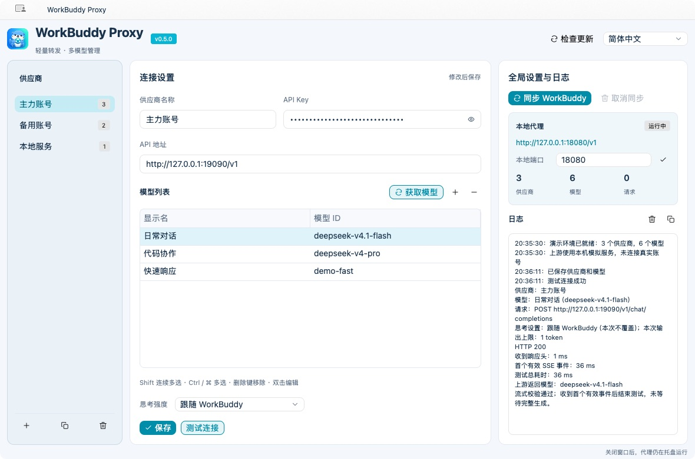
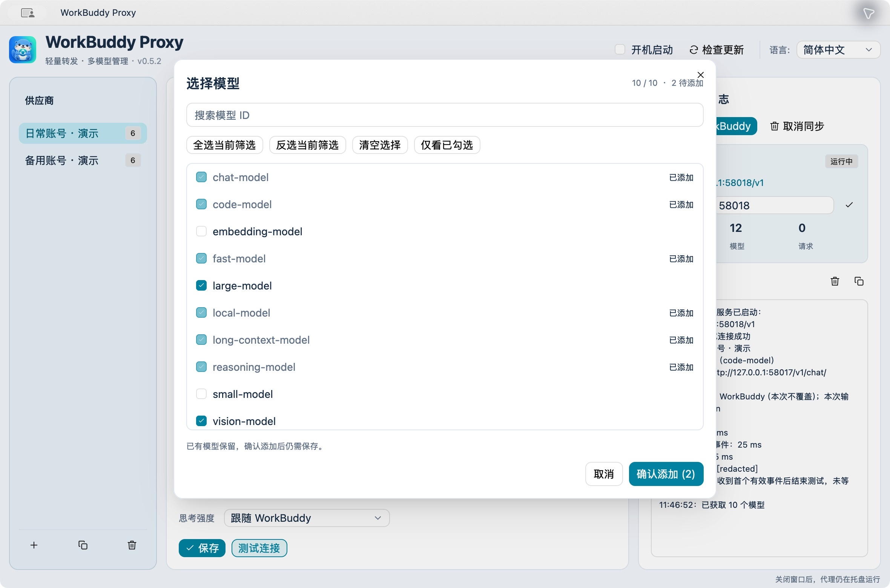
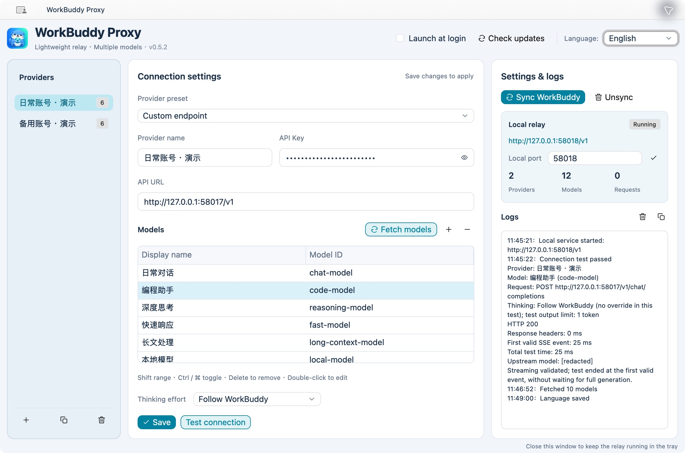
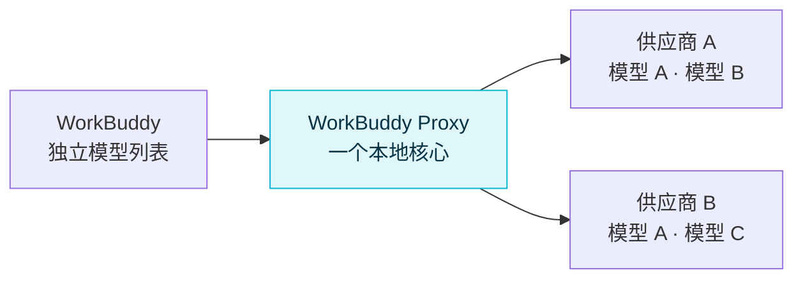

<p align="center">
  
</p>

<h1 align="center">WorkBuddy Proxy</h1>

<p align="center">
  <strong>轻量运行 · 多模型管理 · 流式透传</strong><br>
  为 WorkBuddy 打造的跨平台本地模型代理，一份配置管理多个服务与模型。
</p>

<p align="center">
  <a href="https://github.com/gloryhui/workbuddy-proxy/releases"></a>
  <a href="https://github.com/gloryhui/workbuddy-proxy/actions/workflows/desktop.yml"></a>
  <a href="https://github.com/gloryhui/workbuddy-proxy/actions/workflows/ci.yml"></a>
  
  
  <a href="LICENSE"></a>
</p>

<p align="center">
  <a href="#下载与安装">下载与安装</a> ·
  <a href="#三步接入-workbuddy">快速上手</a> ·
  <a href="#界面预览">界面预览</a> ·
  <a href="#性能实测">性能实测</a> ·
  <a href="#常见问题">常见问题</a>
</p>

<p align="center">
  <a href="https://github.com/gloryhui/workbuddy-proxy/releases/latest"><strong>下载正式版</strong></a> ·
  <a href="docs/ARCHITECTURE.md">设计与性能边界</a>
</p>

<p align="center">
  
</p>
<p align="center"><sub>v0.5.2 macOS 实拍 · Windows 使用同一套设置界面 · 截图使用独立演示配置与本机模拟上游</sub></p>

---

## 用它做什么

把兼容 **OpenAI Chat Completions** 的服务接入 WorkBuddy，用同一套桌面界面管理地址、Key 和模型列表。OpenCode Go、其他兼容供应商，以及本机兼容服务，都可以按同一套方式配置。

| 能力 | 使用体验 |
| --- | --- |
| 🪶 轻量界面 | Rust 转发核心，GPUI Kit 统一界面；关闭设置释放界面进程 |
| 🧩 一份配置，多个模型 | 同一个供应商只填一次 URL 和 Key，模型列表每行添加一个 ID |
| 🗂️ 供应商预设 | 内置 76 个 API 地址，可搜索供应商、地区和套餐，选择后仍可自定义 |
| 🧠 自动识别模型能力 | 结合供应商信息与 models.dev 自动补齐图片、工具、思考档位及 Token 上限，支持离线缓存与手动覆盖 |
| 🔀 同名模型独立选路 | 多个账号、多个供应商使用相同模型 ID，也能在 WorkBuddy 中分别选择 |
| 🌊 流式透传 | 默认只还原模型别名，保留其余请求字节、流式响应与上游错误 |
| 🦦 统一图标 | 主图标覆盖应用、窗口、Windows 任务栏 / 托盘、Mac 菜单栏和启动提示 |
| 🔄 一键同步 | 强制更新本工具管理的条目，支持重装后覆盖或取消，自动备份并保留其他模型 |
| 📋 获取模型 | 按当前地址和 Key 拉取可用模型，弹窗勾选后添加，支持搜索、全选、反选和清空 |
| 🌐 单语言界面 | 简体中文 / English 切换，按钮和提示使用同一种语言 |
| 🪟 单例启动 | 重复打开唤回原窗口，保留未保存的输入，复用后台核心 |
| 🚀 开机启动 | 默认关闭；开启后登录系统只启动托盘与代理服务 |
| 📜 运行日志 | 新日志自动滚动到底部，支持清空与复制，不记录 Key 或对话内容 |
| 🔔 更新检测 | 自动检测 GitHub 正式 Release，也可手动检查 |

最多 **64 个供应商、合计 256 个模型**，共用一个转发核心和一个本地端口。

## 下载与安装

### v0.5.3 正式版

本版新增模型能力自动识别、独立的多模态与思考设置，以及模型列表的“操作”编辑按钮；结合供应商信息和 models.dev 自动补齐能力，支持离线缓存与手动覆盖。[查看更新记录](CHANGELOG.md#v053--2026-10-15)。

| 系统 | 下载 | 体积 | 安装方式 |
| --- | --- | ---: | --- |
| Windows 10 / 11，x64 | [Windows 安装包](https://github.com/gloryhui/workbuddy-proxy/releases/download/v0.5.3/workbuddy-proxy-0.5.3-windows-x64-setup.exe) | 见 Release 附件 | 中文向导，自选目录，默认创建桌面图标 |
| Mac，Apple Silicon | [M 系列芯片 DMG](https://github.com/gloryhui/workbuddy-proxy/releases/download/v0.5.3/workbuddy-proxy-0.5.3-macos-arm64.dmg) | 见 Release 附件 | 打开 DMG，将 WorkBuddy Proxy.app 拖入“应用程序” |
| Mac，Intel | [Intel 芯片 DMG](https://github.com/gloryhui/workbuddy-proxy/releases/download/v0.5.3/workbuddy-proxy-0.5.3-macos-x64.dmg) | 见 Release 附件 | 打开 DMG，将 WorkBuddy Proxy.app 拖入“应用程序” |

Windows 正式分发只提供安装 EXE，Mac 只提供 DMG。程序名称统一为 **WorkBuddy Proxy**。无需 Rust、Python、Node 或 WebView 运行时。分享时直接发送安装包，每个人填写自己的 Key。

Windows 与 Mac 使用同一套设置界面。关闭设置窗口后，托盘 / 菜单栏和转发核心继续运行；需要设置时再打开。

[全部版本](https://github.com/gloryhui/workbuddy-proxy/releases) · [SHA256 校验值](https://github.com/gloryhui/workbuddy-proxy/releases/download/v0.5.3/SHA256SUMS.txt)

> 升级前先从托盘或菜单栏退出旧版。当前 Mac 包为 ad-hoc 签名，未做 Developer ID 公证；Windows 未做 Authenticode 签名，系统可能提示未知开发者。

## 三步接入 WorkBuddy

### 1. 添加供应商

打开程序，在左侧选择或新增供应商。可先用连接设置顶部的**供应商预设**下拉框，搜索供应商名称、地区、套餐或地址，选择后填入供应商名称和 API 地址；也可直接填写自定义地址。

预设不会自动保存或发起上游请求，也不会修改已有 Key、模型和路由。确认地址对应自己的套餐与地区，再填写 Key 和模型：

| 字段 | 填什么 |
| --- | --- |
| 供应商预设 | 可搜索的地址快捷选项；自有服务或未收录地址使用“自定义地址” |
| 供应商名称 | 方便自己区分的名称，例如“日常账号”“备用账号” |
| 上游地址 | 填写供应商提供的 OpenAI 兼容 Base URL；新增时只显示提示文字，不预填任何厂商地址 |
| API Key | 自己在该供应商获得的 Key；保存后保留显示，默认为星号，可切换显示 / 隐藏 |
| 模型列表 | 两列表格：显示名在前、模型 ID 在后；显示名默认使用 ID |

使用 OpenCode Go 时，可选择对应预设，或填写 `https://opencode.ai/zen/go/v1`。上游地址使用 HTTPS，本机 loopback 地址也允许 HTTP。预设中的完整路径应保留，不要统一替换为 `/v1`。

预设目录参考 [yetone/magpie](https://github.com/yetone/magpie)，共收录 76 个固定 OpenAI Chat API 地址（地区和套餐分别列出）；收录范围和来源见[供应商预设说明](docs/PROVIDER-PRESETS.md)。预设只提供地址，不提供 Key 或模型权限；部分套餐没有 `/models` 接口，可手动填写模型 ID。

### 2. 配置模型，保存并测试

点击**获取模型**，程序会按当前 API 地址和 Key 请求上游 `/models`，然后打开模型选择窗口。新模型默认不勾选，可逐行勾选、搜索模型 ID、仅看已勾选，并使用**全选当前筛选**、**反选当前筛选**或**清空选择**（清空所有待添加项）。点击**确认添加**后，仅将勾选的新模型加入编辑表格；取消或关闭窗口不会改动表格。已有模型标记为“已添加”并保留原显示名，手动添加且未出现在获取结果中的模型也会保留；新增项默认使用模型 ID。Key 留空时使用该供应商已保存的 Key。确认后还需要点击**保存**才会写入配置。

获取列表最多展示 4096 个模型；确认添加时检查所有供应商合计最多 256 个模型。超限会提示并保留选择，可取消部分勾选后重试。

也可以点击模型表格旁的 **＋** 手动添加，通过“操作”列的编辑图标或双击模型行，在弹窗中编辑显示名、模型 ID 与能力配置，再用 **−** 移除选中项。例如：

| 显示名 | 模型 ID |
| --- | --- |
| 日常任务 | model-a |
| 编程任务 | model-b |
| 同模型的另一项 | model-a |

模型表格支持 Shift + 点击连续选择，以及 Windows Ctrl / Mac Command + 点击逐项多选。表格获得焦点后，Delete / Backspace 移除所选模型，Ctrl / Command + A 全选，Enter / F2 打开模型编辑弹窗。Ctrl / Command + S 保存当前供应商；编辑弹窗内回车确认，Esc 取消，Delete / Backspace 只删除输入框中的文字。

这些 ID 仅用于演示，请替换成上游实际支持的模型。相同模型 ID 可以添加多项，填写不同显示名即可。修改供应商地址或 Key 会对该供应商下的全部模型生效。

点击**测试连接**会先保存当前修改：选中模型时测试该项；多选时按列表顺序测试第一个选中项；未选中时测试列表第一项。测试使用该模型的思考设置，发送一个简短流式请求。保存失败时保留草稿，不发起测试。也可以随时点击**保存**单独保存。

**v0.5.3 新增：** 模型默认自动识别图片、工具、思考档位和 Token 上限，结合供应商返回信息与 models.dev 自动补齐，并支持离线缓存及手动覆盖。“操作”列可直接打开编辑窗口。[查看自动识别规则与多模态边界](docs/MODEL-CAPABILITIES.md)。

### 3. 同步到 WorkBuddy

在右侧全局设置区点击**同步 WorkBuddy**，弹窗提供**同步并重启 / 仅同步 / 取消**。确认同步后，先自动保存当前供应商的修改，再一次写入所有已保存 Key 的供应商下的模型，无需先单独点击保存。模型编辑弹窗内的修改请先确认；校验或保存失败时保留草稿并停止同步，也不会重启。

**同步并重启**目前支持 macOS：同步成功后请求 WorkBuddy 正常退出，确认退出后重新打开原应用。重启会中断正在执行的任务，请先保存工作；20 秒未退出就停止并提示，不强制结束进程。WorkBuddy 未运行时会尝试打开；未安装、多实例、退出或启动失败会明确提示。选择**仅同步**不会操作 WorkBuddy 进程；取消、关闭弹窗或按 Esc 不保存、不同步。其他平台请在仅同步后手动重开 WorkBuddy。

WorkBuddy 的旧会话可能保留旧模型配置；新增或修改模型后若提示“未配置接口地址或 API key”，请完全退出并重开 WorkBuddy，再继续原会话。同步内容没有变化时保留模型配置文件的原始字节、修改时间及文件标识；有变化时仍备份并原子替换文件。

删除模型行或供应商后，再同步一次即可清理对应的 WorkBuddy 项。供应商侧栏的“复制”用于复制供应商配置。

> **两种 Key 各有用途：** 供应商 Key 填在代理里；WorkBuddy 使用代理生成的本地连接码。“同步 WorkBuddy”会自动完成填写。

## 界面预览

两端采用同一套三栏布局：供应商侧栏、模型设置、全局设置与滚动日志。右侧“同步 WorkBuddy”作用于所有已保存供应商；“取消同步”移除代理添加的条目，如曾覆盖已有条目则恢复原条目。简体中文 / English 默认跟随系统，点击右上角地球图标选择语言，菜单标记当前选项，界面每次只显示一种语言。旁边的四角图标将窗口恢复为默认 **1180 × 780** 逻辑像素，最小尺寸仍为 **1100 × 700**；全屏或最大化时先退出该状态再恢复尺寸。主图标与系统托盘 / 菜单栏保持一致。

右上角开机启动使用电源图标，开启时高亮，悬停显示当前状态，点击切换；“检查更新”仅显示刷新图标，悬停可查看说明。GitHub 图标打开项目主页，反馈图标打开项目的新建 Issue 页面，由用户填写并提交。

顶部按“开机启动 → 检查更新 → 语言”排列，语言选择框前带有标签，版本号以浅灰文字显示在副标题末尾。**开机启动默认不勾选**，旧配置未设置此项时也保持关闭。勾选后，Windows / macOS 在当前用户登录系统时启动托盘与代理服务，不自动弹出设置；取消勾选会移除本软件的登录启动项，选择立即保存。设置失败会回滚选择并显示错误。手动打开应用仍会显示设置窗口；Windows 卸载时清理本软件的启动项并保留配置。

可用按钮显示清晰描边和深色文字，悬停 / 按下有反馈，灰色表示当前不可用。日志统一按“本地时间：操作内容”从旧到新显示，每次操作只记录一次；**新日志出现时自动滚动到底部，没有新内容时保留当前阅读位置**。日志区域提供“清空日志”和“复制日志”，前者同步清空核心记录，后者复制服务摘要及全部当前日志，便于反馈问题；关闭并重开设置窗口仍可查看当前核心进程的日志。连接测试详情包含供应商、模型、请求目标、HTTP 状态、响应头耗时、首个有效 SSE 事件耗时、总耗时及失败提示，收到首个有效事件即结束测试，不等待完整生成。

WorkBuddy 的列表名称为 **显示名 · 供应商**，模型 ID 使用 **供应商名称/上游模型 ID**，例如 `opencode/deepseek-v4.1-flash`。重复条目会加固定的 8 位短后缀，例如 `opencode/deepseek-v4.1-flash-a1b2c3d4`；后缀由内部路由标识生成，调整列表顺序不会改变，删除其他重复条目也会保留已同步的后缀。遇到标识碰撞时自动延长后缀。

升级后再次同步，会按内部路由关联并原位更新已安装条目，保留恢复记录和其他已有模型。修改供应商名称或上游模型 ID 后，再次同步会更新对应的可读 ID。旧的 `wbp-<路由标识>` 及更早版本的别名仍可调用；保存更名后、尚未同步时，当前已安装的 ID 也保持可用。本地 `/models` 列表返回相同的可读 ID。

本地代理状态卡集中显示地址、端口、供应商数、模型数和请求数。日志保留最近 100 条事件，不记录 API Key 或对话内容；关闭设置后，日志仍保留在核心内存中。

### 模型发现与选择

按当前 API 地址和 Key 获取模型，搜索后批量勾选。已有模型单独标记，确认添加前不会修改配置。

<p align="center">
  
</p>

<details>
<summary><strong>查看英文界面</strong></summary>

界面语言通过下拉框选择。供应商名称、显示名等用户输入不会被自动翻译。



</details>

截图均来自 macOS 正式版，使用本机模拟服务和演示 Key；示例模型与测试结果不代表真实供应商账号的可用权限。

### Release 更新检测

打开设置窗口时自动检查本仓库的最新正式 Release，成功结果缓存 24 小时。右上角可手动立即检查；发现更高版本后按钮显示下载入口，点击打开对应 Release 页面。按数字比较主 / 次 / 修订版本，不会把预发布版当作正式更新。

检测不需要 GitHub 登录，不发送供应商 Key；网络超时为 8 秒。失败只显示状态 / 日志，保留当前程序继续使用。下载并替换程序前，先从托盘 / 菜单栏退出旧版。

### 上游没有模型列表接口？

部分供应商不支持 `GET /models`，或返回的列表与账号实际权限不同。获取失败时仍可在表格手动填写 ID；模型能否调用，以实际请求 / 测试结果为准。上游列表最多 1 MiB，所有供应商合计最多 256 个已配置模型。

### 关闭窗口以后

| 操作 | Windows | Mac |
| --- | --- | --- |
| 关闭设置窗口 | 释放设置进程，托盘和转发继续 | 释放设置进程，菜单栏和转发继续 |
| 最小化设置窗口 | 按系统方式最小化 | 按系统方式最小化 |
| 重新打开设置 | 单击托盘，或再次启动程序 | 菜单栏 → 设置，或再次打开 `.app` |
| 完全退出 | 右键托盘 → 退出 | 菜单栏 → 退出，或设置窗口中按 Command + Q |

两个平台都采用**转发核心 + 轻量托盘 + 按需设置界面**。设置打开时有 3 个进程；关闭设置后保留核心与托盘 2 个进程。未保存的草稿保存在私有目录，重新打开可继续编辑。

普通启动使用单例模式，同一配置目录复用原有应用；显式使用不同 `--config-dir` 时可运行隔离实例。仅需转发时，可以使用 `--headless` 运行单个核心进程。

## 多供应商与同名模型



| 配置场景 | 配置方式 |
| --- | --- |
| 同一个账号使用多个模型 | 一个供应商，添加多行模型 |
| 同一个账号、同模型 ID，展示为多项 | 一个供应商，同模型 ID 配不同显示名称 |
| 同一家服务的多个账号 | 复制供应商，为各账号填写各自的 Key |
| 不同供应商提供相同模型 ID | 分别添加供应商，独立同步到 WorkBuddy |

每个模型具有独立内部路由 ID、可读别名和本地 URL。例如 `opencode/deepseek-v4.1-flash` 会在转发时还原为真实上游 ID `deepseek-v4.1-flash`，使用所选供应商的 Key。旧的 `wbp-abc123` 仍支持相同选路；上游响应中的模型字段保持原样。

裸模型 ID 对应多项配置时，代理会拒绝模糊选路。WorkBuddy 自动同步使用每个模型的独立 URL，选中的列表项与上游凭据保持对应。

## 透明转发与思考设置

默认选择**跟随 WorkBuddy**：思考参数、输出上限、消息、工具历史和额外字段由客户端决定，代理只处理选路、认证和模型别名还原。

- 其余请求字节保留原样，包括字段顺序、空白和未知字段；真实模型 ID 已匹配时复用原始请求 Bytes。
- 响应按流返回，保留原始 SSE 字节、HTTP 状态、端到端头与错误内容，支持背压和取消。
- 开启使用统计后，每个转发块先被**有界旁路**观察再原样交给客户端：不缓存整段响应、不改写内容、不延迟首字节，取消与 4 并发许可的释放行为不变。
- 本地 Authorization 替换为供应商 Key，Host 按上游生成；移除 hop-by-hop 及 Connection 指定的头。
- 上游 401 / 403 / 429 原样返回，不自动换 Key、换模型或重试这些错误。

### 需要固定思考档位时

代理提供“关闭 / 低 / 高 / 最高”覆盖，保存后应用到当前供应商的各模型，优先级高于 WorkBuddy 的选择。“保留各模型设置”用于保留迁移来的不同档位；默认透传可保留客户端发送的其他档位。

对 DeepSeek，显式开启会写入 `thinking.type=enabled` 和 `reasoning_effort`；关闭会写入 `thinking.type=disabled` 并删除冲突的 `reasoning_effort`。其他模型只覆盖 `reasoning_effort`。可用档位由上游决定，不支持的参数会收到其原始错误。

<details>
<summary><strong>WorkBuddy 的思考强度、上下文窗口如何显示？</strong></summary>

v0.5.3 默认开启“自动识别模型能力”：读取供应商模型列表的明确声明，再用 models.dev 的供应商／原厂记录补齐图片、工具、思考档位、输入／输出上限与上下文长度。后台定期更新，离线使用缓存；用户手动设置始终优先。点击模型列表“操作”列的编辑按钮，可查看识别结果和主要来源，也可以取消自动识别后单独调整。

能力未知时会明确提示，不将缺少信息解释为模型一定不支持。没有已知思考档位时不虚构选择项。默认转发不主动增加输出上限或上下文参数，实际限制以上游服务为准。

同步后重新打开 WorkBuddy 模型列表，必要时重启 WorkBuddy。[自动识别规则、缓存及多模态边界](docs/MODEL-CAPABILITIES.md)。

</details>


## 使用统计

设置窗口新增**使用统计**页，把本代理实际记录的模型请求汇总成可筛选的报表。

- 记录内容：开始时间、供应商与路由（当时的名称快照）、请求/上游/响应模型、状态与错误类别、耗时、首内容时间、TTFB、Token 用量与用途完整性。
- **不保存**聊天正文、messages、tools、图片、API Key、Authorization 或上游原始错误正文；详情只展示摘要字段。
- 用量异步写入配置目录下的 `usage.sqlite3`（WAL 模式，Unix 权限 0600），写入有界，数据库故障不会影响转发。
- 页面包含筛选条、数据质量提示、已确认 Token 总览、输入/输出/缓存趋势图（原生绘制）、请求日志、供应商统计、模型统计与请求详情。
- 未知用量保持 `null`，显示为“—”，永远不会被当成 0；缓存读/写是输入的子集，图例注明不可相加。
- 供应商默认**被动采集**（observe）。只有在该供应商显式开启“请求上游返回用量”后，代理才会合并 `stream_options.include_usage=true`，并保留其余 `stream_options` 字段。
- 连接测试走同一个记录器，来源标记为“测试连接”，默认不出现在统计页，可勾选“包含测试连接”查看。
- 费用来自用户手工维护的当前价格（供应商 + 上游模型，USD/CNY 分开），按整数纳单位计算，**是估算值，不是实际账单**；每次请求冻结单价、币种及最终分项/总价，当前价格可随时编辑或删除；缺少价格时按默认币种记录 0 元，改价不回写历史。
- 默认保留 180 天，可选 30/90/180/365 天或永久。自动清理只删除早于截止日的已结束请求；“清除历史统计”需要先在页面预览再确认，且只删除确认时刻以前的行。

数据边界：只统计**本代理接受并路由成功之后**的请求。鉴权失败、Host/Origin 拒绝、并发许可不足、请求体超限或无法解析模型等发生在接纳点之前，不写逐请求记录，因此页面“请求数”不等于全部 HTTP 流量。升级前没有明细的历史无法恢复。

## 性能实测

本版将转发核心、托盘和设置界面分为独立进程。关闭设置窗口会释放 GPUI 设置进程，核心继续转发；托盘重新打开会恢复私有草稿。

以下为上一版 **v0.5.2 同一提交的 CI 发行包测试**，配置为 1 个供应商、64 个模型，数值为进程 RSS 合计：

| CI 环境 | 设置打开：核心 + 托盘 + 界面 | 关闭设置：核心 + 托盘 |
| --- | ---: | ---: |
| Windows x64 | 75.53 MiB | 22.73 MiB |
| Mac Apple Silicon | 148.77 MiB | 52.80 MiB |
| Mac Intel | 72.46 MiB | 21.76 MiB |

这些数值包含界面开销；关闭设置会释放设置进程。不同机器和 GPU 环境会影响占用，不能据此比较平台优劣。RSS 合计可能重复计算共享页，GPU 内存未独立测量。核心延迟测试使用本机模拟 HTTP 上游，不代表真实模型推理速度。

[查看 v0.5.2 原始数据](docs/benchmarks/v0.5.2) · [三平台构建与测试](https://github.com/gloryhui/workbuddy-proxy/actions/runs/38675797234) · [测量方法与历史记录](docs/PERFORMANCE.md)

### 轻量实现

| 部分 | 选择与边界 |
| --- | --- |
| 核心 | Rust，单线程 Tokio I/O 调度器，Axum / Hyper / Reqwest |
| 界面 | GPUI Kit 共享组件，虚拟化模型列表 |
| TLS | 系统原生 TLS，保留证书验证 |
| 选路 | 内存哈希索引，模型共享供应商 URL / 凭据 |
| 连接 | 上游池化复用，每个主机最多 2 个空闲连接，60 秒后清理 |
| 并发 | 全局 4 个在途请求；忙时本地返回 429，不堆积等待队列 |
| 请求体 | 每个最多 8 MiB，输入读取最多 30 秒 |
| 上游读取 | 单次读取的空闲超时 180 秒 |
| Go 会话缓存 | 最多 64 个会话，每个最多 128 个消息哈希，按需清理 |

界面按需运行。模型目录由用户配置；程序没有后台余额轮询、自动更新器、遥测、数据库或聊天日志。更完整的取舍见 [设计与性能边界](docs/ARCHITECTURE.md)，历史测量见 [首版记录](docs/PERFORMANCE.md)。

## 常见问题

<details>
<summary><strong>同步成功了，WorkBuddy 里还是看不到模型？</strong></summary>

重新打开模型列表，必要时重启 WorkBuddy。确认已保存供应商 Key 和至少一个模型；没有 Key 的草稿供应商不会同步。配置文件位置为当前用户的 `~/.workbuddy/models.json`。

</details>

<details>
<summary><strong>模型列表要手动填写吗？可以自动发现吗？</strong></summary>

点击“获取模型”，按当前供应商地址和 Key 拉取上游 `/models`，在弹窗中勾选并确认添加后保存，也可以手动添加真实模型 ID。“测试连接”先保存修改，再测试所选模型；多选时测试列表顺序的第一项，未选中时测试首项。

代理的 `/v1/models` 可向兼容客户端提供已配置模型列表，供应商 URL 下的 `/models` 只返回该供应商的模型。WorkBuddy 使用“一键同步”即可批量添加。

</details>

<details>
<summary><strong>可以连接本机兼容模型服务吗？</strong></summary>

可以使用 `http://127.0.0.1:端口/v1` 这类 loopback 地址。上游需实现 OpenAI Chat Completions；本工具的供应商 Key 字段需要保存非空值，不校验 Key 的上游可填写自用占位值，例如 `local`。

远程上游要求 HTTPS，地址不能包含用户名、密码、查询参数或 fragment。

</details>

<details>
<summary><strong>改完 Key、增加或删除模型，还要做什么？</strong></summary>

先保存，再同步 WorkBuddy 列表。Key 留空会保留当前供应商已保存的值；URL / Key 的修改作用于该供应商全部模型。已开始的请求沿用原来的选路，新请求使用新配置。

</details>

<details>
<summary><strong>测试报 401 / 403 / 429，怎么排查？</strong></summary>

若“测试连接”提示上游 HTTP 401 / 403，检查供应商 Key、地址、账号权限及模型可用性。若 WorkBuddy 提示本地 Key 错误，重新同步 WorkBuddy。

上游 429 通常需要检查服务额度或限流；代理自己也会在 4 个请求同时在途时返回 429，错误信息会说明请求槽已满。HTTP 400 可检查模型 ID 和参数；不确定思考档位时先选择“跟随 WorkBuddy”。

</details>

<details>
<summary><strong>同步 / 取消同步提示列表项已被修改？</strong></summary>

同步会强制覆盖本工具管理的条目，手动修改、重复条目或重装后遗留的代理条目也会被更新；缺失条目会重新添加。取消同步会移除这些条目，条目已删除或重复取消也会成功，重装后无需先同步即可取消。已保存的历史原条目仍会恢复，其他手动添加的模型会保留。同标识但无法识别为本工具管理的条目仍会提示冲突，避免覆盖其他模型。

新同步的条目带有管理标记；旧版遗留条目通过本地代理地址和代理 Key 特征识别。写入前仍会生成 `models.json.workbuddy-proxy-时间戳.bak` 备份。

</details>

<details>
<summary><strong>端口被占用，或者 Windows 启动失败？</strong></summary>

默认监听 `127.0.0.1:18080`。运行时可在右侧“本地端口”输入 1–65535 并点击“应用”：程序先检查新端口是否可用，再切换监听并自动更新现有 WorkBuddy 代理模型的地址。占用或保存失败会保留原设置，已开始的流式请求继续完成。修改后重新打开 WorkBuddy 模型列表；必要时重启 WorkBuddy。启动时若端口已被占用，退出占用程序或使用命令行指定其他端口。

Windows 包内有 `Diagnose.cmd`，可查看无界面启动诊断。启动日志在代理配置目录的 `startup.log`，只记录启动元数据，不记录聊天内容或 Key。

</details>

<details>
<summary><strong>OpenCode Go 会话是怎样处理的？</strong></summary>

使用 Go 地址时，程序发送自己的 User-Agent，并补齐 `x-opencode-session`。优先采用客户端会话头，缺少时依据消息历史前缀推断，且使用独立模型 ID 区分连接。

相同开场历史可能归为同一会话；历史压缩、超出缓存窗口或服务重启可能产生新会话标识。请求和响应内容仍来自原对话，不会交换聊天内容。通用上游不进行这项 Go 会话处理。

</details>

## 升级、备份与配置位置

从 v0.1 / v0.2 升级时，旧配置先备份为 `config.pre-v0.3-*.bak` 再自动迁移。同供应商标签、同 URL、同 Key 的 v0.2 连接会合并为一个供应商，其模型别名、思考设置、本地连接码和恢复记录保留；不同 Key 分别保留。

| 文件 / 目录 | 位置与用途 |
| --- | --- |
| Windows 代理配置 | `%APPDATA%\WorkBuddyProxy` |
| Mac 代理配置 | `~/Library/Application Support/WorkBuddyProxy` |
| Linux 代理配置 | `~/.config/workbuddy-proxy`，用于无界面开发 / 测试 |
| 已保存设置与 Key | 代理配置目录中的 `config.json` |
| 未保存的设置草稿 | 同目录的 `gpui-drafts.json`，可能包含 Key |
| 启动诊断 | 同目录的 `startup.log`、`gpui-startup.log`；界面事件日志保留在核心内存中 |
| WorkBuddy 模型配置 | `~/.workbuddy/models.json`，Windows 的 `~` 为当前用户目录 |
| WorkBuddy 备份 | 与 `models.json` 相邻，名称为 `models.json.workbuddy-proxy-时间戳.bak` |

上游 Key 和本地连接码以明文保存在本机配置中。Unix 目录 / 文件权限为 0700 / 0600；Windows 使用当前用户配置目录的默认权限。**配置目录及备份不要打包分享。** 安装 EXE / DMG 不包含这些文件。

服务只监听 loopback，校验 Host、Origin 和本地 Key；管理接口使用独立令牌。控制连接禁用系统代理，上游转发可使用系统代理，且关闭重定向。上游 Key 只发往配置的供应商。

## 开发与协议范围

OpenAI 兼容范围为 Chat Completions 与已配置模型目录：

| 端点 | 用途 |
| --- | --- |
| `POST /v1/chat/completions` | 按模型别名选路；裸 ID 唯一时也可使用 |
| `GET /v1/models` | 所有已保存供应商的模型列表 |
| `/r/供应商ID/v1` | 限定一个供应商的聊天与模型目录 |
| `/r/模型ID/v1` | 限定一个模型，供 WorkBuddy 自动同步使用 |

当前不提供 Responses、Anthropic 协议转换或 MCP。构建需要 Rust 1.88+ 和平台 C 编译器：Mac 使用 Xcode 命令行工具，Windows 使用 MSVC Build Tools / Windows SDK。Windows 发布构建静态链接 CRT。

主分支只维护 GPUI Kit 统一设置界面；旧 Win32 / AppKit 设置页归档在 [backup 分支](https://github.com/gloryhui/workbuddy-proxy/tree/backup)，不再维护。平台适配层仅负责托盘、单例唤醒和错误提示。

<details>
<summary><strong>构建、验证、无界面运行与打包命令</strong></summary>

```sh
cargo test --locked
cargo clippy --locked --all-targets -- -D warnings
cargo build --release --locked
cargo test --manifest-path gpui/Cargo.toml --locked
cargo build --manifest-path gpui/Cargo.toml --release --locked

python3 scripts/smoke.py --exe target/release/workbuddy-proxy
python3 scripts/multi_routing.py --exe target/release/workbuddy-proxy
python3 scripts/benchmark.py --exe target/release/workbuddy-proxy --output bench-results/local.json
```

Windows 把可执行文件路径改为 `target/release/workbuddy-proxy.exe`。基准默认配置 64 个模型，可用 `--models` 改变数量；设置进程测量使用 `scripts/gpui_package_test.py`。测试只用假 Key 和临时目录，Python 是开发工具，发布程序运行不依赖它。

```sh
# 从源码构建后，以默认配置目录无界面启动
./target/release/workbuddy-proxy --headless --port 18080

# Mac 打包前安装仅构建时使用的 DMG 工具
python3 -m pip install -r scripts/dmg-requirements.txt

# 构建设置程序
cargo build --manifest-path gpui/Cargo.toml --release --locked

# Mac 打包 DMG；Windows 暂存 ZIP 仅供安装包构建
python3 scripts/package.py --exe target/release/workbuddy-proxy --gpui gpui/target/release/workbuddy-proxy-gpui --platform macos-arm64
```

需要独立配置目录时，可附加 `--config-dir "私有目录路径"`。

在 Mac 上修改图标原稿后，可运行 `python3 scripts/generate_icons.py` 生成 ICO、ICNS 和 PNG。资源随构建 / 打包嵌入程序。

CI 在 Windows、Apple Silicon Mac、Intel Mac、Linux 上验证实际程序，包含流式直通、取消释放槽位、同名选路、凭据隔离、WorkBuddy 同步 / 恢复、旧后台升级兼容、登录启动项注册与静默启动，以及设置窗口与核心的进程隔离。Windows 另验证自选目录、快捷方式、重复安装、卸载清理启动项并保留配置。自动检查不替代目标机的人工作业和真实上游账号验证。

</details>

统计功能的实现、价格快照口径和验收边界见[统计文档](docs/statistics/README.md)。

## 致谢

感谢 [yetone/magpie](https://github.com/yetone/magpie) 提供的思路和方案。本项目在供应商预设、模型能力自动识别与 WorkBuddy 配置同步等方面参考了 Magpie 的设计，帮助减少用户手动配置的工作。

供应商预设的来源与许可见[供应商预设说明](docs/PROVIDER-PRESETS.md)及[Magpie 上游许可](docs/third-party/magpie-LICENSE.txt)。

## 许可

[MIT License](LICENSE)。第三方开源项目，与 WorkBuddy、腾讯、OpenCode 无隶属关系。
