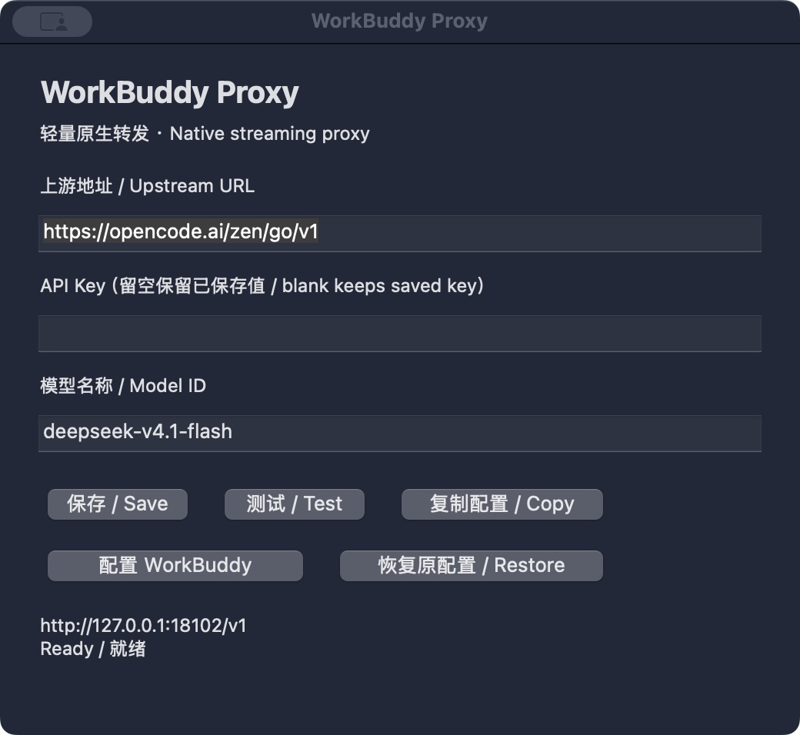

# WorkBuddy Proxy

专门给 WorkBuddy 使用的轻量模型代理。Rust 转发核心，Windows Win32 / macOS AppKit 原生界面，设置界面按需启动，后台只常驻转发核心。首版支持 OpenAI Chat Completions 与 OpenCode Go。



目标是**更少的常驻内存、更低的转发开销**。本项目不声称在所有平台、所有负载下“全球最小 / 最快”；每次 CI 都构建真实可执行文件、运行冒烟测试并记录可复现的内存与延迟数据。

## 使用

从 [Releases](https://github.com/gloryhui/workbuddy-proxy/releases) 下载与你的系统对应的包。测试与开发中的文件也会出现在 [Actions](https://github.com/gloryhui/workbuddy-proxy/actions) 的构建附件里。

- Windows 10/11 x64：解压，双击 `workbuddy-proxy.exe`，直接显示原生设置窗口。窗口打开时提供托盘菜单；关闭窗口会退出界面进程，核心继续运行，再次双击打开设置。
- macOS 12+：解压，将 `WorkBuddy Proxy.app` 拖到“应用程序”，双击启动。关闭设置窗口后界面进程退出，转发核心继续运行；再次双击可重新打开设置。
- 无需安装 Rust、Python、Node 或额外 WebView 运行时。

1. 填写上游地址、你自己的 API Key 和模型名，点击保存。默认上游为 `https://opencode.ai/zen/go/v1`，默认模型为 `deepseek-v4.1-flash`。
2. 测试连接。测试会向你配置的上游发送一个小请求。
3. 点击“配置 WorkBuddy”。程序先备份 `models.json`，仅添加或替换同 ID 模型，保留其他配置。
4. 重新打开 WorkBuddy 模型设置，必要时重启 WorkBuddy，在聊天中选择 `WorkBuddy Proxy · 模型名`。

也可点击“复制配置”，手动向 WorkBuddy 添加自定义模型。接口地址默认 `http://127.0.0.1:18080/v1`，API Key 填本工具生成的**本地连接码**，不填上游订阅 Key。工具调用默认开启；图片和思考能力默认关闭，确认上游模型支持后再开启。

“恢复配置”只恢复本工具改动的模型。如果该模型后来被其他操作修改，程序拒绝覆盖，并保留备份供手动恢复。备份位于 WorkBuddy 配置旁，名称为 `models.json.workbuddy-proxy-时间戳.bak`。

## 轻量设计

| 部分 | 选择 |
| --- | --- |
| 网络核心 | Rust、单线程 Tokio I/O 调度器、Axum / Hyper、Reqwest |
| TLS | 系统原生 TLS 和证书验证 |
| Windows UI | Win32 标准控件和托盘 |
| Mac UI | AppKit 标准控件和菜单栏 |
| 响应 | 流式直通、背压、取消时释放上游流 |
| 请求 | 原始 JSON 字节传递；借用字段，仅为会话识别读取必要信息 |
| 并发 | 4 个在途请求；忙时返回本地 HTTP 429，不排队堆积 |
| 请求体 | 每个最多 8 MiB，输入读取最多 30 秒 |
| 会话缓存 | 最多 64 个会话，每个最多 128 个消息哈希；24 小时不活跃后按需清理 |
| 上游连接 | 每个主机最多保留 2 个空闲连接，60 秒空闲后清理 |

没有内置浏览器、前端框架、数据库、自动更新器、遥测、聊天日志或响应重写。同一个可执行文件包含核心和设置界面：后台常驻 1 个核心进程，打开设置时暂时增加 1 个原生界面进程，关闭窗口释放整份 UI 内存。运行时不进行模型目录同步和后台余额轮询。

对于 OpenCode Go，发送本工具自己的 User-Agent，并补齐 `x-opencode-session`。优先读取客户端会话头，缺少时根据聊天历史前缀推断；不同会话不会共用一个全局固定值。相同开场历史的独立聊天可能被归为同一会话；超过缓存窗口、历史压缩和服务重启可能产生新的上游会话。这影响路由 / 缓存，不会混合或交换聊天内容。使用范围与额度以 [OpenCode Go 官方说明](https://opencode.ai/docs/go/) 为准。

## 验证和性能

参见 [设计与性能边界](docs/ARCHITECTURE.md)。基准脚本测量进程 RSS、直接 / 代理的本地请求延迟、4 并发 1 MiB 输入的采样峰值。**本地 HTTP mock 数据不等于真实 TLS、互联网、模型响应或 Windows 人工验收。**

[首版原始性能记录](docs/PERFORMANCE.md)：无界面核心空闲约 Mac 6.23 MiB / Windows 8.61 MiB；打开原生界面时的总占用另列，关闭窗口后释放界面进程。

```sh
cargo test --locked
cargo clippy --locked --all-targets -- -D warnings
cargo build --release --locked
python3 scripts/smoke.py --exe target/release/workbuddy-proxy
python3 scripts/benchmark.py --exe target/release/workbuddy-proxy --output bench-results/local.json
```

Windows 将二进制路径改为 `target/release/workbuddy-proxy.exe`。添加 `--gui` 可测量原生窗口打开时的整个进程。测试脚本只用假 Key 和临时目录，Python 仅为开发 / 验证工具，发布程序不依赖 Python。

## 配置与启动诊断

- Windows：`%APPDATA%\WorkBuddyProxy`
- Mac：`~/Library/Application Support/WorkBuddyProxy`
- Linux（仅无界面开发 / 测试）：`~/.config/workbuddy-proxy`

`config.json` 以本地明文保存上游 Key 和本地连接码。Unix 目录为 0700、配置文件为 0600；Windows 使用当前用户配置目录的默认权限。目录、文件和备份均不要打包分享。只分发官方发布 ZIP，每位使用者填写自己的 Key。

服务仅监听 `127.0.0.1`，校验请求 Host、Origin 和本地 Key；原生界面通过独立管理令牌访问本机控制接口，控制连接不经过系统代理；上游重定向关闭，保留 TLS 验证。订阅 Key 仅发往配置的上游。请求和响应内容不写日志，启动日志最多约 64 KiB；核心与界面分别使用操作系统文件锁。关闭设置不重启核心，也不清空聊天会话缓存。

命令行：`workbuddy-proxy --headless --port 18080 --config-dir <私有目录>`。默认端口冲突会报错，不静默换端口，以免 WorkBuddy 指向错误地址。Windows 包含 `Diagnose.cmd`，原生启动失败也会显示错误框。正常退出会取消在途请求。

上游 429 / 401 / 403 原样返回，不自动重试、换模型或切换计费产品。单次读取上游数据的空闲超时为 180 秒。API 仅覆盖 `/v1/chat/completions` 和本地单模型 `/v1/models`，不包含 Responses、Anthropic 协议转换或 MCP。

Mac 发布包目前仅 ad-hoc 签名，未做 Developer ID 公证；Windows 文件未做 Authenticode 签名。系统可能提示未知开发者。没有自动移除隔离属性或关闭安全保护的脚本。

## 开发与许可

构建需要 Rust 1.88+ 和平台 C 编译器。Mac 使用 Xcode 命令行工具，Windows 使用 MSVC Build Tools。CI 使用 Cargo.lock 锁定依赖，Windows 静态链接 CRT。

MIT License。第三方项目，与 WorkBuddy、腾讯、OpenCode 无隶属关系。
