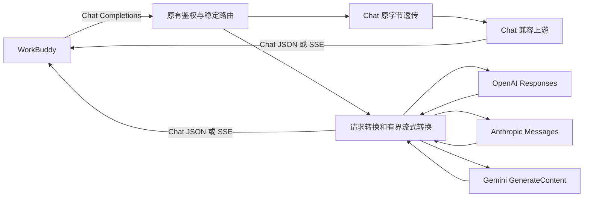

# WorkBuddy 多协议兼容开发任务书

本任务把 WorkBuddy Proxy 扩展为上游多协议适配器：WorkBuddy入口和返回固定为OpenAI Chat Completions，上游增加Responses、Anthropic Messages、Gemini GenerateContent。须覆盖智能体连续工具循环。

2026-10-16用户已授权Codex直接接手goal，不再交给dsh。统计和固定分页已合入本地main（40ec917）。协议实现位于`/Users/glory/.codex/worktrees/upstream-protocols/workbuddy-proxy`，分支`codex/upstream-protocols`；旧`protocol-compat` worktree仅留作设计原件，不在旧基线施工。

当前版本仍0.5.3，管理协议7，统计schema 4。本地提交/测试/合并已授权，不推送、不发布、不安装。各阶段真实进展以[实施状态](IMPLEMENTATION-STATUS.md)为准，本地验证与真实供应商验收分别记录。使用方式见 [USAGE.md](USAGE.md)，验证见 [FINAL-VALIDATION.md](FINAL-VALIDATION.md)。

## 阅读顺序

1. [实施状态](IMPLEMENTATION-STATUS.md)：已完成的真实工作、测试和下一步。
2. [需求与边界](REQUIREMENTS.md)、[架构与配置](ARCHITECTURE.md)、[转换契约](CONTRACTS.md)。
3. [官方依据](SOURCES.md)：REST字段和思考/结构化输出的核对依据。
4. [旧协作设计](PARALLEL-WORK.md)：仅参考接口边界，最新用户接手授权优先；当前没有启动DeepSeek或子agent。

设计原件曾引用尚未建立的执行提示/机器验收清单/统计接入文件；以当前实施状态所列待办为准，后续随真实实现补齐，不能把设计清单存在与否当运行测试通过。

## 固定方案



供应商选择上游协议。WorkBuddy 配置只感知本地 Chat URL 和可用能力，不感知上游原生协议。Gemini 本次特指 API Key 认证的 GenerateContent REST；官方已出现更新接口，不把 Interactions、Vertex AI 或 Live API 混入本任务。

## 启动与继续

统计前置已满足。当前由Codex在上述协议worktree继续，不启动DeepSeek、不创建新聊天。

继续已有实现时发送：

```text
继续实现 WorkBuddy Proxy 多协议兼容。只在协议 worktree 工作。
先读取 docs/protocol-compat/IMPLEMENTATION-STATUS.md、README.md 和本目录全部契约，
核对 git 状态、实际代码与最新测试结果，从第一个未完成门禁继续。
固定 WorkBuddy Chat Completions 入口，保留 Chat 透传，完成三个原生上游适配器和工具闭环。
不要把未验证项目、Mock 结果或被跳过的测试写成真实 WorkBuddy/供应商通过。
```

测试入口和证据以实施状态为准；文档结构检查不等于业务验收。
