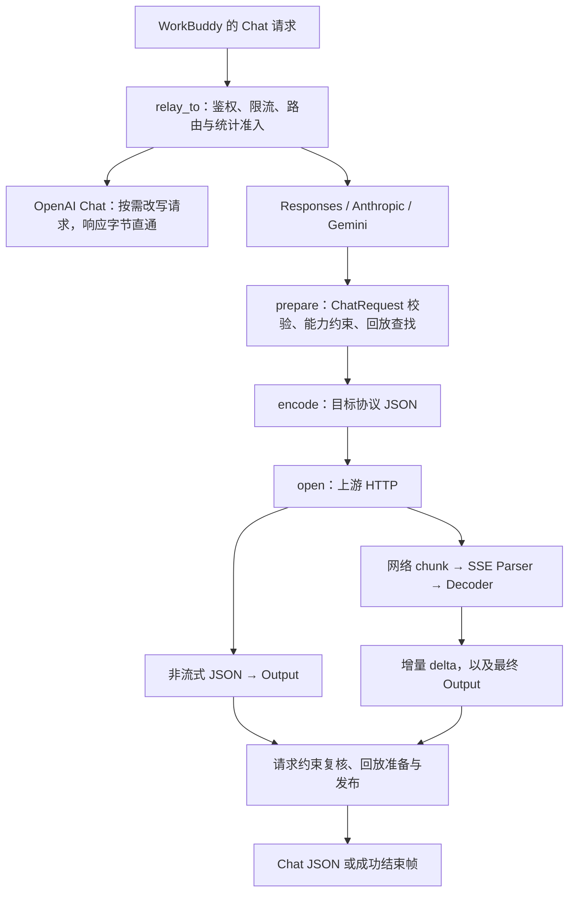

# 协议转换：从一次 Chat 请求读懂适配链

本文接在 [服务核心流程](SERVICE_CORE.md) 之后，面向熟悉 Java / Spring Boot、初次接触 Rust 的开发者。先建立完整链路，再分别进入请求、响应与工具回放专题：

1. [请求校验与上游编码](PROTOCOL_REQUEST.md)。
2. [响应归一与流式状态机](PROTOCOL_RESPONSE.md)。
3. [多轮工具调用与回放缓存](PROTOCOL_REPLAY.md)。

这组导读解释当前源码怎样实现转换。实际支持范围与拒绝规则分别查 [使用说明](../protocol-compat/USAGE.md) 和 [转换契约](../protocol-compat/CONTRACTS.md)；不能由一个函数的存在推断它支持供应商的全部 API。

源码中的 `native` 指供应商自己的 API 消息格式，例如 Anthropic 的 content blocks，并不是 Java 的 JNI 或本地机器指令。`opaque` 指代理为后续调用保留、不会作为普通 Chat 字段公开的不透明数据，例如签名和加密推理块。`replay` 则指下一轮请求恢复这些原生历史；它不表示重新发送上一次 HTTP 请求。

## 1. 先分清调用方向

WorkBuddy 发给本地代理的是 Chat Completions。供应商配置中的 `protocol` 决定代理使用哪一种上游协议：



流式路径在校验过程中就可能交出部分文本或工具参数；图中的终点只表示最后收尾。后续发生错误时，已经交出的增量无法收回，但仍不能补发成功结束帧。

主要 HTTP 接线位于 [src/proxy_native.rs](../../src/proxy_native.rs)。它通过 `#[path]` 作为 `proxy::native` 模块编译，因此源码文件名与 Rust 符号路径不同。断点和测试过滤器应使用实际模块名。

## 2. 按 Java 经验理解分层

| 熟悉的 Java 概念 | 本项目对应位置 | 阅读时必须确认的区别 |
| --- | --- | --- |
| Controller / 外部调用服务 | `proxy::native::relay`、`prepare`、`open` | 这里管理 HTTP、取消、响应流和统计守卫；纯协议模块不负责发网络请求 |
| 请求 DTO 与校验器 | `ChatRequest`、`strict_json`、消息与工具历史校验 | DTO 是代码显式构造的；未知字段、重复 JSON key、不可转换的历史都有拒绝路径 |
| 按类型选择的适配器 | `encode::encode`、`output::decode` | 用枚举 `match` 选择实现，没有 Spring 扫描或自动注入 |
| 每次请求的状态对象 | `sse::Parser`、`streaming::Decoder` | 每条响应各有状态，不能放成多个响应共同修改的全局解析器 |
| 回调 / 流消费者 | `NativeStream::next` 与 `stream::unfold` | 下游轮询驱动上游读取；一个异步函数不会自动创建一条线程 |
| 进程内缓存 | `replay::Cache` | 保存原生 assistant 状态与 ID 对照，受路由代次、历史绑定和容量约束，不是数据库 |

`Result<T, Error>` 表示这一步可以失败。`?` 把失败交给当前函数的调用方，不会自动回滚已经发送的 HTTP 或已经交出的流式增量。必须继续追踪调用者怎样把错误变成 HTTP 响应、SSE 错误事件及统计终态。

## 3. 源码地图与数据对象

| 文件 | 主要对象 / 函数 | 上游 → 下游 |
| --- | --- | --- |
| [mod.rs](../../src/protocol/mod.rs) | `Error`、`envelope` | 协议校验失败 → 安全错误信封 |
| [config.rs](../../src/protocol/config.rs) | `UpstreamProtocol`、`ProtocolSettings` | 已保存设置 → 端点、鉴权与思考参数约束 |
| [request.rs](../../src/protocol/request.rs) | `ChatRequest`、`Message`、`Part`、`ToolCall` | Chat JSON → 统一语义模型 |
| [encode.rs](../../src/protocol/encode.rs) | `encode`、`ReplayTurn`、`ResolvedHistory` | 语义模型 + 历史 → 目标协议 JSON |
| [output.rs](../../src/protocol/output.rs) | `Output`、`Identity`、`Finish` | 原生完整响应 → Chat message 与结束原因 |
| [sse.rs](../../src/protocol/sse.rs) | `Parser`、`Frame`、`Event` | 字节 → 完整 SSE 帧 → 事件名与 data |
| [streaming/mod.rs](../../src/protocol/streaming/mod.rs) | `Decoder`、`Step`、`Common` | 原生事件 → Chat delta、协议状态与最终输出 |
| [streaming/responses.rs](../../src/protocol/streaming/responses.rs) | Responses 状态机 | Responses 事件及完成快照 → 公共状态 |
| [streaming/anthropic.rs](../../src/protocol/streaming/anthropic.rs) | Anthropic 状态机 | message / content block 事件 → 公共状态 |
| [streaming/gemini.rs](../../src/protocol/streaming/gemini.rs) | Gemini 状态机 | candidate、parts 与结束原因 → 公共状态 |
| [usage.rs](../../src/protocol/usage.rs) | `Usage`、`normalize`、`merge_cumulative` | 供应商计数 → Chat usage 与统计用量结果 |
| [replay.rs](../../src/protocol/replay.rs) | `Pending`、`Cache`、历史摘要 | 原生工具状态 → 后续请求可使用的历史关联 |

`protocol/config.rs` 由根入口作为 `upstream_config` 加载，再由 `protocol::config` 重新导出。看到两个路径时，应理解为模块别名，而不是两套不同的协议配置。

沿请求方向会依次遇到这些对象：

```text
请求 body 字节
  → ChatRequest：已验证、拥有自己的字符串和容器
  → ResolvedHistory：消息下标 → Arc<ReplayTurn>
  → serde_json::Value：待发送的原生 JSON
  → Prepared.body：有大小上限的序列化字节
```

沿响应方向则是：

```text
JSON：字节 → parse_json / decode → Output → Chat JSON

SSE：字节 → Parser → Frame → Event → Decoder.event → Step.delta
                                      ↓ 传输干净结束后
                                Decoder.finish → Output
```

`Frame::into_event(self)` 消费帧的所有权；`Decoder::event(&mut self, ...)` 更新当前响应的解析状态；`Decoder::finish(self)` 消费解析器，结束这次转换。它们在函数签名中就表达了“谁还能继续使用当前对象”。

## 4. 跟踪请求时，先问哪些信息会被保留

`prepare` 先解析客户端 Chat 请求，再应用选定路由的思考配置、目录/手工能力约束及输出上限。请求里的模型字符串结合路径作用域用于路由选择，可以是别名、安装标识或允许的实际模型名；归属和歧义由 `Routes::resolve` 检查。实际发往上游的模型由选中的连接提供。

这里的转换要处理语义差异。例如：

- 系统、开发者、用户、assistant、tool 消息在目标协议中的位置不同。
- 工具声明、调用和结果必须分别转换；同名工具的两个调用仍由不同 ID 区分。
- `max_tokens` 与 `max_completion_tokens` 被统一后，还要与目标协议和配置约束一起解释。
- 图片可能以 data URI 或远程 URL 表达；是否能发送取决于适配器和能力规则。
- 本地的思考强度需要显式配置映射；不能因为各 API 都有类似字段就假定取值可直接复用。

具体字段表、失败路径和合成示例在 [请求专题](PROTOCOL_REQUEST.md)。初读时先跟一条普通文本请求，再跟一条完整的工具结果历史；第一遍无需同时理解图片、schema 和全部思考 profile。

## 5. 跟踪响应时，区分四种“结束”

| 观察点 | 负责位置 | 意义 |
| --- | --- | --- |
| 一帧结束 | `Parser` / `Frame` | 可以交给协议解析器的一段 SSE 数据已完整 |
| 原生协议给出结束信息 | 三种协议状态机 | 可以检查终态，或开始等待传输收尾；尚不能直接认定客户端成功 |
| 上游干净 EOF，解析和最终校验通过 | `NativeStream::next`、`Decoder::finish` | 可以准备最终 Chat 结束帧与回放状态 |
| 成功 `[DONE]` 被代理流交给 HTTP body 层 | `NativeStream::next` | 提交相应完成状态和交付标记；仍不是客户端 socket 收到的证明 |

网络一次返回的 chunk 可能不足一帧，也可能包含很多帧；一个原生事件也可能产生需要切片发送的 Chat delta。每层保留自己的未消费状态，避免把整条响应先读完再向下游发送。

`usage` 是另一条观察线。正文转换成功不要求供应商必须提供完整用量。`None`、缺失字段和未知计数不能被填成 0；原生 usage 归一结果与 `RequestGuard` 的统计终态也有各自职责。

## 6. 多轮工具为什么要再读回放专题

客户端保留标准 Chat 的 `tool_calls` 与 `tool_call_id`，但部分上游还需要原生调用 ID、签名、加密推理或完整 assistant blocks。公开的 Chat 结果不能完整表达这些字段。

回放缓存保存 `ReplayTurn`，把对外生成的工具 ID 关联到原生状态。下一轮到来时，`Cache::resolve` 同时核对路由代次和可见历史绑定，然后把 `Arc<ReplayTurn>` 交给编码器。找不到状态或历史不匹配时有明确错误，不能从其他供应商或另一段历史猜出替代状态。

这不是请求重试、HTTP 重放或对话持久化。有效 EOF 后发布缓存、客户端取消时撤销尚未交付状态、活动请求仍持有缓存对象时怎样计算预算，见 [回放专题](PROTOCOL_REPLAY.md)。

## 7. 排错与阅读练习

| 现象 | 先查哪里 |
| --- | --- |
| 请求还没发上游就被拒绝 | `ChatRequest::parse → prepare → encode`，记录结构路径与错误码 |
| 上游 HTTP 成功但非流式转换失败 | `validate_headers → output::parse_json → Output::validate_request` |
| 已输出文字，随后报流不完整 | `Parser::finish`、`Decoder::finish`、终态后超时与网络错误分支 |
| 文本重复或工具参数错位 | `Common` 的前缀核对、工具 ID / index、三种协议事件顺序 |
| 第二轮工具调用报状态过期 | `Cache::resolve` 的路由、TTL、淘汰与历史绑定 |
| 正文成功但统计用量未知 | `usage::normalize → Usage::outcome`，再跟统计字段 |

协议错误对象只保存静态错误码、结构路径和状态码，不复制原始对话或凭据。HTTP 状态已经发送后，流内失败不能把先前的 HTTP 200 改成 502；此时要同时看 SSE 错误、成功结束帧是否缺失，以及统计终态。

建议完成三个练习：

1. 从一个合成的单轮文本请求，标出 `ChatRequest`、目标 JSON、`Output` 和 Chat 响应分别在哪生成。
2. 把一个 SSE 帧拆成两个网络 chunk，指出 parser 保留了什么；再把两帧合成一个 chunk，指出调用者如何保存余量。
3. 跟一次工具调用的两轮交互，标出公开 ID、原生 ID、历史摘要、缓存发布和第二轮查找的位置。

测试入口在三个专题中分别列出。运行时遵循 [按风险验证规范](../CODEX_FAST_WORKFLOW.md)；已有单测用于理解具体契约，不能代替真实供应商、WorkBuddy 工具执行器或跨平台验收。
