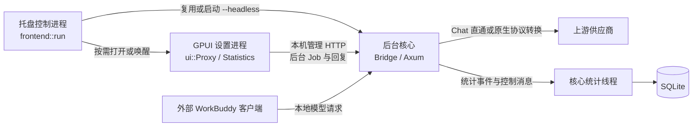

# 从 Java / Spring Boot 进入 WorkBuddy Proxy 源码

这份导读面向会写 Java / Spring Boot、第一次接触 Rust 的开发者。目前覆盖服务与界面的核心骨架、协议转换和统计持久化：应用怎样启动，配置怎样变成路由，界面操作怎样进入核心，一次请求怎样转换与返回，以及统计怎样在旁路入队、落库和恢复。阅读时把代码中的中文注释与本文对照；定价、查询聚合、历史导入和自动更新的深层算法，留作后续专题。

## 先建立项目地图

本项目是本机桌面代理。WorkBuddy 是调用代理的外部客户端，GPUI 是代理自己的设置界面。区分这两个客户端，才能理解“聊天请求”和“管理请求”为什么走不同入口、使用不同的令牌。

| 部分 | 源码入口 | 可以借助的 Java 经验 | 本项目的具体边界 |
| --- | --- | --- | --- |
| 核心程序 | [src/main.rs](../../src/main.rs)、[根 Cargo.toml](../../Cargo.toml) | 应用启动与资源装配 | 启动参数决定进入后台核心、桌面控制或更新辅助模式 |
| HTTP 服务 | [src/proxy.rs](../../src/proxy.rs) | Router / Controller / Service | `Bridge` 汇集共享状态，Axum 路由调用处理函数；依赖由代码显式构造 |
| 配置与持久化 | [src/config.rs](../../src/config.rs) | 配置对象、DTO、持久化工具 | JSON 配置、内存配置和已生成的路由表各有更新时机 |
| 协议转换边界 | [src/proxy_native.rs](../../src/proxy_native.rs) | 外部服务适配层 | Chat 直通与原生协议转换走不同路径，不能把所有响应都当透传 |
| 协议语义与状态机 | [src/protocol/](../../src/protocol/) | 请求 DTO、协议适配器、流解析状态与缓存 | 严格校验 Chat 输入，按目标协议编码，归一输出；工具回放保存原生状态与公开 ID 的关联 |
| 统计协调 | [src/stats/mod.rs](../../src/stats/mod.rs)、[event.rs](../../src/stats/event.rs) | 事件采集、后台写入、查询服务 | 转发持有请求守卫，统计通过队列与数据库读写线程协作 |
| 桌面控制与托盘 | [src/frontend.rs](../../src/frontend.rs)、[platform.rs](../../src/platform.rs)、[gpui_host.rs](../../src/gpui_host.rs) | 启动器与平台桥接 | 常规桌面模式会复用或启动后台核心，再管理托盘和设置窗口 |
| 设置界面 | [gpui/src/main.rs](../../gpui/src/main.rs)、[ui.rs](../../gpui/src/ui.rs) | 客户端入口、页面状态、事件处理 | 是另一份 Cargo 工程；GPUI 实体由界面上下文访问，管理操作经后台任务调用核心 |
| 界面后台任务 | [gpui/src/backend.rs](../../gpui/src/backend.rs)、[stats_backend.rs](../../gpui/src/stats_backend.rs) | 客户端任务队列、HTTP 客户端 | 普通配置任务与统计调度器各自维护请求、回执及结果应用规则 |

`gpui/src/main.rs` 中的 `#[path = "../../src/config.rs"]` 表示编译时复用源码。两个可执行程序会分别拥有自己的配置对象；它们没有因为使用同一个 Rust 文件就共享堆内存。运行时控制通过本机管理 HTTP、实例记录及相关状态文件衔接。

桌面模式应分三个角色阅读：托盘控制进程、后台核心进程、按需打开的 GPUI 设置进程。不是每种平台或启动方式都同时运行这三个角色；例如 `--headless` 直接进入核心路径，Linux 在根入口中选择无界面路径。具体创建与复用条件看 `main::run` 和 `frontend::run`。



图中是角色与主要关系，不是每条请求的完整时序。统计读写线程的分工，以及窗口唤醒和版本替换分支，分别在两份核心流程文档中展开。

## 推荐阅读顺序

1. 先读 [Rust 与 Java 对照](RUST_FOR_JAVA.md)。只需先理解所有权、借用、`Option`、`Result`、`Arc` 和异步任务，就能开始跟踪代码。
2. 读 `src/main.rs` 的 `main → run`，把参数分支、实例锁、监听器、`Bridge`、网络线程和退出顺序画在纸上。
3. 读 `src/config.rs` 的 `Config / Provider / Model / Connection`，分清持久化对象与运行时投影；再跟到 `Bridge::new` 和 `Bridge::routes`。
4. 按 [服务核心流程](SERVICE_CORE.md) 跟踪 `relay_to`，分别进入 Chat 直通与 `proxy::native::relay`；第一遍不必钻进每一种协议的状态机。
5. 读 `gpui/src/main.rs → ui::Proxy::new`，再按 [界面核心流程](UI_CORE.md) 跟一次保存操作，直到核心响应被合并回界面状态。
6. 按 [统计持久化导读](STATS_PERSISTENCE.md) 读 `RequestGuard → EventQueue → stats-writer → SQLite`，分清终态发布、事务提交和故障修复，再跟统计页的调度与过期回复过滤。
7. 需要理解协议细节时，进入 [协议转换总览](PROTOCOL_CONVERSION.md)，依次跟请求、响应与多轮工具回放。
8. 最后用下方的练习验证理解；遇到具体专题再进入现有统计和更新文档。

每到一个函数，先问六件事：谁调用它；输入是谁产生的；当前在哪个进程或线程；它修改什么状态；错误由谁处理；结果最后给谁使用。

## 用两条链路把服务与界面接起来

### 保存供应商：管理请求

先在 `ui.rs` 找 `save_steps`、`save` 和任务发送位置，观察界面输入怎样变成 `Draft` 与命令列表。再到 `backend.rs` 看任务逐步执行、`call_detailed` 读取 `instance.json` 并发送管理 HTTP。到服务侧跟 `proxy::action → Bridge::command → command_inner`，确认配置、路由与返回值分别何时更新。

返回界面后，还要继续找回执消费逻辑：收到 HTTP 成功，并不意味着所有输入框都可以无条件被磁盘配置覆盖。`config_refresh`、供应商创建结果和连接测试结果都有各自的状态合并规则。用户可能已经继续编辑，也可能发生“保存成功、后续同步或重启失败”。

新供应商创建还经过 `provider_create::commit`。它区分明确失败和执行结果不确定，避免把网络异常简单当作“核心肯定没有保存”。读这一支时，把本地草稿身份与核心保存后的供应商身份分别记下来。

### 聊天请求：转发与统计

从 `Bridge::routes` 找聊天入口，跟到 `relay_to`。沿途记录本地鉴权、并发许可、请求体限制、模型路由和上游协议分支。Chat 路径返回上游流的同时进行有界统计观察；原生路径需要解析、转换和终态校验。

统计守卫不是“返回 HTTP 头就记一次成功”。响应体可能还没有读完，可能在中途失败，也可能被下游取消。继续看响应流持有的许可和 `RequestGuard`，以及它们在完成、错误、释放和进程关闭时的处理。随后再看事件如何交给统计线程写入 SQLite。

最后从 `Statistics` 发起查询，沿 `StatsScheduler → 本机管理 API → 核心查询 → StatsReply → 回复门禁` 回到界面。查询结果必须仍属于当前筛选、页面和查询身份，才适合显示。

## 先分清几组容易混淆的状态

| 状态 | 维护位置 | 阅读时要确认的问题 |
| --- | --- | --- |
| 已保存配置 | `Config`、`config.json` | 是当前核心使用的配置，还是界面刚读到的磁盘快照？ |
| 未保存草稿 | `Draft`、`Drafts`、`gpui-drafts.json` | 用户是否仍在编辑，外部刷新是否应保留它？ |
| 可用路由 | `Bridge` 中生成的路由结构 | 保存后新请求如何选路，已开始请求是否继续持有旧路由？ |
| 运行实例记录 | `instance.json` | 端口和管理令牌是否属于仍在运行的核心？记录存在不等于进程健康 |
| 请求终态 | `RequestGuard`、`Outcome` | 上游结束、协议结束、下游取消、核心退出分别怎样分类？ |
| 统计事实与查询 | 核心统计模块、SQLite、统计 DTO | 未知值是否仍为未知，当前查询是否过期，故障是否影响转发？ |

管理令牌和代理访问令牌用途不同。阅读示例和排错时使用合成凭据，不把配置中的实际 Key、实例管理令牌或对话体复制进日志与学习材料。

## 开发启动与验证入口

纯阅读不必启动软件。需要断点跟踪时，先选一个独立开发配置目录；下面两处占位符必须替换成同一个实际目录，避免读取或修改日常使用的数据。

```sh
# 终端一：只启动核心；保留此终端以便观察和结束该次开发运行。
cargo run --locked -- --headless --config-dir "<独立开发配置目录>"

# 终端二：仅在支持桌面界面的环境中启动设置程序。
cargo run --manifest-path gpui/Cargo.toml --locked -- --config-dir "<同一个独立开发配置目录>"
```

界面入口要求核心已写出实例记录。构建环境、原生依赖与平台差异仍以仓库现有配置为准；以上是启动入口，不代表真实上游或跨平台行为已经验收。需要发起模型请求时，优先使用本地 mock 与合成数据。

以下现有测试适合结合源码学习。运行前按实际改动选择相关项，注释变更遵循 [L0 验证规范](../CODEX_FAST_WORKFLOW.md)，不要求例行全量编译：

```sh
# 核心：路由、流终态、配置替换。
cargo test --locked grouped_routes_share_credentials_and_reject_ambiguity
cargo test --locked native_cancellation_never_claims_a_valid_terminal
cargo test --locked atomic_replacement

# 界面：结果不确定、部分成功、过时回复与草稿保留。
cargo test --manifest-path gpui/Cargo.toml --locked port_restart_occurs_only_after_success_and_keeps_committed_state_on_restart_failure
cargo test --manifest-path gpui/Cargo.toml --locked a_stale_reply_cannot_overwrite_a_newer_read
cargo test --manifest-path gpui/Cargo.toml --locked external_save64_refreshes_clean_selection_without_replacing_another_dirty_draft
```

测试名体现的是各测试覆盖的契约，不能由某个单测通过推断整个桌面交互或真实供应商已验证。涉及进程、更新、数据库或持久化修改时，按项目规范提高验证等级，并使用隔离数据。

## 能否上手：用这些问题自查

读完核心注释后，应当能在代码中指出以下问题的答案，而不只是复述模块名：

1. 关闭设置窗口为什么不等于退出后台代理？正常桌面启动是谁拉起核心？
2. 修改供应商后，哪些是草稿，哪些已落盘，路由什么时候更新？
3. 一个聊天请求在哪里鉴权、选路、获取并发许可？许可活到什么时刻？
4. 为什么收到上游响应头不能直接认定流式请求成功？
5. 统计解析失败、数据库不可用与聊天转发分别会发生什么？
6. 为什么旧查询回复不能覆盖新筛选结果？为什么切页不能随便取消已授权的写操作？
7. 一次多步骤保存失败时，怎样判断哪些动作已经发生，哪些动作不应该自动重试？

## 当前覆盖与后续专题

源码注释覆盖服务入口、配置、转发边界、会话、端口切换、统计协调/事件/采集/持久化恢复，以及 GPUI 启动、主状态、任务、草稿与统计控制。协议专题进一步展开严格请求解析、三协议编码、JSON/SSE 响应归一、用量和工具回放。不是每个子模块和平台分支都已写成教学材料。

后续可按需求继续深入：

- [协议转换源码专题](PROTOCOL_CONVERSION.md)：请求编码、输出归一、SSE 分帧、各协议状态机和回放绑定；具体支持范围对照 [使用说明](../protocol-compat/USAGE.md) 和 [契约](../protocol-compat/CONTRACTS.md)。
- [统计持久化源码专题](STATS_PERSISTENCE.md)：双槽预约、请求守卫、SQLite 事务、迁移、故障修复和关闭边界；查询与定价继续从 [统计实现入口](../statistics/DEVELOPMENT.md) 阅读。
- [WorkBuddy 用量导入](../workbuddy-import/README.md)：文件读取、归属、去重、检查点与 ACK。
- [桌面应用](../DESKTOP.md)、[更新与恢复](../AUTO-UPDATE.md)：平台桥接、窗口生命周期、安装与更新。

接口版本请查 [`CONTROL_PROTOCOL`](../../src/main.rs)、[`API_VERSION`](../../src/stats/dto.rs) 和 [`SCHEMA_VERSION`](../../src/stats/store.rs) 的实际定义。发布版本、控制协议、统计 API 与数据库 schema 是不同维度，不应互相替代。
