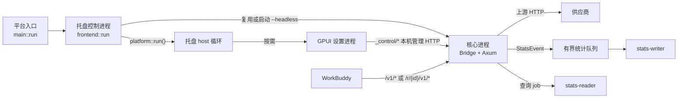

# WorkBuddy Proxy 服务核心源码流程

本文面向熟悉 Java / Spring Boot、第一次阅读 Rust 的开发者，串联当前服务核心的真实入口、线程和调用关系。阅读目标是能回答：

- 桌面常规启动怎样进入托盘控制进程，再复用或启动 headless 核心；
- 配置文件怎样加载、校验、投影为路由，并在保存或换端口时更新；
- 一次 Chat 请求怎样鉴权、选路、直通或转换，响应流何时结束；
- 上游失败、协议失败、客户端取消和进程关闭为什么不能混为一类；
- 统计事件怎样从请求任务进入有界队列，再由 writer 落库、reader 查询。

版本语义以代码常量为准：

- [控制协议常量](../../src/main.rs)：`CONTROL_PROTOCOL`，核心与桌面控制器的管理命令兼容性；
- [统计数据库 schema](../../src/stats/store.rs)：`store::SCHEMA_VERSION`；
- [统计 API](../../src/stats/dto.rs)：`dto::API_VERSION`。

发布版本、控制协议、统计 API 与 SQLite schema 是不同维度。其他概览文档中的静态版本文字可能落后，不应复制它们作为当前值。

## 1. 先建立进程、线程和所有权地图

桌面常规启动不是一个“二选一进程”问题，而是一条可能包含三个角色的链：



角色的实际数量取决于平台和参数。普通 `--headless` 直接进入核心；Linux 等没有内置图形入口的平台也会固定走 headless。桌面常规入口由 `frontend::run` 承担托盘控制，真正负责模型请求的是它复用或启动的 headless 核心。GPUI 设置窗口按需存在，不应仅凭窗口是否打开判断核心是否运行。

`frontend.lock` 约束托盘 controller；GPUI 设置进程使用自己的 `gpui.lock` 实例锁与
`gpui-wake.json` 唤醒路径。关闭设置窗口不会释放或结束托盘 controller。

还需要分清两个容易混淆的入口：

- [frontend::run](../../src/frontend.rs) 启动托盘控制角色：取得 `frontend.lock`，复用或启动核心，再调用 `platform::run()`；
- [frontend::spawn](../../src/frontend.rs) 没有传 `--headless`，它拉起的是常规图形入口，随后仍会进入托盘控制路径。不要把它解释成直接启动 headless 核心。

`platform::run()` 是托盘控制 host。关闭按需出现的 GPUI 设置窗口不会结束这个 host，也不会停止正在服务请求的核心。显式退出、版本替换等流程才会通过管理接口请求核心停止。

核心进程中的主要执行单元如下：

| 执行单元 | 所有权与职责 |
| --- | --- |
| 核心主线程 | 解析参数、持有 `instance.lock`、绑定监听器、创建 `Bridge`、等待 `proxy-io` 线程 |
| `proxy-io` 系统线程 | 创建 current-thread Tokio runtime，驱动 Axum、请求 future、上游流和后台维护任务 |
| `stats-writer` | 启动时创建，持有 SQLite 写连接，消费统计事件与控制消息 |
| `stats-reader` | 第一次查询时懒启动，持有另一条只读连接，空闲后退出 |
| 托盘控制进程 | 持有 `frontend.lock`、托盘 host、控制器运行时和 `Remote` |
| GPUI 设置进程 | 使用自己的 `gpui.lock`、`gpui-wake.json` 和界面状态，经管理 HTTP 联系核心 |

核心与托盘 controller 各自构造自己的 `Bridge`，并在各自进程内部把该值放进 `Arc` 共享。GPUI 是独立进程，经本机 HTTP 与状态文件协作；三方不是跨进程共享同一块 Rust 内存。`Bridge` 内不同字段分别由 `Mutex`、`RwLock`、原子量、`Semaphore` 或有界 channel 管理；`Arc<Bridge>` 不表示所有字段天然可以并发修改，也不构成多字段事务。

Rust 类比可以先这样建立：

- `Arc<T>` 接近一个可供多方共同持有的引用计数句柄，但内部 `T` 仍要自行提供并发规则；
- `Mutex<T>` 与 Java `synchronized` 都涉及互斥，但这里必须在源码里看锁守卫的实际作用域；
- `async` 表示可暂停的 future，`.await` 不等于创建线程；
- `Clone` 的具体代价取决于类型；`Arc::clone` 只增加共享句柄，不复制完整业务状态。

## 2. 启动：从参数到可接受请求

入口链路是：

```text
main::main
  -> main::run
  -> frontend::run                 # Windows/macOS 的常规图形启动
     -> 复用或 spawn --headless
  -> 核心 main::run                # --headless 或支持平台的后台子进程
     -> instance.lock
     -> config::Config::load
     -> TcpListener::bind
     -> proxy::Bridge::new
     -> config::write_json(instance.json)
     -> spawn(proxy-io)
```

`main::run` 先解析 `--headless`、`--autostart`、`--port`、`--config-dir` 和更新辅助参数。`--apply-update` 是短生命周期 helper，不属于模型代理服务路径。

Windows/macOS 的常规入口进入 [frontend::run](../../src/frontend.rs)。它依次处理：

1. 检查 GPUI helper 是否可用；
2. 取得 `frontend.lock`，同一控制角色不能让多个实例同时管理托盘；
3. 读取 `instance.json`，用管理 ping 判断记录对应的核心是否仍存活；
4. 用 `/health` 返回的发布版本和 `control_protocol` 判断是否可复用；
5. 不兼容时请求旧核心停止；
6. 复用存活核心，或用当前可执行文件加 `--headless` 启动新的核心；
7. 构造 `Bridge::for_controller`，启动仅用于控制器任务的 Tokio runtime；
8. 进入 `platform::run()` 托盘循环。

等待新核心时，代码执行固定次数的 sleep 轮询，并在每轮调用带超时的管理 ping。两个 sleep 之间的间隔不能直接相加成整个等待过程的严格上限，因为每轮 `alive` 自身还包含运行时创建、HTTP 连接和响应等待。超时也不能证明子进程从未启动；代码不会在这里盲目杀掉一个可能尚未发布 `instance.json` 的初始化进程。

核心启动的关键顺序在 [main::run](../../src/main.rs)：

1. 打开并独占 `instance.lock`。文件锁被占用时，当前进程只尝试联系已有实例；
2. 调用 `config::Config::load`，再应用命令行端口覆盖；
3. 同步绑定 `127.0.0.1` 监听器；端口冲突在这里成为启动错误；
4. 调用 `proxy::Bridge::new`。正常核心在这里创建 `StatsHandle::start`，启动统计 writer；
5. 写入 `instance.json`，记录实际监听端口和独立管理 key；
6. 启动 `proxy-io` 系统线程，在内部创建 current-thread Tokio runtime；
7. 把标准监听器转换为 `SwitchingListener`，让 Axum 服务与管理控制共享 accept 循环；
8. 同时启动价格目录周期任务和元数据预热任务。

`instance.json` 的 `management_key` 只用于本机管理端点，`Config.local_key` 才用于模型客户端访问本地 `/v1/*`。两者用途不同。

普通 headless 核心因 `headless == true`，不会执行 `main::run` 末尾的 `if !headless { platform::run(); ... }` 分支。它直接等待 `proxy-io` worker。不要把该分支理解成每个核心都会进入的桌面循环。

## 3. 配置：磁盘模型、内存快照和路由投影

配置主类型在 [src/config.rs](../../src/config.rs)：

- `Config` 保存本地 key、语言、端口、供应商和 WorkBuddy 安装审计；
- `Provider` 保存一个供应商共享的地址、协议、设置和凭据；
- `Model` 保存模型路由所需字段；
- `Connection` 是把 provider 与 model 合并后的运行时/展示投影。

`Config::load` 读取 `config.json`。文件缺失时创建默认配置；已有文件有大小上限；受支持的旧格式会在校验后迁移。缺少 `local_key` 时补齐。旧格式成功迁移时先复制备份，再通过单文件原子替换写回。

[config::atomic_write](../../src/config.rs) 的步骤是：

1. 在目标同目录创建唯一临时文件；
2. 写入全部内容；
3. 调用 `sync_all`；
4. 用 rename 或平台替换接口把临时文件变为目标；
5. 失败时尽力删除本次临时文件。

这提供的是单文件替换的局部保证，不是多个文件的联合事务，也没有目录 fsync 保证。断电等系统故障下的持久性不能由这段代码单独推出。

`Model.alias` 是持久化模型条目的内部兼容 alias。`Config::workbuddy_connections` 会生成一份 `Connection` 投影，并根据安装审计和冲突情况为投影生成可读 alias；这条路径不会把投影 alias 回写为 `Model.alias`。

保存供应商的调用链是：

```text
proxy::action
  -> Bridge::command
  -> Bridge::command_inner
  -> clone Config
  -> edit next snapshot
  -> next.validate()
  -> Routes::rebuild(&next, previous)
  -> config::write_json
  -> replace Bridge.routes
  -> replace Bridge.config
```

`Routes::rebuild` 在局部对象中构造新索引；失败时磁盘配置和旧内存快照保持不变。真正成功写入后，磁盘、路由和内存配置按代码顺序更新，不是跨资源的数据库事务。已开始的请求已经取得选定的 `Arc<Route>`，不会因为后续保存而切换成新路由。

`Provider::set_model_rows` 先解析局部模型列表，全部成功后才覆盖 `self.models`。它的复用顺序是稳定 route id、`(model, name)`、上游 model。这样可以尽量保留已有路由 id，但改名和其他字段组合仍可能影响匹配，必须以实现为准。

## 4. 请求：鉴权、选路、直通或转换

聊天入口由 [Bridge::routes](../../src/proxy.rs) 注册，最终进入 [proxy::relay_to](../../src/proxy.rs)。处理顺序如下：

1. `request.into_parts()` 分离 headers/URI 与 body；
2. 校验请求来自允许的本机 Host/origin；
3. 用 `Config.local_key` 校验 bearer key；
4. 非阻塞获取并发 permit；没有空位时立即返回 429；
5. 更新维护状态可能暂时拒绝请求；
6. 在超时和大小上限内读取 Chat body；
7. 解析 `model` 和 `stream`；
8. 根据 `/r/{id}` scope 与 model 解析唯一候选路由；
9. 路由成功后调用 `StatsHandle::begin`；
10. 检查 provider 是否已有上游 key；
11. native 协议进入 `proxy::native::relay`；
12. OpenAI Chat 路径按需推导 Go 会话 ID、注入 usage 请求、改写思考强度/alias，再调用 `Bridge::upstream`；
13. 把上游状态和筛选后的响应 headers 返回给客户端；
14. 响应 body future 同时持有 permit 和统计 guard。

前八步发生在统计 admission 之前。Host、local key、并发 permit、body、model 或路由失败不会新增统计行。admission 之后，缺失 provider key、请求改写失败、连接失败和协议失败会按具体分支写入相应终态。

### OpenAI Chat 路径

“直通”描述的是响应协议不经过 native 适配器，不表示请求完全原样发送。`rewrite_request` 可能：

- 把客户端选择的 alias 替换成上游 model；
- 应用路由配置的思考强度；
- 在统计配置允许时请求上游返回 usage。

无改写时它可以返回同一个 `Bytes`；只换 model 时保留其余原始字节；组合改写时重新序列化顶层对象，并尽量保留下层 `RawValue`。失败返回本地 400，guard 记录 rejection。

上游响应到达后，`forward_headers` 过滤 headers，Axum 返回同样的状态码。body 流逐 chunk 调用 `RequestGuard::observe`，然后把同一个 chunk yield 给客户端。permit 与 guard 随流存活；处理函数返回响应对象并不表示客户端已经收完。

### Go 会话

只有路由被识别为 OpenCode Go 时，`relay_to` 才解析 `session::Envelope` 并调用 [Sessions::resolve](../../src/session.rs)。

当前实现的优先级和返回值是：

1. 按 `x-opencode-session`、`x-workbuddy-session`、`x-conversation-id`、`x-session-id` 的顺序调用 `HeaderMap::get`；
2. 取一个能转成文本、非空、字节长度不超过 256 的值，对 `"header-name:value"` 计算 SHA-256，返回 32 个小写十六进制字符；
3. 同名 header 如果存在多个值，代码没有额外的“拒绝重复”分支；这里不能写成“重复头必视为无 ID”；
4. 没有可用 header 时，按消息原顺序保留最多 128 个能解析出 `role` 且不是 system/developer 的消息哈希；
5. 消息集合为空，或首次出现一组新哈希前缀时，生成 `config::token()` 的 48 字符随机 ID；
6. 命中缓存中已有的最长哈希前缀时，复用该条目此前保存的 48 字符 ID，并用当前哈希列表替换旧列表。

缓存最多保留 64 个条目，并在一次非空消息查找时清除超过 24 小时的条目；命中或插入后刷新 `last`。缓存只在核心进程内存中，没有跨重启恢复保证。

统计身份的 `x-conversation-id`/`x-conversation-message-id` 校验是另一套逻辑：它要求两个 header 都存在、各只有一个值、非空、控制字符规则通过且字符数不超过 160。不能把这里的 160 字符规则、重复 header 规则或哈希结果搬用到 `Sessions::resolve`。

### Native 协议路径

Responses、Anthropic Messages 和 Gemini 进入 [proxy::native::relay](../../src/proxy_native.rs)。`src/proxy_native.rs` 通过 `#[path]` 作为 `proxy::native` 模块编译，因此源码文件名与断点所用的 Rust 符号不同：

```text
proxy::relay_to
  -> proxy::native::relay
     -> prepare    # Chat 请求 -> native 请求
     -> open       # 发上游 HTTP
     -> 非流式：读取 EOF -> parse -> replay -> 单个 Chat JSON
     -> 流式：NativeStream 增量解码 -> Chat SSE
```

`prepare` 解析 Chat 请求，结合目录或显式 capabilities 校验模型能力，解析历史中的 opaque replay 状态，再编码为 native JSON。`open` 使用目标协议对应的认证 header，并要求 identity content encoding。响应如果不是 HTTP 2xx，或 content-type/encoding 不适合声明协议，会转换为协议错误。

流式响应由 `NativeStream::next` 推进。它发布 role 控制帧、有限大小的 delta、结束 chunk 和 `[DONE]`；大文本或 tool arguments 会按字符边界切片。协议细节应继续阅读 [协议支持文档](../protocol-compat/USAGE.md)。

非流式响应必须在收到 upstream EOF、完整解析成功并通过 replay 校验后才生成 Chat JSON。replay `CacheTicket` 在状态刚 publish 时仍是 `delivered=false`；只有完整 body 首次准备交给 HTTP body stream 时才设为 true。尚未交付就被 drop 的 ticket 会撤销 cache 状态。`delivered=true` 仍只说明代理 body 层接收了该值，不证明客户端 socket 已确认收到。

连接测试入口 [proxy::native::test](../../src/proxy_native.rs) 只等待首个确认事件，随后主动停止读取。因此一次成功的连接探测会把统计标记为主动 cancelled/client_drop；这表示探测按设计截断，不等同于上游连接失败。整个探测包在固定 timeout 内。

## 5. 成功、失败、取消与“实际收到”的边界

统计终态最终由 [RequestGuard](../../src/stats/event.rs) 决定。阅读时要区分观察层：

| 事件 | 可以说明什么 | 不能说明什么 |
| --- | --- | --- |
| 上游返回响应头 | HTTP 状态已到达代理 | body 合法、完整或客户端已收到 |
| 上游 body EOF | 代理读到 transport 结束 | 客户端一定完整接收 |
| SSE `[DONE]`/adapter finalize 成功 | 协议允许形成完整结果 | 新生成的字节已被客户端 socket 确认 |
| body stream 交出全部声明长度 | 代理已观察并继续 yield 这些字节 | 客户端已作 TCP/HTTP 层确认 |
| guard 被关闭流程释放 | 请求在进程退出时未显式完成 | 请求可以改记为普通客户端取消 |

`RequestGuard::terminal` 的当前顺序是：

1. HTTP 状态已知且非 2xx，判为 `Failed/UpstreamHttp`；
2. native 观察存在时，完成标记决定 `Completed` 或 `Interrupted/UpstreamStream`；
3. SSE collector 见到显式协议错误，判为 `Failed/SseError`；
4. 非流式 JSON 在 EOF 后解析；错误 envelope 或 malformed JSON 判失败；
5. SSE 未完成判 `Interrupted/UpstreamStream`，其余协议完整结束判 `Completed`。

guard 的 `Drop` 另有一条兜底顺序：

1. 已发布 `Finish` 时直接返回；
2. 全局 `closing=true` 时记 `Interrupted/Shutdown`；
3. 有 `Content-Length` 且已观察的字节达到该长度时，用 `terminal` 分类；
4. 否则记 `Cancelled/ClientDrop`。

因此：

- 普通客户端中途取消，且没有完整长度证据，通常是 cancelled/client_drop；
- 核心关闭时尚未完成的 guard 是 interrupted/shutdown，不伪装成客户端取消；
- 显式本地拒绝在尚未调用上游时 usage 为 not applicable；
- 上游已经给出完整 usage 后即使最终 cancelled，已知 usage 仍可保留；
- 显式 `finish` 只发布一次终态；重复调用不会产生第二条 `Finish`；
- 上游连接错误、HTTP 错误、SSE/JSON 错误和取消是不同业务结果，不能只看 HTTP 200 或“流对象已返回”就判成功。

## 6. 统计：准入、队列、写入、查询和恢复

本节先建立整体位置；事务、双槽预约、丢失事件修复与迁移的详细教学见 [统计持久化导读](STATS_PERSISTENCE.md)。

统计主入口在 [src/stats/mod.rs](../../src/stats/mod.rs)：

```text
Bridge::new                 -> StatsHandle::start       # 核心，启动 writer
Bridge::for_controller      -> StatsHandle::for_controller
                            -> 不打开 SQLite，不建 run

relay_to
  -> StatsHandle::begin
     -> 冻结 Route/Model/价格元数据
     -> EventQueue::reserve(2)
     -> push Start
     -> return RequestGuard
  -> 响应流 observe / finish / Drop
  -> push Finish
  -> stats-writer 批量写 SQLite
```

`EVENT_QUEUE_CAPACITY` 当前是 1024。每个 admission 一次预约两个配额：一个立即发布 `Start`，另一个保留给终态 `Finish`。配额只参与容量预算，代码没有“连续槽位”概念。`reserve` 不等待 writer；容量不足时立即返回 `None`，聊天请求继续，已启用的统计才增加 dropped。这个设计保证“已准入 guard 最终不需要排队等待一个终态配额”，但不保证数据库一定写入成功。

`Counters.pending` 在 admission 成功后加一，在首次 `finish` 发布终态时减一。`dropped`、`write_failures`、`pending` 和 `commits` 是健康信息，不是聊天响应的一部分。

writer 拓扑：

1. 核心进程启动一个名为 `stats-writer` 的系统线程；
2. 线程创建/迁移 SQLite 写连接；数据库暂时被锁时保持 `Migrating` 并重试；
3. 就绪后发布 settings、provider usage mode 和价格 cache；
4. 主循环先 drain 控制队列，再取最多 `BATCH_EVENTS` 个事件；
5. 事件较少时最多等待 `BATCH_WAIT`；
6. 批内写入会有界重试或隔离；最终失败时进入 degraded，记录丢失 Finish 的 ID，按 recovery/orphan/backlog 规则修复，不重放整个原始批次；
7. 关闭时进入 `flush_and_stop`，在 `SHUTDOWN_FLUSH_BUDGET` 内排水并尝试结束 run/collection interval。

`Degraded` 仍允许新请求做统计 admission，因为 writer 会重试或隔离错误事件；`Migrating`、`Disabled` 和 closing 状态拒绝统计准入。统计失败只体现在 health 和计数，不把 Agent Chat 请求改成失败。

控制队列当前容量为 16。普通控制命令用有界 `try_send` 加短等待并返回 busy；shutdown 不能依赖控制队列一定有空位，所以 `StatsHandle::shutdown` 在发送失败时直接关闭事件队列。writer 最终将队列关闭作为第二退出信号。

查询路径：

```text
StatsHandle::command
  -> StatsHandle::read
  -> StatsHandle::reader_send
     -> 懒启动 stats-reader
     -> QUERY_QUEUE_CAPACITY 有界入队
  -> reader_thread
     -> 只读 SQLite 连接
     -> oneshot reply
```

reader 队列容量为 8，空闲 `READER_IDLE` 后退出，下一次查询再创建。查询 admission 只在状态为 `Ready` 时通过；degraded 期间 writer 可以继续接收事件，但查询会返回 unavailable。线程已结束或超过空闲阈值时，`StatsHandle::reader_send` 会在互斥锁内替换句柄。

数据库 recover 只在 writer 线程执行。`recover_collection` 不是“探活成功即恢复”：它还会检查启动扫描、degraded 窗口、孤儿请求终态和 durable backlog。只有所有部分都完成，状态才从 `Degraded` 回到 `Ready`；部分完成继续 `Progressing`，失败才增加退避。

统计字段中的 `None` 与 0 有不同语义：

- `input_tokens: None` 表示未知、缺失或无效；`Some(0)` 才表示上游或规则确认了零；
- `ttfb_ms: None` 表示没有观察到可计时的转发字节；`Some(0)` 是合法测量值；
- `http_status: None` 表示尚未取得上游状态；
- `Content-Length: None` 表示上游没有给出可用长度，不能据此认定 body 为空；
- `pending_requests=0` 表示当前确实没有已准入但未发布的 guard。

## 7. 配置管理调用与端口热切换

设置界面的管理调用通过本机 `POST /_control/action`。服务端 `proxy::action` 校验 Host/origin 和 `management_key`，限制控制 JSON 大小，再把命令交给 `Bridge::command`。控制回复统一放在 JSON 的 `message` 字段中。

控制器 [Remote::execute](../../src/frontend.rs) 使用 `instance.json` 中的端口和 key 联系核心。对 `set_port`，成功响应还需把 `message` 解析成 `port::Applied`，解析成功后才更新 `Remote.port`。HTTP 成功和业务 JSON 可解析是连续两层条件。

端口切换的 channel 所有权是：

- 核心 `Bridge.port_changes` 保存 `tokio::sync::mpsc::Sender<port::Request>`；
- `SwitchingListener` 持有对应 receiver；
- `Bridge::command_inner` 发送请求并等待 oneshot 回执；
- `Listener::accept` 在同一个 accept 循环中处理换端口请求和新建 TCP 连接。

[SwitchingListener::apply](../../src/port.rs) 的顺序是：

1. 当前端口相同则直接返回 `changed=false`；
2. 先绑定并转换新 `TcpListener`，失败时旧 listener 不变；
3. 持有配置锁，克隆配置并把副本端口改为新值；
4. 构造 `config.json`、可选 WorkBuddy 配置和 `instance.json` 的目标内容；
5. 需要修改 WorkBuddy 配置时先备份；
6. 按数组顺序逐个原子替换文件；
7. 文件全部报告成功后，才替换内存配置、listener 和 `AtomicU16` 端口。

文件批次不是跨文件事务。若第 N 个文件失败，`port::commit` 只尝试恢复此前成功写入的文件；回滚反向遍历并继续尝试剩余前序项，错误文本保留最后一个回滚错误。失败点文件依靠单文件原子写入避免留下半份内容。备份文件也可能在失败后继续存在。内存 listener 与端口不会在该失败路径切换。

`Listener::accept` 中的 `tokio::select!` 没有 `biased`。换端口请求与新连接同时 ready 时，代码不能声称固定先处理某一分支。`apply` 内部没有 `.await`，一旦开始会执行到返回；但其中包含同步端口绑定和文件 I/O，阅读性能边界时不能把它当成不会阻塞当前 Tokio 调度线程。

## 8. 退出和关闭：有界收尾与实际限制

正常退出大致是：

```text
server future / _control/stop / Ctrl-C
  -> proxy-io runtime select 结束
  -> StatsHandle::mark_closing
  -> network Tokio runtime dropped
     -> 未完成 RequestGuard 按 interrupted/shutdown 发布终态
  -> main::run worker.join()
  -> StatsHandle::shutdown
     -> control Shutdown 或 queue close
     -> writer flush_and_stop
  -> remove instance.json
  -> release instance.lock
```

主 `tokio::select!` 同样没有 `biased`，server 结束、管理 stop 和 Ctrl-C 同时 ready 时不能从文本顺序推断固定优先级。

核心关闭顺序刻意让 closing 标志在网络 runtime 销毁前设置：这样仍由 runtime teardown 释放的 guard 会发布 interrupted/shutdown。`proxy-io` 线程先结束，`main::run` 再 join；join 后单独调用 `StatsHandle::shutdown` 收尾统计 writer。

`StatsHandle::shutdown` 只把总等待限制在 `SHUTDOWN_FLUSH_BUDGET`。等待超时后进程仍可能继续退出，队列里剩余的事件因此不一定全部落库。正常退出处理不为崩溃、强制终止、断电或数据库长期不可写提供“全部持久化”保证。

`instance.json` 只在 worker 已 join 且 `StatsHandle::shutdown` 返回后删除。删除失败被忽略；文件存在本身也从来不是“核心一定健康”的证明，存活判断必须结合管理 ping。

## 9. 建议断点与现有测试入口

静态阅读时可先下这些断点：

| 目标 | 建议符号 |
| --- | --- |
| 参数和核心启动 | `main::run` |
| 托盘复用/启动核心 | `frontend::run`、`frontend::claim_or_wake_frontend` |
| 配置加载和单文件替换 | `Config::load`、`config::atomic_write` |
| 管理保存后的路由更新 | `Bridge::command_inner` 的 `save/add/duplicate/delete` 分支 |
| 一次 Chat 请求 | `proxy::relay_to`、`Bridge::upstream` |
| Go 会话推导 | `Sessions::resolve` |
| native 转换 | `proxy::native::prepare`、`proxy::native::relay`、`NativeStream::next` |
| 统计 admission | `StatsHandle::begin`、`RequestGuard::begin` |
| 终态和 Drop | `RequestGuard::terminal`、`RequestGuard::finish`、`RequestGuard::drop` |
| 统计写入 | `stats::writer_thread`、`stats::recover_collection`、`stats::flush_and_stop` |
| 统计查询 | `StatsHandle::read`、`StatsHandle::reader_send`、`stats::reader_thread` |
| 端口热切换 | `Bridge::command_inner` 的 `set_port` 分支、`SwitchingListener::apply` |

现有测试可作为源码契约的阅读入口。下面列出测试名，可结合相应测试函数理解
正常、失败与取消分支：

- `session::tests::go_sessions_accept_multimodal_content_and_hash_media_changes`
- `proxy::native::tests::undelivered_replay_ticket_is_revoked_and_delivered_ticket_survives`
- `proxy::native::tests::native_cancellation_never_claims_a_valid_terminal`
- `stats::event::tests::guard_finishes_exactly_once_for_every_terminal_path`
- `stats::event::tests::a_real_client_cancellation_stays_cancelled`
- `stats::event::tests::shutdown_classifies_open_guards_as_interrupted`
- `stats::tests::statistics_are_recorded_and_queried_end_to_end`
- `stats::tests::a_transient_database_lock_recovers_settles_orphans_and_resumes`
- `port::tests::failed_file_batch_restores_exact_previous_bytes`
- `config::tests::atomic_replacement`

测试名只能说明相应单测覆盖的合同，不能据此推断真实上游、操作系统进程退出、跨平台锁行为或所有 UI 路径已经验证。需要运行时，应按 [快速验证规范](../CODEX_FAST_WORKFLOW.md) 选择与改动风险相称的最小检查。

## 10. 本轮覆盖与后续阅读边界

本文详细覆盖启动、托盘控制与核心边界、配置管理、Chat 请求、OpenCode Go 会话、native 转换入口、端口切换、统计事件/写入/查询和退出终态。

以下算法只在这里交代入口，不在本文展开：

- 各上游协议的编码、SSE 状态机和 replay 数据格式，由 [协议转换源码专题](PROTOCOL_CONVERSION.md) 展开；具体支持范围见 [协议支持文档](../protocol-compat/USAGE.md)；
- SQLite 迁移、事务及故障恢复见 [统计持久化导读](STATS_PERSISTENCE.md)；token、价格快照与金额见 [用量与费用导读](STATS_USAGE_PRICING.md)；查询从 [统计开发文档](../statistics/DEVELOPMENT.md) 继续；
- WorkBuddy 历史读取、当前分类、去重与 ACK 见 [历史导入导读](WORKBUDDY_IMPORT.md)；配置同步入口为 `src/workbuddy.rs`，其中历史观测与不确定区间也在导入专题展开；
- 更新下载、请求排空、跨进程安装与失败恢复见 [更新与恢复导读](UPDATE_RECOVERY.md)，实际操作见 [自动更新文档](../AUTO-UPDATE.md)；
- GPUI 页面状态、任务调度和表格交互由界面专题文档覆盖。
