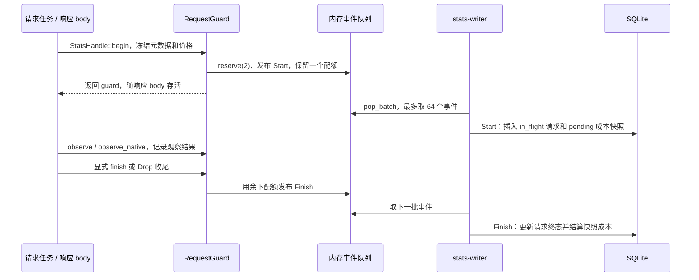

# 统计持久化：从请求守卫到 SQLite

本文面向会写 Java / Spring Boot、第一次接触 Rust 的开发者。沿着一个代理请求，解释统计何时开始、由谁持有、怎样进入写线程、事务怎样提交，以及取消、写库失败和重启怎样收尾。先读 [Rust 与 Java 对照](RUST_FOR_JAVA.md) 和 [服务核心流程](SERVICE_CORE.md)，再把本文与源码注释对照。

这里展开统计的生命周期与存储；token 口径、价格匹配和金额精度由 [用量与费用导读](STATS_USAGE_PRICING.md) 展开，查询聚合与界面调度后续深入。价格在本文只作为请求快照的一部分出现。现有领域说明见 [统计实现入口](../statistics/DEVELOPMENT.md)。

## 1. 先用熟悉的 Spring 概念找到职责

| 本项目对象 | 可借用的 Java / Spring 概念 | 阅读时要保留的差异 |
| --- | --- | --- |
| [`StatsHandle`](../../src/stats/mod.rs) | 业务 Service 的统计门面 | `Clone` 只复制 `Arc<Inner>` 句柄；没有复制数据库连接 |
| [`RequestSpec / RequestMeta`](../../src/stats/mod.rs) / [`event.rs`](../../src/stats/event.rs) | 请求上下文与不可变快照 DTO | 保存的是路由、时间、模型、价格等元数据，不是聊天正文 |
| [`RequestGuard`](../../src/stats/event.rs) | 请求作用域的生命周期对象 | 跟着响应 body 移动，依靠所有权和 `Drop` 收尾；没有容器自动注入 |
| `StatsEvent::Start / Finish` | 应用事件 | 跨线程移动的有类型数据；不是序列化到外部消息中间件 |
| `EventQueue / Reservation` | 有界生产消费队列与容量许可 | 入队前一次预约两个配额，给未来的结束事件保留空间 |
| [`writer_thread`](../../src/stats/mod.rs) | 单消费者工作线程 | 同一线程串行处理事件、控制写操作和导入提交 |
| [`store::Writer`](../../src/stats/store.rs) | Repository / DAO 与事务协调 | 直接拥有一个 SQLite 写连接，显式创建和提交事务 |
| `stats-reader` | 独立查询执行器 | 按需启动，只读连接；GPUI 通过管理 API 查数据 |
| `stats_runs / stats_collection_intervals` | 运行审计与采集可用性记录 | 分别记录一次核心运行和其中的采集区间，不是请求结果 |

`RequestGuard` 不是 Java `finalize()` 的等价物。正常 Rust 所有权释放会同步调用 `Drop`；它不依赖垃圾回收器。但进程被强杀、abort 或系统断电时，不能保证执行析构。重启修复正是为已经落下的残留记录准备的。

## 2. 总流程：业务请求与统计旁路怎样接起来



图中把 Start 和 Finish 分开提交，便于理解；快速请求可能把两条事件放在同一批中。批次按队列顺序处理，不会先按事件种类重新分组。

这里至少有四个不同时间点：

1. **guard 已创建**：请求通过统计准入，两个事件配额预约成功；
2. **事件已入队**：数据还在本进程内存里；
3. **数据库事务已提交**：相应行才成为后续查询的已提交事实；
4. **界面已应用查询回复**：还要经过管理请求、只读线程、前端调度及过期回复门禁。

HTTP 处理函数返回响应头时，body 可能仍在流动，guard 也可能仍存活。不能在 Controller 类比位置看到 `return response`，就断言请求已经成功或统计已经写完。

## 3. 启动：谁创建数据库，谁负责迁移

从 [`StatsHandle::start → writer_thread`](../../src/stats/mod.rs) 跟到 [`Writer::open`](../../src/stats/store.rs)：

1. `initialize` 创建内存队列、控制通道、共享状态和本轮 `run_id`，初始健康状态是 `Migrating`。
2. 创建 `stats-writer` 系统线程；`StatsHandle::start` 返回时，不要求 SQLite 已初始化完成。
3. writer 打开配置目录下的 `usage.sqlite3`，设置连接参数，执行迁移，再加载设置、供应商用量模式、价格与数据库概况。
4. 启动事务一起执行 `recover` 和 `start_run`：标记旧运行非正常结束、收尾旧采集区间、冻结修复范围，写入本轮运行及采集区间。
5. 提交后构造 `RecoveryScan`；writer 把已加载设置和价格发布到共享内存，开放统计准入。
6. 若旧数据扫描未完成，进入 `Degraded` 并继续有界恢复；全部条件满足后才回到 `Ready`。

`Writer::open` 的迁移不属于第 4 步的启动事务。迁移有自己的分步事务；后续启动失败，不会把已成功的 schema 升级整体回滚。第 4 步把旧 run 修复和新 run 记账放在同一事务，是为了锁竞争重试时不会反复生成采集区间，或提前消耗上次崩溃的证据。

数据库锁竞争属于可重试的初始化错误：保持 `Migrating`，每次最多用 250 ms 等待控制消息后再尝试打开。其他初始化错误会禁用统计并向管理端报告问题。聊天服务与统计初始化分别推进，不能因数据库尚未就绪就阻断转发。

托盘 controller 使用 `StatsHandle::for_controller`：关闭队列、禁用统计，不打开数据库、不恢复旧 run，也不写一个新的统计运行。不要把“托盘与核心都创建了句柄”理解成两个写库进程。

### schema 迁移与连接的几个边界

- 当前版本来自 `store::SCHEMA_VERSION`；`PRAGMA user_version` 是数据库自己的版本。拒绝打开比本程序支持版本更高的 schema。
- 升级已有非空版本前，通过 SQLite backup API 写入 `usage-backup.sqlite3`；它使用固定备份名，会替换原备份，不是无限保留的迁移历史。
- 按缺失版本顺序应用 `migrations/*.sql`。每步事务内修改结构、检查外键并更新版本；失败回滚当前步，前面已提交的版本仍保留。
- 涉及表重建的部分版本，在事务外暂时关闭外键再恢复；不要把这些语句搬进事务后仍期待同样效果。
- 已是当前版本时仍执行 `report_indexes.sql`。因此“无需升级版本”不等于完全没有数据库操作。
- 写连接启用 WAL、外键和 `synchronous=NORMAL`。WAL 允许只读连接观察已提交快照；这里没有为每个请求做一次独立文件同步，不能把事务成功扩大为任何断电场景下都不丢失。
- 只读报告连接启用 SQLite 只读打开标志与 `query_only`；查询页缓存不等于缓存业务报表结果。界面本身不直接打开这个库。

## 4. 准入与双槽预约：为什么开始时要占两个名额

阅读顺序是 `StatsHandle::begin → RequestGuard::begin → EventQueue::reserve`，都在 [`mod.rs`](../../src/stats/mod.rs) 和 [`event.rs`](../../src/stats/event.rs)。

`StatsHandle::begin` 收到已解析的路由描述，先检查采集开关及接受状态，再从内存价格 cache 冻结快照，生成请求 ID 和 `RequestMeta`。最后向事件队列预约两个配额：

```text
容量限制：items.len() + reserved + 本次申请 <= capacity

预约成功        items +0，reserved +2
发布 Start     items +1，reserved -1
writer 取走    items -1，reserved 不变
发布 Finish    items +1，reserved -1
```

这里的槽位是容量预算，没有连续内存位置要求。当前容量为 1024 个事件预算，不是“最多能排 1024 条完整请求”。writer 消费速度和未结束 guard 保留的配额一起影响后续准入。

这解决一个具体问题：流已经返回一半时队列可能变满，但结束事件不能为了等空间而卡住响应，也不能在 `Drop` 里 `await`。预留的第二个配额使它能同步发布 Finish。`Reservation::drop` 会归还未使用的配额，避免容量泄漏。

“非阻塞准入”指不等待队列空位或数据库 ACK；队列内部仍使用 `Mutex`，可能短暂等待锁。它不是无锁队列。预约失败只跳过本次统计，代理请求继续。

计数也有不同含义：

| 指标 | 何时变化 | 不能据此断言 |
| --- | --- | --- |
| `admitted` | guard 创建成功后增加 | 对应数据库行已经存在 |
| `pending` | guard 创建加一，首次 finish 发布减一 | 归零后数据库已排空 |
| `dropped` | 已通过采集门禁但双槽预约失败时增加 | 包含所有禁用期间或迁移期间的请求 |
| `write_failures` | 批次、隔离或恢复损失等路径累计 | 是全局去重后的丢失请求总数 |
| `commits` | 正常循环在批次返回 Ok 后增加；关闭路径每次批次尝试后增加 | 是 SQLite 成功事务的精确审计计数 |

只有已准入请求才有统计事件。鉴权、并发、请求体或选路校验在准入前失败时，不会创建这一行；具体顺序见 [服务请求入口](SERVICE_CORE.md#4-请求鉴权选路直通或转换)。

## 5. guard：谁决定终态，为什么不会重复发结束事件

guard 持有 `RequestMeta`、剩余预约、单调时钟、HTTP 状态、协议观察结果和 `finished` 标志。请求处理代码把它交给响应 body，body 完成、读取失败或被释放时再收尾。

`finish` 的第一道判断是 `finished`。首次调用设置标志，构造 `FinishRecord` 并发布 Finish，随后减少 pending；重复调用直接返回。`Drop` 也检查同一标志，因此显式结束后再析构，不会再发布一次。

这里承诺的是**同一 guard 至多发布一个终态事件**。进程强杀可能没有 Finish；事件在内存里也可能尚未落库。它不是消息系统的“恰好一次投递”协议。

第一遍跟代码时分清三层：

1. `observe` / `observe_native` 记录证据。Chat 直通观察原上游字节，collector 做有界协议解析；native 由适配器提供原上游字节数、语义首内容、归一用量与模型，累计用量快照更新时替换旧值。
2. `terminal` 按上游 HTTP、协议错误、JSON/SSE 完整性或 native 完成标记分类。上游返回 200 不保证是成功模型结果。
3. 调用方的错误分支和 `Drop` 决定以何种原因收尾。没有读完也没有完整证据时，不能因为请求曾经建立连接就记成功。

`Drop` 会先看核心是否 closing。正常关闭销毁网络 runtime 时，未结束 guard 应记 `interrupted/shutdown`；真实客户端中途释放 body 则按相应证据记取消或其他终态。已观察到完整上游声明字节、协议结束或错误时，析构分支会结合这些证据判断，不能把所有 Drop 都等同于客户端取消。

`Content-Length` 已全部交给 HTTP body 层、干净的 transport EOF、协议终止标记和客户端 socket ACK 是不同概念。这里没有客户端收包 ACK；有关协议终态详见 [响应转换导读](PROTOCOL_RESPONSE.md)。

时间也分两类：`started_at_ms / ended_at_ms` 是 Unix epoch 毫秒；`duration_ms / ttfb_ms / first_content_ms` 来自进程单调时钟。总时长 `duration_ms` 始终从 guard 创建开始；TTFB 和首内容使用 `elapsed_ms`：已有 `upstream_at` 就从上游派发开始，否则从 guard 创建开始。不要把这些时长当作两个墙上时间戳的简单相减。

## 6. 写入：Start 与 Finish 怎样合成一条事实记录

[`writer_thread`](../../src/stats/mod.rs) 每轮先处理控制队列，再取最多 `BATCH_EVENTS=64` 个事件；通常等待窗口为 `BATCH_WAIT=100 ms`，实际等待还会受报表调度协调。没有为每条请求单独启动线程或数据库连接。

`pop_batch` 把事件移到 writer 局部 Vec 时已经释放队列容量，但事务还没开始。随后 [`Writer::apply_batch`](../../src/stats/store.rs) 调用 `apply_batch_once`，开启 SQLite `Immediate` 事务，依次处理事件：

| 事件 | 请求事实 `usage_requests` | 成本快照 `usage_costs` | 事务边界 |
| --- | --- | --- | --- |
| Start | 插入 `in_flight`，冻结路由/供应商/请求模型/开始时间等 | 插入 `pending` 和准入时的价格快照 | 两条记录及可选身份关联同事务 |
| Finish | 仅把同 ID 的 `in_flight` 行更新为终态，写用量与时延 | 从请求自己的 pending 快照结算，不查最新价格 | 请求更新和成本结算同事务 |

同一事务还写入运行计数。事务提交前某步返回错误，Rust 的 `?` 把错误逐层返回；未提交的事务释放时回滚。可类比 Service 内显式创建事务并在成功时提交，但这里没有按方法注解自动生成的事务代理。

幂等边界直接体现在 SQL：

- Start 用 `ON CONFLICT(request_id) DO NOTHING` 避免重复插入；成本快照也按请求 ID 防重复。
- Finish 的更新条件包含 `outcome='in_flight'`。更新行数不是 1 时返回成功，不覆盖已结束行；缺失 Start 的 Finish 也不会凭空补一条请求。
- 请求终态更新与成本结算放在一个事务，成本失败会使本次请求更新一起回滚。
- 正常结算不覆盖已经结束的成本；历史版本纠错属于显式恢复路径，不能据此认为业务 Finish 可以随时改历史。

因此重复事件不必导致重复金额，但没有 Start 时也无法仅靠 Finish 重建请求。幂等 SQL 只减少重复写入的影响，不提供丢失数据的恢复能力。

`None` 在写库时保持为 SQL `NULL`。请求成功、usage 完整、金额已知是三个维度：缺 token 不能自动补 0；价格明确为默认零时金额可为已知零，也不意味着 token 已经观察到了。具体结算公式留给定价专题。

## 7. 批次失败：重试、隔离和中断修复怎样分工

一个批次共享 `WriteBudget`，正常配置预算为 1500 ms，包含重试和隔离尝试；SQLite 单次锁等待会按剩余预算缩短。它是控制重试和锁等待的期限，不是能抢占任意正在执行 SQL 的硬超时。

```text
apply_batch
  -> 整批 apply_batch_once 事务
     -> 可恢复数据库错误：在同一预算内有界整批重试
     -> 非瞬态错误：在剩余预算内逐事件独立事务隔离
  -> Ok(BatchOutcome)：已提交部分 + dropped 事件
  -> Err(DbError)：本次不能完成，交给协调层记录故障
```

`DatabaseBusy / DatabaseLocked / SystemIoFailure / OperationInterrupted` 属于瞬态判断。锁竞争不应触发逐事件锁等待，把一批 64 条逐个重试会放大阻塞。其他错误可能进入隔离，让坏事件不拖走健康事件。隔离每个事件独立事务，所以 **一次 `apply_batch` 不总是一个事务**。

返回 Ok 也必须检查 `BatchOutcome.dropped`。已提交的事件不会因同批其他事件被隔离而撤销；协调层把 dropped 按本组请求 ID 去重计入失败，并记住丢失 Finish 的请求 ID。

关键区别是：`apply_batch` 结束后，协调层**不把原始批次重新入队**。它保留的主要恢复信息是 Finish 对应的 ID，不是完整 FinishRecord。因而：

| 最终写入情况 | 后续能做什么 |
| --- | --- |
| Start 已落库，Finish 丢失 | 补 `interrupted` 和可信的成本终态；原 token / 时延无法从 ID 找回 |
| Start 和 Finish 都没落库 | 修复发现 ID 不存在，移除失效 ID 并保留损失计数 |
| Start 丢失，Finish 后来正常执行 | 更新不到 in_flight 行，Finish 不凭空造记录 |
| 请求已终态、成本仍 pending 的旧版本残留 | 恢复同时检查成本，不能只看请求 outcome |

`Degraded` 表示统计数据可信度受影响，仍接受新统计准入，直到容量或其他门禁阻止；报表查询入口要求 `Ready`，此时新查询可能返回 unavailable。写故障不会把已发送的聊天响应改成失败。

## 8. 恢复：三份待办与一个可信度条件

[`recover_collection`](../../src/stats/mod.rs) 协调下列来源，具体 SQL 在 [`store.rs`](../../src/stats/store.rs)：

| 待办 | 来源与存活范围 | 如何推进 |
| --- | --- | --- |
| `RecoveryScan` | 启动事务冻结的历史行水位 `as_of_id`，扫描游标在内存 | 每次最多扫描 256 个候选，范围只到启动水位，不误伤新请求 |
| `orphans` | 本轮运行丢失 Finish 的 ID，内存最多保留 512 个 | 尝试补终态；溢出先就地结算，再交数据库 backlog |
| `stats_recovery_backlog` | 已提交到 SQLite 的待修复 ID | 有界批量修复，完成或确认 ID 不存在后移除 |

启动扫描按 `id > cursor_id AND id <= as_of_id` 找候选，包含 `in_flight`、pending 成本及特定历史错误成本。有候选时，修不完的 ID 必须在同事务写进 backlog，提交成功后才推进游标，避免越过失败项却没有记录待办。空候选分支则先把内存游标设到水位，再提交这个没有行级修复的事务；不要把非空分支的提交顺序直接套到所有分支。

`repair_one` 返回 `Done / Missing / Retry`：Done 需要请求和成本都不再待结束；Missing 表示没有请求行；Retry 表示仍有待办。它会把残留 in_flight 记为中断，启动恢复使用 `unclean_shutdown`，运行中丢失终态使用其他中断原因。修复依据请求已有价格快照，不使用今天的新价格改历史。

当内存 ID 超限且数据库也不能接收 backlog，系统只保留有界部分，其余计入损失；这不是无损消息管道。下一次启动扫描能修复已有残留行，不能找回从未写入数据库的请求。

恢复不要求再来一个聊天请求：队列空闲时会探测写能力，主动推进扫描、孤儿、backlog 和故障区间记账。一次调用最多推进有界工作；全部完成返回 `Complete`，仍在正常推进返回 `Progressing`，真正失败返回 `Failed` 才增加退避。

回到 Ready 前还要完成降级区间记录和丢失计数持久化。探测能拿到写锁，只说明“现在可能写入”，不能单独证明历史数据已修复。采集区间描述的是统计可用性；即使恢复结束，也不能把故障期间本来丢失的数据宣称成完整。

## 9. 关闭：为什么先停网络，再排空统计

从 [`main::run`](../../src/main.rs) 和 [`StatsHandle::shutdown / flush_and_stop`](../../src/stats/mod.rs) 对照：

1. 网络 runtime 销毁前设置 closing，停止新统计准入，让残留 guard 的 Drop 能区分核心关闭与客户端取消。
2. 结束并 join 网络线程，使响应 body 和 guard 得到释放机会。
3. `StatsHandle::shutdown` 尝试发送 Shutdown；控制队列满等发送失败时，直接关闭事件队列作为后备信号，并唤醒 writer。
4. writer 在关闭排水预算内写剩余事件，随后尽力记录计数、正常结束 run、关闭采集区间、做被动 WAL checkpoint。
5. 关闭队列并设 Disabled。调用方只有限时轮询，不在此处 join writer。

调用方等待预算和 writer 排水预算都是四秒，但各自起点不同，后续记账也不是同一事务或硬实时截止。超预算、写失败或强杀都可能留下一部分未结束数据；不能把这套流程写成“关机绝不丢统计”。

`is_stopped()` 实际只看队列关闭标志，后备信号也能设置它，因此不能拿 `true` 证明 writer 已经退出或全部数据已提交。关闭路径也没有跑完所有恢复待办的保证，重启扫描仍有必要。

## 10. 建议断点与学习用测试

依次在这些位置停下来，观察“谁拥有数据”和“现在是否已经提交”：

1. `StatsHandle::begin / RequestGuard::begin`：看门禁、冻结元数据与 reservation。
2. `RequestGuard::finish / Drop`：看首次结束标志、调用原因和 pending。
3. `EventQueue::pop_batch`：看事件从内存队列移动到局部 Vec。
4. `Writer::apply_batch_once / finish_request`：看请求与成本如何共享事务。
5. `writer_thread` 的 Ok / Err 分支：看 dropped、故障区间和 orphan ID。
6. `recover_collection / scan_recovery_batch / repair_one`：看水位、backlog、恢复终态。
7. `flush_and_stop`：看关闭预算和尽力执行的边界。

以下都是现有测试函数，可当作具体场景说明阅读；本次注释工作没有执行这些业务测试。未来行为修改时，先按 [风险验证规范](../CODEX_FAST_WORKFLOW.md) 选相关项，使用隔离数据。

| 阅读文件 | 测试函数 | 要理解的契约 |
| --- | --- | --- |
| [`event.rs`](../../src/stats/event.rs) | `guard_finishes_exactly_once_for_every_terminal_path` | 显式结束与析构不会重复发布终态 |
| [`store.rs`](../../src/stats/store.rs) | `failed_startup_rolls_back_recovery_and_run_bookkeeping_together` | 初始化事务失败不提前消耗旧 run 证据 |
| 同上 | `start_and_finish_in_one_batch_keep_the_timestamp_order` | 快速请求同批写入仍满足时间约束 |
| 同上 | `a_held_lock_fails_one_batch_within_the_budget` | 锁竞争不能把每条事件的等待无限叠加 |
| 同上 | `a_failed_repair_is_queued_before_the_scan_advances` | 扫描越过失败项前先持久记录待办 |
| 同上 | `the_recovery_backlog_is_durable_bounded_and_idempotent` | backlog 的持久性、有界推进与幂等 |
| 同上 | `every_schema_generation_upgrades_in_place_and_is_idempotent` | 各代 schema 的增量升级路径 |
| [`mod.rs`](../../src/stats/mod.rs) | `a_transient_database_lock_recovers_settles_orphans_and_resumes` | 故障后修复并恢复采集的协作 |

自查时试着回答：为什么 pending 为零仍可能看不到请求？为什么重复 Finish 不会重复计费，但丢失 Start 也不会自动补行？为什么能写库以后还要保持 Degraded？为什么恢复中断状态不等于恢复真实用量？能指着函数与事务边界回答这些问题，就可以继续深入定价与查询链路。
